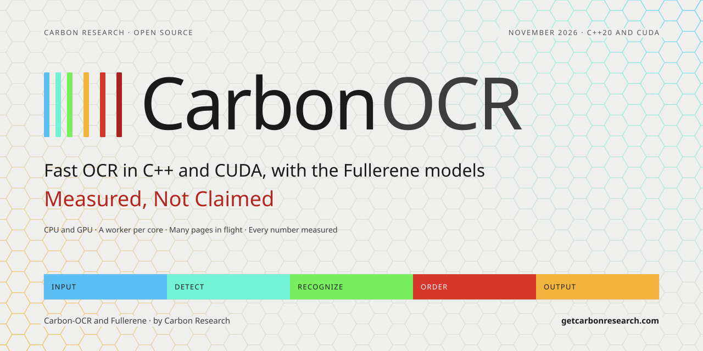
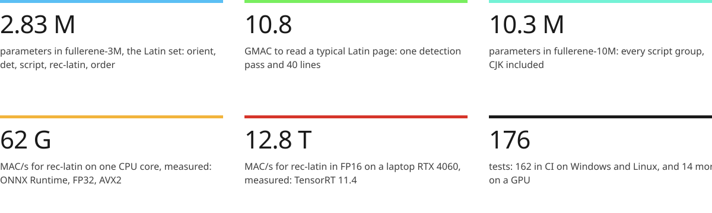
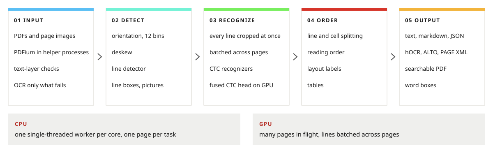
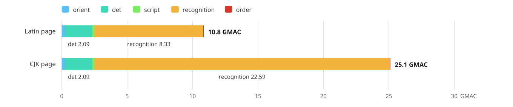
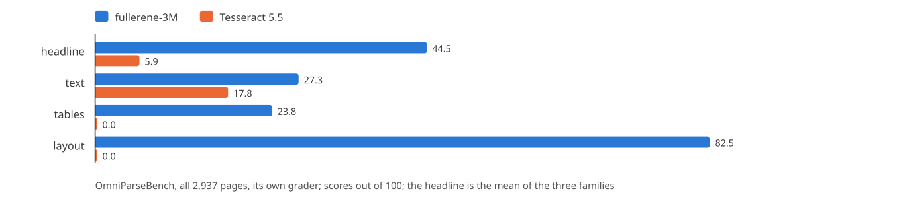
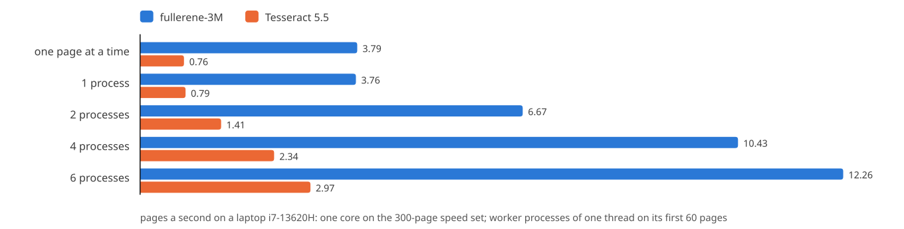

<picture>
  <source media="(prefers-color-scheme: dark)" srcset="docs/assets/banner-dark.svg">
  
</picture>

<p>
  
  
  
  
  
  
  
</p>

**Carbon-OCR is an OCR engine in C++ and CUDA, and Fullerene is its family of small models.** It reads scans, photos of documents and PDFs, and gives text, markdown, HTML and JSON with boxes. It runs on CPUs with its own int8 kernels or ONNX Runtime, one worker per core, and on NVIDIA GPUs through TensorRT, with many pages in flight.

The goal is to be far more accurate than Tesseract and faster than every open engine of its class. Every number here is measured, never estimated. The engine is complete and tested. The Fullerene weights are not released yet, so until they are the engine has no models to read with. Their sets, files and metadata are specified ([docs/MODELS.md](docs/MODELS.md)), so the engine reads them as soon as they ship.

##  At a glance

<picture>
  <source media="(prefers-color-scheme: dark)" srcset="docs/assets/glance-dark.svg">
  
</picture>

The top row is the design budget, counted from the models' layer shapes. The bottom row is measured on random weights, since speed does not depend on the weights (see Measured so far, below).

##  How it works

<picture>
  <source media="(prefers-color-scheme: dark)" srcset="docs/assets/pipeline-dark.svg">
  
</picture>

- **Input.** Pages come in as images (PNG, JPEG, BMP, PNM) or PDFs. PDFium renders a PDF in helper processes, so a PDF that crashes it takes down a helper, not your program. When a born-digital page's text layer passes the checks, the page is read from that layer and only its pictures go through OCR.
- **Orient and deskew.** A small model turns a page by quarter turns when it is sure. A projection search levels what remains, up to 5 degrees.
- **Detect and recognize.** A small line detector, then CTC recognizers per script, read every line of every page in flight in a few batched calls. A page of tiny text is detected again at twice the scale and the two passes merged line by line. On the GPU, the recognizer's last layer runs fused with greedy CTC decoding, so the logits never leave the chip: only ids, confidences and frame positions come back.
- **Order and output.** A reading-order and layout model orders the lines, groups them into labeled blocks and finds tables' cells. Where it is unsure, an XY-cut does the ordering. The result goes out as text, markdown, HTML, JSON, hOCR, ALTO, PAGE XML or a searchable PDF.

On the CPU, a pinned worker per physical core reads pages in parallel. Work is cut smaller than a page, so a single page also uses every core. The int8 kernels are picked at run time for the CPU: AVX2, AVX-VNNI, AVX-512, NEON or the Arm dot product. On the GPU, `carbon::Pipeline` batches each model across all the pages in flight. [docs/ENGINE.md](docs/ENGINE.md) covers the engine in full.

##  The models

The trained Latin set, `fullerene-3M`, is on Hugging Face: [huggingface.co/CarbonResearchLabs/fullerene-3M](https://huggingface.co/CarbonResearchLabs/fullerene-3M).

Fullerene is eight small networks, shipped in two sets named by their parameter count:
- **`fullerene-3M`**, the Latin set, 2.83 M parameters: `orient`, `det`, `script`, `rec-latin` and `order`.
- **`fullerene-10M`**, every script, 10.30 M parameters: the Latin set plus `rec-rtl`, `rec-indic` and `rec-cjk`.

| model | job | in → out | parameters | cost |
|---|---|---|---|---|
| `orient` | page orientation | a 512 × 512 thumbnail → 12 angle bins and a vertical flag | 0.34 M | 255 MMAC a page |
| `det` | line detection | the page at 1024 × 800 → four maps at stride 2 | 0.44 M | 2.09 GMAC a page |
| `script` | script group of a line | a 32 × 512 crop → 6 groups | 0.06 M | 3.7 MMAC a line |
| `rec-latin` | read Latin, Cyrillic and Greek | a 32 × W crop → 800 classes per 4 px | 1.51 M | 208 MMAC a 512-px line |
| `rec-rtl` | read Arabic script and Hebrew | a 32 × W crop → 400 classes per 4 px | 1.41 M | 195 MMAC a line |
| `rec-indic` | read Indic and Southeast Asian scripts | a 32 × W crop → 1,500 classes per 4 px | 1.69 M | 231 MMAC a line |
| `rec-cjk` | read Chinese, Japanese and Korean | a 32 × W crop → 12,000 classes per 4 px | 4.37 M | 565 MMAC a line |
| `order` | reading order, block labels, tables | 16 features per line → an order, 13 labels, table cells | 0.48 M | 22 MMAC a 40-line page |

All the models use ReLU and channels in multiples of 16. Their RepVGG blocks are folded into plain 3×3 convolutions in the shipped files. Each model ships as ONNX in three forms: FP32 for CPUs, FP16 for TensorRT, and INT8 (Q/DQ) for the engine's own CPU kernels. The recognizers read a 32-px band of the line and give a CTC frame per 4 px of width.

<picture>
  <source media="(prefers-color-scheme: dark)" srcset="docs/assets/fig-page-compute-dark.svg">
  
</picture>

A Latin page is 10.8 GMAC, and 77% of that is recognition. That is why the recognizers got the GPU kernels first. [docs/MODELS.md](docs/MODELS.md) describes every model layer by layer, along with the files of a set and the metadata the engine reads from them.

##  Measured so far

The trained `fullerene-3M` ([on Hugging Face](https://huggingface.co/CarbonResearchLabs/fullerene-3M)), read by the engine on all 2,937 pages of OmniParseBench and graded by the benchmark's own grader, against Tesseract 5.5 with its defaults, on the same laptop (3 November 2026): a headline of **43.5** against 5.9 (text 26.2 against 17.8; tables 23.6 and layout 80.6, which Tesseract, writing text alone, scores 0), and **3.79 pages a second on one core** against 0.76 (a median page of 223 ms against 947), 12.3 against 3.0 in six processes. Its FP16 files on the CPU score the same.

<picture>
  <source media="(prefers-color-scheme: dark)" srcset="docs/assets/fig-bench-dark.svg">
  
</picture>

<picture>
  <source media="(prefers-color-scheme: dark)" srcset="docs/assets/fig-bench-speed-dark.svg">
  
</picture>

The rows below were measured on the same laptop (and its RTX 4060 Laptop GPU) between 27 and 30 October 2026, using random weights, since speed does not depend on them.

| what | measured |
|---|---|
| `rec-latin` on one CPU core | 62 GMAC/s: 16 lines of 512 px in 65 ms (ONNX Runtime 1.31, FP32, AVX2), about 80% of the core's peak; 8 lines in 11.4 ms in int8 on the engine's own kernels |
| `fullerene-3M` on one CPU core | a Latin page in 98 ms with every model, the set's int8 files on the engine's own kernels: 10.2 pages a second per core; a CJK page with `fullerene-10M` in 271 ms |
| across CPU cores | a pinned worker per core, with tasks smaller than a page: no loss per clock cycle up to 4 workers; the laptop's power limit lowers its clock as more cores load (47.4 pages a second on 10) |
| one page alone | 40 ms on the 6 P-cores, 129 ms on one: orientation runs beside detection, detection runs on the idle cores, and the lines are split over them, with every output byte the same |
| `rec-latin` on the GPU | 256 lines of 512 px on device buffers (TensorRT 11.4, CUDA 13.4.1): 5.1 ms in FP16 (12.8 TMAC/s), 13.6 ms in FP32, 2.98 ms in INT8 |
| the fused CTC head | 1.6x to 2.1x as fast as the cuBLAS GEMM and argmax it replaces; it never writes the logits (750 MB for a batch of `rec-cjk`) |
| CUDA graphs | one 224-px line in 0.164 ms instead of 0.242 |

##  Build

You need CMake 3.25 or newer (for the presets) and a C++20 compiler: MSVC 2022, GCC 11+ or Clang 14+. CMake downloads the pinned dependencies (ONNX Runtime 1.31.0, PDFium, libdeflate, stb_image and GoogleTest 1.18.0) and checks their SHA-256.

```shell
cmake --preset ninja-release        # Linux, macOS, or a Visual Studio developer shell
cmake --build --preset ninja-release
ctest --preset ninja-release

cmake --preset vs2022               # Windows, Visual Studio 2022
cmake --build --preset vs2022
ctest --preset vs2022

pip install ./python                # the Python module, carbon_ocr
```

For the GPU you need CUDA 12.9 or 13.x and an unpacked TensorRT 11 with `TensorRT_ROOT` set to it; then use the `ninja-trt` or `vs2022-trt` preset. [docs/BUILD.md](docs/BUILD.md) covers every preset and option, the GPU build and the Python module.

##  Use

```shell
carbon-ocr ocr page.png scan.jpg --set models/fullerene-3M          # plain text
carbon-ocr ocr report.pdf --set models/fullerene-3M --dpi 300       # PDFs and their text layers
carbon-ocr ocr page.png --set models/fullerene-3M --format json     # boxes, words, confidences
carbon-ocr ocr scan.png --set models/fullerene-3M --format hocr     # or alto, page, markdown, html
carbon-ocr ocr scan.pdf --set models/fullerene-3M --format pdf --output searchable.pdf
carbon-ocr ocr scans/*.png --set models/fullerene-3M --device cuda --engine-cache .engines
carbon-ocr cpus --gemm                                              # the CPU's kernels, timed
```

```python
import carbon_ocr

engine = carbon_ocr.Engine("models/fullerene-3M")
page = engine.ocr([carbon_ocr.load_image("page.png")])[0]
print(page["text"])
for line in page["lines"]:
    print(line["box"], line["confidence"], line["text"])
```

Carbon-OCR also runs as OCRmyPDF's OCR engine:

```shell
ocrmypdf --plugin tools/ocrmypdf/carbon_ocrmypdf.py \
    --carbon-set models/fullerene-3M in.pdf out.pdf
```

[docs/USAGE.md](docs/USAGE.md) covers every command and option, the output formats, the Python module and the plugin.

##  Repository

| path | what |
|---|---|
| [`carbon/`](carbon) | the engine library: [`include/carbon/`](carbon/include/carbon) is the public API (`carbon.h` includes it all); `src/` holds the CPU kernels, the CUDA kernels, the backends and the PDF helpers |
| [`cli/`](cli) | `carbon-ocr`, and `carbon-pdf`, the helper process PDFs are rendered in |
| [`python/`](python) | `carbon_ocr`, the engine for Python ([python/README.md](python/README.md)) |
| [`models/`](models) | where model sets go, and how a set is laid out ([models/README.md](models/README.md)) |
| [`tests/`](tests) | the C++ tests (GoogleTest), the Python tests and their fixtures: small ONNX models and PDFs |
| [`tools/ocrmypdf/`](tools/ocrmypdf) | the OCRmyPDF plugin |
| [`docs/`](docs) | the documentation below |

##  Documentation

Two of them are also typeset as PDFs, each in a light and a dark edition:
- **The engine guide**: the engine, building it and using it, in one document ([PDF](docs/Carbon-OCR-Engine-Guide.pdf), [dark](docs/Carbon-OCR-Engine-Guide-Dark.pdf)).
- **The models** ([PDF](docs/Carbon-OCR-Models.pdf), [dark](docs/Carbon-OCR-Models-Dark.pdf)).

| document | what it covers |
|---|---|
| [docs/ENGINE.md](docs/ENGINE.md) | how the engine reads a page and a batch of pages: inputs, each stage, the CPU layout, the backends, the GPU pipeline, the options |
| [docs/MODELS.md](docs/MODELS.md) | the Fullerene models: each one's job, inputs and outputs, layers, parameters and compute; the files of a set and their metadata |
| [docs/BUILD.md](docs/BUILD.md) | building on Windows, Linux and macOS, CPU and GPU; the CMake options; the Python module |
| [docs/USAGE.md](docs/USAGE.md) | the `carbon-ocr` commands, the output formats, the Python API, the OCRmyPDF plugin |

##  License

The code is licensed under [Apache 2.0](LICENSE). The Fullerene weights, once released, are licensed under [OpenRAIL-AMS](LICENSE-WEIGHTS.md).

##  Citation and credits

If you use Carbon-OCR or the Fullerene models, please cite them (also in [CITATION.cff](CITATION.cff), which GitHub offers as "Cite this repository"):

```bibtex
@software{vora2026carbonocr,
  author       = {Karan Vora},
  title        = {Carbon-OCR and Fullerene: OCR in C++ and CUDA, with the Fullerene models},
  organization = {Carbon Research Labs},
  year         = {2026},
  url          = {https://github.com/karanvora2599/Carbon-OCR}
}

@misc{vora2026fullerene3m,
  author       = {Karan Vora},
  title        = {Fullerene 3M: the Latin model set of Carbon-OCR},
  organization = {Carbon Research Labs},
  year         = {2026},
  howpublished = {\url{https://huggingface.co/CarbonResearchLabs/fullerene-3M}}
}
```

**Credits.** Carbon-OCR and Fullerene are built by Karan Vora at Carbon Research Labs ([getcarbonresearch.com](https://getcarbonresearch.com)), with [David Delaurier](https://www.linkedin.com/in/david-delaurier/), lead MLOps, and [Karthik Kumar Viswanathan](https://www.linkedin.com/in/vkaku/), technical advisor.
