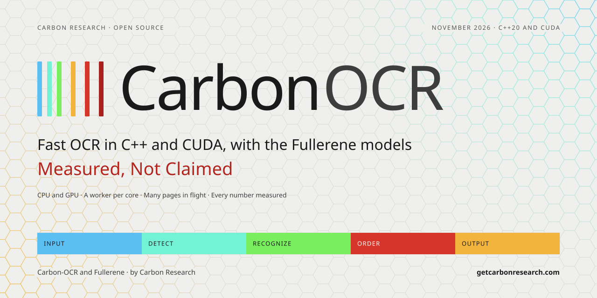
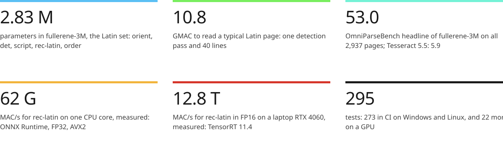
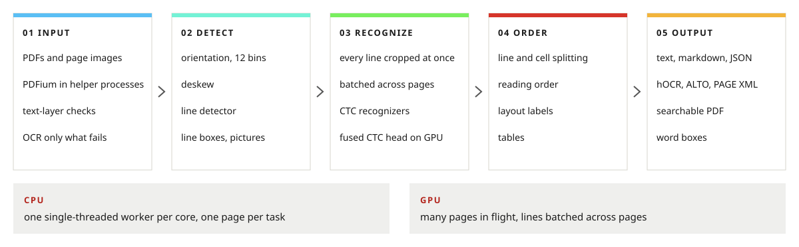
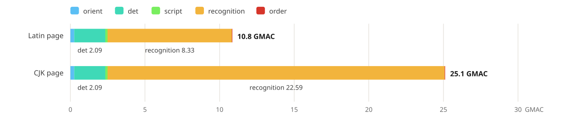
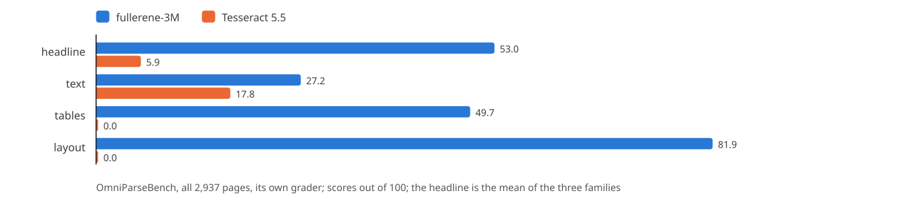
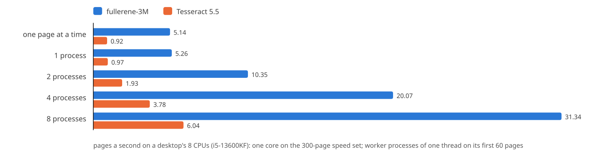
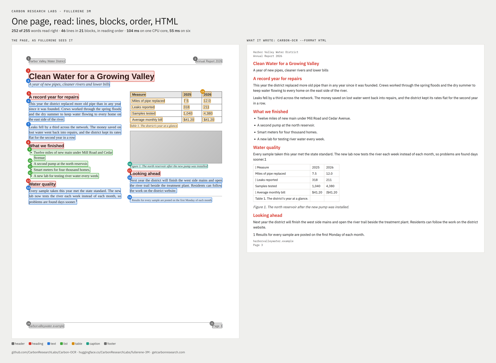

<picture>
  <source media="(prefers-color-scheme: dark)" srcset="docs/assets/banner-dark.svg">
  
</picture>

<p>
  
  
  
  
  
  
  
</p>

**Carbon-OCR is an OCR engine in C++ and CUDA, and Fullerene is its family of small models.** It reads scans, photos of documents and PDFs, and gives text, markdown, HTML and JSON with boxes. It runs on CPUs with its own int8 kernels or ONNX Runtime, one worker per core, and on NVIDIA GPUs through TensorRT, with many pages in flight. On either, a model runs in FP32, FP16 or INT8, from the set's file of that precision. You can call it from the command line, C++ or Python, or over HTTP.

The goal is to be far more accurate than Tesseract and faster than every open engine of its class. Every number here is measured, never estimated. The engine is complete and tested. The first Fullerene set, `fullerene-3M` (Latin), is out on [Hugging Face](https://huggingface.co/CarbonResearchLabs/fullerene-3M) under the Carbon-OCR OpenRAIL-AMS license; the other script groups follow. Every set's files and metadata are specified ([docs/MODELS.md](docs/MODELS.md)), so the engine reads each one as it ships.

##  At a glance

<picture>
  <source media="(prefers-color-scheme: dark)" srcset="docs/assets/glance-dark.svg">
  
</picture>

The top row is the Latin set: its parameters and its compute for a page, counted from the models' layer shapes, and its score on OmniParseBench. The bottom row is the kernels' speed, measured on random weights since speed does not depend on them, and the tests (Measured so far, below).

##  How it works

<picture>
  <source media="(prefers-color-scheme: dark)" srcset="docs/assets/pipeline-dark.svg">
  
</picture>

- **Input.** Pages come in as images (PNG, JPEG, BMP, PNM) or PDFs. PDFium renders a PDF in helper processes, so a PDF that crashes it takes down a helper, not your program. When a born-digital page's text layer passes the checks, the page is read from that layer, its words set in the lines the detector finds, and only its pictures go through OCR.
- **Orient and deskew.** A small model turns a page by quarter turns when it is sure. A projection search levels what remains, up to 45 degrees, so a page photographed askew reads too.
- **Detect and recognize.** A small line detector, then CTC recognizers per script, read every line of every page in flight in a few batched calls. A page of tiny text is detected again at twice the scale and the two passes merged line by line. On the GPU, the recognizer's last layer runs fused with greedy CTC decoding, so the logits never leave the chip: only ids, confidences and frame positions come back. The lines it is unsure of can be read again by a CTC prefix beam with the set's language models, a character n-gram and a small transformer (`--lm-mode`, off by default).
- **Order and output.** A reading-order and layout model orders the lines and groups them into labeled blocks. Where it is unsure, an XY-cut does the ordering. In the blocks it marks as tables, the engine builds the grid from the lines' rows and columns: a table cut in two joined again, a cell set on two lines kept as one, row labels spanning their rows. The result goes out as text, markdown, HTML, JSON, hOCR, ALTO, PAGE XML or a searchable PDF.

On the CPU, a pinned worker per physical core reads pages in parallel, from a list or a stream (`submit` and `next`) that keeps every core busy. Work is cut smaller than a page, so a single page also uses every core. The int8 kernels are picked at run time for the CPU: AVX2, AVX-VNNI, AVX-512, NEON or the Arm dot product. On the GPU, `carbon::Pipeline` batches each model across all the pages in flight. `carbon-ocr serve` keeps a set loaded and reads pages sent over HTTP/1.1, with every client's pages sharing the CPU's workers or the GPU's batches. [docs/ENGINE.md](docs/ENGINE.md) covers the engine in full.

##  The models

The trained Latin set, `fullerene-3M`, is on Hugging Face: [huggingface.co/CarbonResearchLabs/fullerene-3M](https://huggingface.co/CarbonResearchLabs/fullerene-3M).

Fullerene is eight small networks, shipped in two sets named by their parameter count:
- **`fullerene-3M`**, the Latin set, 2.83 M parameters: `orient`, `det`, `script`, `rec-latin` and `order`.
- **`fullerene-10M`**, every script, 10.30 M parameters: the Latin set plus `rec-rtl`, `rec-indic` and `rec-cjk`.

| model | job | parameters | cost |
|---|---|---|---|
| `orient` | page orientation: 12 angle bins and a vertical flag | 0.34 M | 255 MMAC a page |
| `det` | line detection | 0.44 M | 2.09 GMAC a page |
| `script` | the script group of a line | 0.06 M | 3.7 MMAC a line |
| `rec-latin` | reads Latin, Cyrillic and Greek | 1.51 M | 208 MMAC a 512-px line |
| `rec-rtl` | reads Arabic script and Hebrew | 1.41 M | 195 MMAC a line |
| `rec-indic` | reads Indic and Southeast Asian scripts | 1.69 M | 231 MMAC a line |
| `rec-cjk` | reads Chinese, Japanese and Korean | 4.37 M | 565 MMAC a line |
| `order` | reading order, block labels, tables | 0.48 M | 22 MMAC a 40-line page |

All the models use ReLU and channels in multiples of 16. Their RepVGG blocks are folded into plain 3×3 convolutions in the shipped files. Each model ships as ONNX in FP32, FP16 and INT8 (Q/DQ), and the engine runs each precision on the CPU and, through TensorRT, on the GPU (`--precision`); the GPU's INT8 is a symmetric file of its own. The recognizers read a 32-px band of the line and give a CTC frame per 4 px of width.

Beside the networks, a set can ship two language models per script group, which read again only the lines a recognizer is unsure of: a character 7-gram (`lm-latin.bin`, memory-mapped) and a small character transformer of 0.9 M parameters (`tlm-latin.bin`, in FP32 and FP16) that rescores a line's best readings after the line above it. They are off by default and switched on with `--lm-mode ngram`, `transformer` or `both`. The Latin set `fullerene-1.1-3M` ships both, and `fullerene-3M` the 7-gram.

<picture>
  <source media="(prefers-color-scheme: dark)" srcset="docs/assets/fig-page-compute-dark.svg">
  
</picture>

A Latin page is 10.8 GMAC, and 77% of that is recognition. That is why the recognizers got the GPU kernels first. [docs/MODELS.md](docs/MODELS.md) describes every model layer by layer, along with the files of a set and the metadata the engine reads from them.

##  Measured so far

The trained `fullerene-3M` ([on Hugging Face](https://huggingface.co/CarbonResearchLabs/fullerene-3M)) against Tesseract 5.5 with its defaults, on every page of three benchmarks, each graded by its own grader (18 November 2026), in its default precision: on the CPU, its INT8 recognizer and orientation model, with detection and order in FP32. The engine's rules were tuned on OmniParseBench. olmOCR-Bench and OmniDocBench were held out, only graded, to check that what helps one benchmark holds on pages it was not tuned on.

| benchmark | `fullerene-3M` | Tesseract 5.5 |
|---|---|---|
| OmniParseBench, 2,937 page images: headline | **53.0** | 5.9 |
| OmniParseBench: text, tables, layout | 27.2, 49.7, 81.9 | 17.8, 0, 0 |
| OmniParseBench, read as PDFs | **58.8** | not run |
| olmOCR-Bench, 1,403 PDFs read as images | **47.0** ± 1.0 | 34.2 |
| olmOCR-Bench, read as PDFs | **48.1** ± 0.9 | not run |
| OmniDocBench v1.6, 755 English pages: tables (TEDS) | **51.1** | none |
| OmniDocBench: text (edit distance, lower is better) | 0.164 | **0.129** |
| OmniDocBench: reading order (edit distance, lower is better) | 0.287 | **0.253** |

Read as PDFs means through `carbon-ocr ocr`, as you would run it: each page from its text layer where the layer passes its checks, its words set in the lines the detector finds, and by OCR otherwise. Setting the words in the detector's lines costs the text pages about 10% of their speed (`--layer-lines layer` skips it). Tesseract writes text alone, so it scores 0 on tables and layout. Where `fullerene-3M` loses: Tesseract reads OmniDocBench's text better and orders it a little better, most of all on newspapers (an edit distance of 0.097 against 0.282). Tesseract also reads more of olmOCR-Bench's old scans (20.7 to 15.6), and neither writes LaTeX (0 on the math tests). [docs/ENGINE.md](docs/ENGINE.md) has each benchmark's breakdown.

**With the language models** (19 November): `fullerene-1.1-3M`, a newer Latin set that ships them, read greedily and with each mode on every page in its default precision (on the CPU the INT8 files of `orient`, `det` and the recognizer, which ship though each failed its gate; `order` runs in FP32 on the CPU at every precision), each benchmark graded by its own grader. The models' weights and gates were tuned on held-out lines. The 7-gram was tuned twice; the set ships the first tuning (alpha 0.3, beta 2.0), chosen after both were measured on the benchmarks.

| benchmark | greedy | `--lm-mode ngram` | `--lm-mode both` | Tesseract 5.5 |
|---|---|---|---|---|
| OmniParseBench, 2,937 page images: headline | 54.00 | **55.15** | 55.08 | 5.95 |
| olmOCR-Bench, 1,403 PDFs read as images | 51.1 | 52.5 | **52.8** | 34.2 |
| OmniDocBench: text (edit distance, lower is better) | 0.151 | 0.150 | 0.151 | **0.129** |

In FP32 (`--precision fp32`) the n-gram scores 55.33 on OmniParseBench and both 55.30, from 54.37 greedy. The beam alone, without a model, removes few of greedy's errors on held-out lines (a mean of 11.58% to greedy's 11.86%, against the 7-gram's 10.30%): the gains are the models'. OmniDocBench's text is the one they barely move. `fullerene-3M` ships the 7-gram tuned for its recognizer: in its default precision it takes OmniParseBench from 53.0 to 54.0 and olmOCR-Bench from 47.0 to 48.4.

**Speed**, on a desktop (a virtual machine with 8 CPUs of an Intel Core i5-13600KF, and an RTX 4060 Ti), 18 November, `fullerene-3M` in its default precision unless a line says otherwise:
- **9.34 pages a second on one core** against Tesseract's 0.92, so 10.2 times as fast (a median page of 91 ms against 793); with det's INT8 file too (`--precision int8`; not shipped, it failed its gate), 11.12; in FP32, 5.15.
- **51.1 pages a second in eight processes** against Tesseract's 6.00, 8.5 times as fast; with det's INT8 file too, 65.7; in FP32, 30.6.
- **48.2 pages a second** in one process of 8 workers with 16 pages in flight, 53.2 sustained over five minutes; one page at a time on 8 workers, 22.6, a median page of 36 ms. With det's INT8 file too, 58.3 and 63.5 sustained.
- 56.6 pages a second served over HTTP (`carbon-ocr serve` on the CPU, 32 connections), the images' decoding included; 36.3 through `carbon-ocr ocr` on 8 workers, in runs of 64 pages that each load the models.
- **209.9 pages a second on the GPU**, sustained over five minutes (`--device cuda`, the FP16 files on TensorRT, 32 pages in flight), scoring 53.4 on OmniParseBench. In INT8 (`--precision int8`) it reads about as fast: 202.1 sustained against 209.9, though a single pass over all of OmniParseBench went 223.8 against 194.3. In INT8 the recognizer runs whole, without the fused CTC head.

**By precision** (18 November): `fullerene-3M` read every way the engine can read it, each benchmark graded by its own grader. det's and order's INT8 files, and the GPU's symmetric INT8 files, fail their gates and the set does not ship them: they change more than 0.3% of their decisions against FP32, the symmetric recognizer its character error rate on codes, amounts and IDs (1.11% against 0.97%, the limit 0.05 points more), though it reads rendered lines better (4.70% against 4.87%). They are measured here all the same.

| `fullerene-3M` | OmniParseBench | olmOCR-Bench | OmniDocBench text (lower is better) | pages a second |
|---|---|---|---|---|
| the default on the CPU: INT8 recognizer and orientation model | 53.0 | 47.0 ± 1.0 | 0.164 | 9.34 on one core, 51.1 in 8 processes, 53.2 sustained on 8 workers |
| `--precision int8`: det's INT8 file too (on the CPU `order` runs in FP32 at every precision) | 51.4 | 46.8 ± 1.0 | 0.162 | 11.12 on one core, 65.7 in 8 processes, 63.5 sustained on 8 workers |
| FP32 | 53.2 | 46.8 ± 0.9 | 0.167 | 5.15 on one core, 30.6 in 8 processes, 30.8 sustained on 8 workers |
| FP16 on the CPU | 53.4 | 46.8 ± 0.9 | 0.163 | 3.55 on one core |
| FP16 on the GPU (TensorRT) | 53.4 | 46.7 ± 1.0 | 0.165 | 209.9 sustained |
| INT8 on the GPU (TensorRT, symmetric files) | 50.1 | 45.6 ± 0.9 | 0.170 | 202.1 sustained |
| the default with the 7-gram (`--lm-mode ngram`) | 54.0 | 48.4 ± 0.9 | 0.164 | 7.00 on one core, 41.0 sustained on 8 workers |
| Tesseract 5.5 | 5.9 | 34.2 ± 1.0 | 0.129 | 0.92 on one core, 6.00 in 8 processes |

<picture>
  <source media="(prefers-color-scheme: dark)" srcset="docs/assets/fig-bench-dark.svg">
  
</picture>

<picture>
  <source media="(prefers-color-scheme: dark)" srcset="docs/assets/fig-bench-speed-dark.svg">
  
</picture>

**Pages, read** (17 November): `fullerene-3M` on three invented pages, a report page, a page of two tables and a rough photo of the first, every picture drawn from the engine's own output. On the report page it found every line, read 252 of 255 words right, put 21 blocks in the page's own reading order and wrote HTML, in 104 ms on one core; it turned the photo 180° and levelled it; it put all 73 table cells in their row and column, 62 of them character for character. Every fault found is listed with where it comes from ([docs/DEMO.md](docs/DEMO.md), [PDF](docs/Carbon-OCR-Demo.pdf), [dark](docs/Carbon-OCR-Demo-Dark.pdf); the scripts in [docs/demo/](docs/demo/)).

<picture>
  <source media="(prefers-color-scheme: dark)" srcset="docs/assets/demo-read-dark.png">
  
</picture>

The kernels, measured on the laptop and its RTX 4060 Laptop GPU between 27 and 30 October 2026, on random weights, since speed does not depend on them:

| what | measured |
|---|---|
| `rec-latin` on one CPU core | 62 GMAC/s: 16 lines of 512 px in 65 ms (ONNX Runtime 1.31, FP32, AVX2), about 80% of the core's peak; 8 lines in 11.4 ms in int8 on the engine's own kernels |
| `fullerene-3M` on one CPU core | a Latin page in 98 ms with every model, the set's int8 files on the engine's own kernels: 10.2 pages a second per core; a CJK page with `fullerene-10M` in 271 ms |
| across CPU cores | a pinned worker per core, with tasks smaller than a page: no loss per clock cycle up to 4 workers; the laptop's power limit lowers its clock as more cores load (47.4 pages a second on 10) |
| one page alone | 40 ms on the 6 P-cores, 129 ms on one: orientation runs beside detection, detection runs on the idle cores, and the lines are split over them, with every output byte the same |
| `rec-latin` on the GPU | 256 lines of 512 px on device buffers (TensorRT 11.4, CUDA 13.4.1): 5.1 ms in FP16 (12.8 TMAC/s), 13.6 ms in FP32, 2.98 ms in INT8 |
| the fused CTC head | 1.6x to 2.1x as fast as the cuBLAS GEMM and argmax it replaces; it never writes the logits (750 MB for a batch of `rec-cjk`) |
| CUDA graphs | one 224-px line in 0.164 ms instead of 0.242 |

##  Build

You need CMake 3.25 or newer (for the presets) and a C++20 compiler: MSVC 2022, GCC 11+ or Clang 14+. CMake downloads the pinned dependencies (ONNX Runtime 1.31.0, PDFium, libdeflate, stb_image and GoogleTest 1.18.0) and checks their SHA-256.

```shell
# Linux, macOS, or a Visual Studio developer shell
cmake --preset ninja-release
cmake --build --preset ninja-release
ctest --preset ninja-release

# Windows, Visual Studio 2022
cmake --preset vs2022
cmake --build --preset vs2022
ctest --preset vs2022

# the Python module, carbon_ocr
pip install ./python
```

For the GPU you need CUDA 12.9 or 13.x and an unpacked TensorRT 11 with `TensorRT_ROOT` set to it; then use the `ninja-trt` or `vs2022-trt` preset. [docs/BUILD.md](docs/BUILD.md) covers every preset and option, the GPU build and the Python module.

##  Use

```shell
# plain text
carbon-ocr ocr page.png scan.jpg --set models/fullerene-3M

# PDFs, from their text layers where they pass; at 300 dpi, or at the dpi each page needs
carbon-ocr ocr report.pdf --set models/fullerene-3M --dpi 300
carbon-ocr ocr report.pdf --set models/fullerene-3M --dpi auto

# boxes, words and confidences; or hocr, alto, page, markdown, html
carbon-ocr ocr page.png --set models/fullerene-3M --format json
carbon-ocr ocr scan.png --set models/fullerene-3M --format hocr

# a searchable PDF
carbon-ocr ocr scan.pdf --set models/fullerene-3M --format pdf --output searchable.pdf

# on the GPU: FP16 by default, or another precision
carbon-ocr ocr scans/*.png --set models/fullerene-3M --device cuda --engine-cache .engines
carbon-ocr ocr scans/*.png --set models/fullerene-3M --device cuda --precision fp32

# unsure lines read again with the language models, on a set that ships them
carbon-ocr ocr page.png --set models/fullerene-1.1-3M --lm-mode ngram
carbon-ocr ocr page.png --set models/fullerene-1.1-3M --lm-mode both --tlm-gpu 0

# an HTTP server on 127.0.0.1:8080, and a page sent to it
carbon-ocr serve --set models/fullerene-3M
curl --data-binary @page.png "http://127.0.0.1:8080/ocr?format=text"

# the CPU's kernels, timed
carbon-ocr cpus --gemm
```

`serve` keeps the models loaded and answers each page sent to `POST /ocr` in any of `ocr`'s formats (JSON by default), with every client's pages sharing the CPU's workers or, with `--device cuda`, the GPU's batches.

`--lm-mode` switches the language models as one option. `none` reads every line greedily, as the engine does by default; `ngram` reads the lines under the gate again with a CTC prefix beam of 8 and the set's 7-gram (`lm-latin.bin`); `transformer` rescores the beam's best readings with the set's transformer (`tlm-latin.bin`), each after the line above it; `both` does both. Each model runs at the weights and gate tuned into its file for the set's recognizer. `--lm-gate`, `--lm-alpha`, `--lm-beta` and `--tlm-alpha` override them, and `--tlm-gpu N` runs the transformer on that GPU (on the CPU otherwise; with `--device cuda`, on the pipeline's GPU). A mode whose model the set lacks is an error. On `fullerene-1.1-3M`, in its default precision, the n-gram takes OmniParseBench from 54.00 to 55.15 and olmOCR-Bench from 51.1 to 52.5, at 72% of greedy's pages a second (7.67 on one core to 10.59); both models take olmOCR-Bench to 52.8, at 67% of greedy's pages a second on 8 workers with the transformer on the GPU (40.54 to 60.92), while the transformer on the CPU leaves an eighth of them on one core (1.34). `serve` takes the same options.

```python
import carbon_ocr

engine = carbon_ocr.Engine("models/fullerene-3M")
page = engine.ocr([carbon_ocr.load_image("page.png")])[0]
print(page["text"])
for line in page["lines"]:
    print(line["box"], line["confidence"], line["text"])

engine = carbon_ocr.Engine("models/fullerene-1.1-3M", lm_mode="ngram")  # as --lm-mode ngram
```

Carbon-OCR also runs as OCRmyPDF's OCR engine:

```shell
ocrmypdf --plugin tools/ocrmypdf/carbon_ocrmypdf.py \
    --carbon-set models/fullerene-3M in.pdf out.pdf
```

[docs/USAGE.md](docs/USAGE.md) covers every command and option, the output formats, the Python module and the plugin. [Examples/](Examples) has Jupyter notebooks that work through the engine from Python and the command line: a quickstart, every option tried on a page where it matters, streams and batches, each step by hand, measuring accuracy, the HTTP server, and the language models.

##  Repository

| path | what |
|---|---|
| [`carbon/`](carbon) | the engine library: [`include/carbon/`](carbon/include/carbon) is the public API (`carbon.h` includes all of it but the server, `server.h`); `src/` holds the CPU kernels, the CUDA kernels, the backends, the PDF helpers and the HTTP server |
| [`cli/`](cli) | `carbon-ocr` (and its HTTP server, `carbon-ocr serve`), and `carbon-pdf`, the helper process PDFs are rendered in |
| [`python/`](python) | `carbon_ocr`, the engine for Python ([python/README.md](python/README.md)) |
| [`Examples/`](Examples) | Jupyter notebooks on using the engine and tuning it ([Examples/README.md](Examples/README.md)) |
| [`models/`](models) | where model sets go, and how a set is laid out ([models/README.md](models/README.md)) |
| [`tests/`](tests) | the C++ tests (GoogleTest), the Python tests and their fixtures: small ONNX models and PDFs |
| [`tools/ocrmypdf/`](tools/ocrmypdf) | the OCRmyPDF plugin |
| [`docs/`](docs) | the documentation below |

##  Documentation

Three of them are also typeset as PDFs, each in a light and a dark edition:
- **The engine guide**: the engine, building it and using it, in one document ([PDF](docs/Carbon-OCR-Engine-Guide.pdf), [dark](docs/Carbon-OCR-Engine-Guide-Dark.pdf)).
- **The models** ([PDF](docs/Carbon-OCR-Models.pdf), [dark](docs/Carbon-OCR-Models-Dark.pdf)).
- **Pages, read**: `fullerene-3M` at work on three pages ([PDF](docs/Carbon-OCR-Demo.pdf), [dark](docs/Carbon-OCR-Demo-Dark.pdf)).

| document | what it covers |
|---|---|
| [docs/ENGINE.md](docs/ENGINE.md) | how the engine reads a page and a batch of pages: inputs, each stage, the CPU layout and the HTTP server, the backends and the precisions, the GPU pipeline, the options |
| [docs/MODELS.md](docs/MODELS.md) | the Fullerene models: each one's job, inputs and outputs, layers, parameters and compute; the files of a set and their metadata |
| [docs/BUILD.md](docs/BUILD.md) | building on Windows, Linux and macOS, CPU and GPU; the CMake options; the Python module |
| [docs/USAGE.md](docs/USAGE.md) | the `carbon-ocr` commands, the HTTP server, the output formats, the Python API, the OCRmyPDF plugin |
| [docs/DEMO.md](docs/DEMO.md) | `fullerene-3M` on three pages: turned and levelled, lines, blocks and order, tables, the HTML, the numbers, every fault and where it comes from; its scripts and their output in [docs/demo/](docs/demo/) |

##  License

The code is licensed under [Apache 2.0](LICENSE). The Fullerene weights are licensed under the [Carbon-OCR OpenRAIL-AMS license](LICENSE-WEIGHTS.md): royalty-free use, modification and redistribution, under the use restrictions of its Attachment A, which every derivative and redistribution carries. The trained set is on Hugging Face: [CarbonResearchLabs/fullerene-3M](https://huggingface.co/CarbonResearchLabs/fullerene-3M).

##  Citation and credits

If you use Carbon-OCR or the Fullerene models, please cite them (also in [CITATION.cff](CITATION.cff), which GitHub offers as "Cite this repository"):

```bibtex
@software{vora2026carbonocr,
  author       = {Karan Vora},
  title        = {Carbon-OCR and Fullerene: OCR in C++ and CUDA, with the Fullerene models},
  organization = {Carbon Research Labs},
  year         = {2026},
  url          = {https://github.com/CarbonResearchLabs/Carbon-OCR}
}

@misc{vora2026fullerene3m,
  author       = {Karan Vora},
  title        = {Fullerene 3M: the Latin model set of Carbon-OCR},
  organization = {Carbon Research Labs},
  year         = {2026},
  howpublished = {\url{https://huggingface.co/CarbonResearchLabs/fullerene-3M}}
}
```

**Credits.** Carbon-OCR and Fullerene are built by Karan Vora at Carbon Research Labs ([getcarbonresearch.com](https://getcarbonresearch.com)), with [David Delaurier](https://www.linkedin.com/in/david-delaurier/), lead MLOps, and [Karthik Kumar Viswanathan](https://www.linkedin.com/in/vkaku/), technical advisor.
