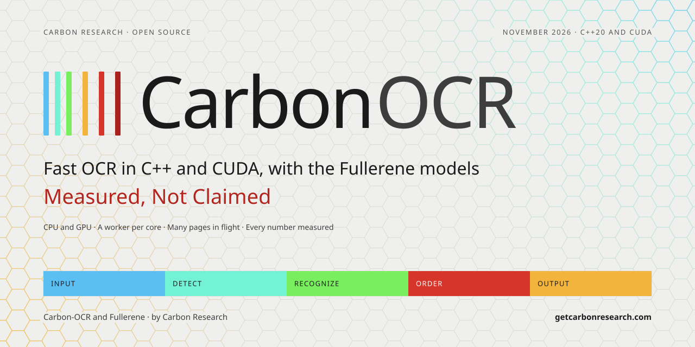
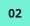
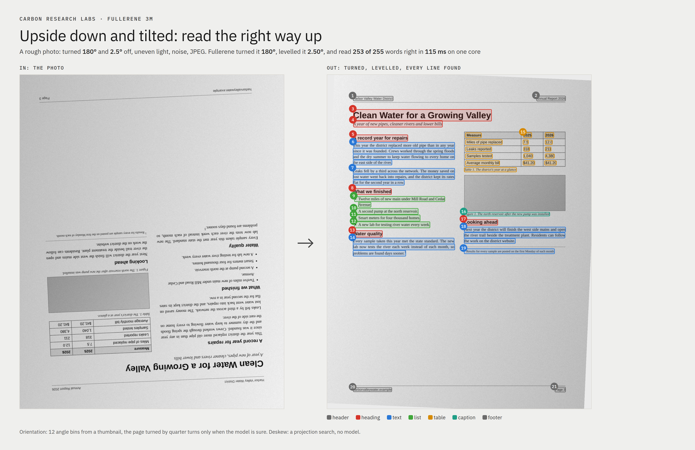
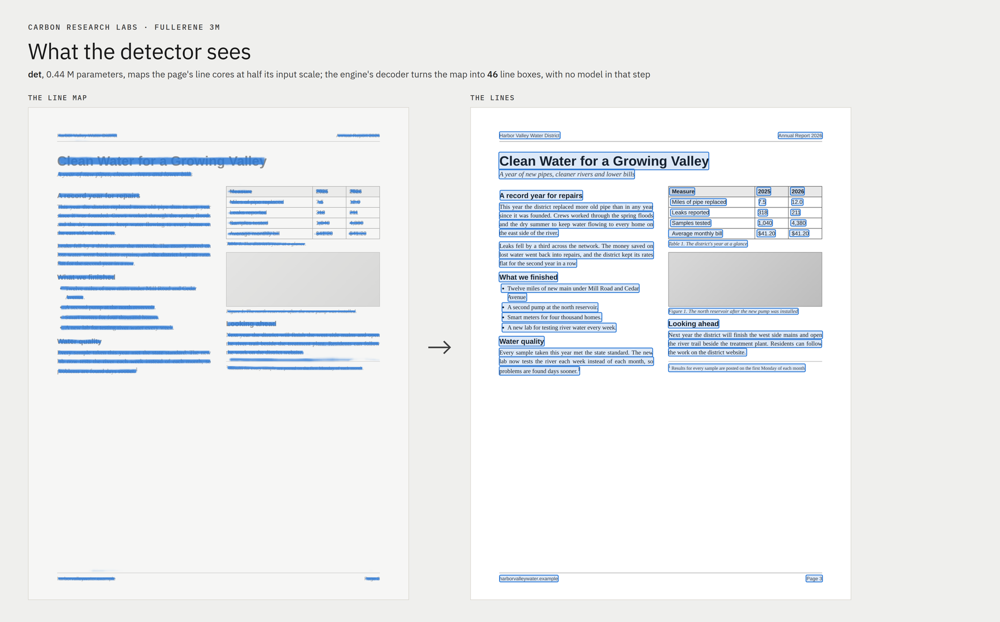
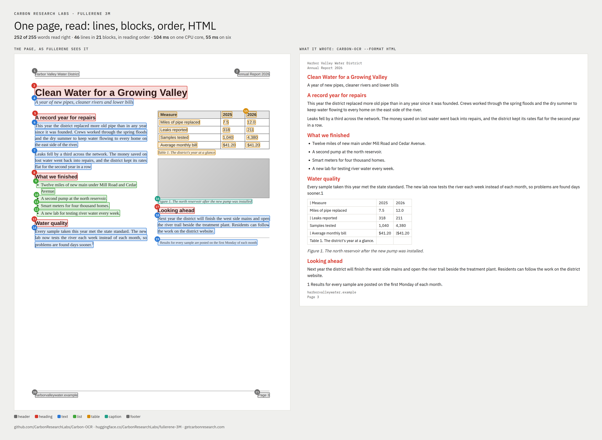
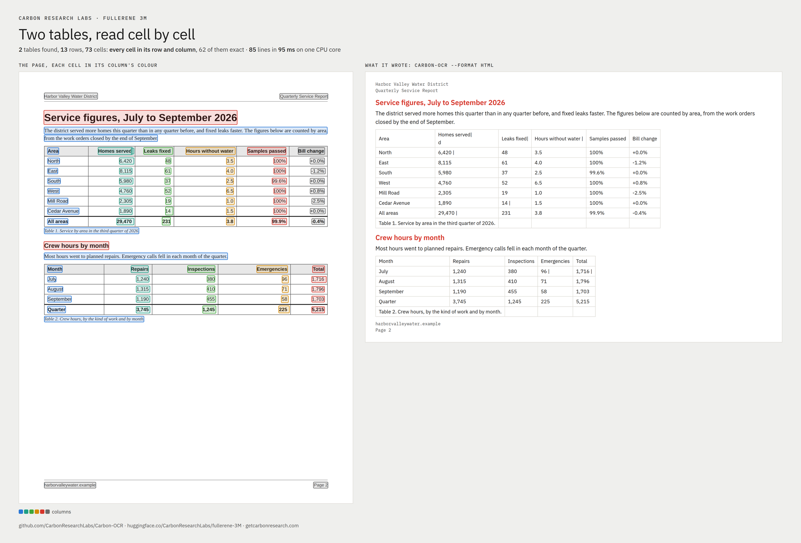
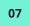
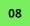
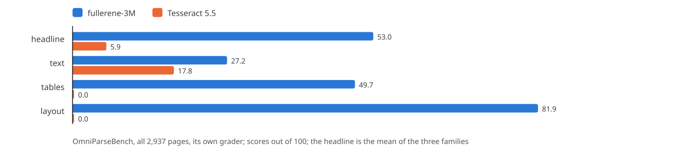

<picture>
  <source media="(prefers-color-scheme: dark)" srcset="assets/banner-dark.svg">
  
</picture>

# Fullerene at work: pages, read

<p>
  
  
  
  
</p>

**What `fullerene-3M` does with a page, shown on three: a page of an annual report, a page of two tables, and a rough photo of the first, upside down and tilted.** Every picture here is drawn from the engine's own output for that page, and every number is measured on one machine's CPU. The pages are invented for this report, so their text is known word for word and none of it was ever trained on. The scripts that made them are in [demo/](demo/), so anyone with the engine and the set can make them again (section 10).

On the report page the engine found every line, read 252 of its 255 words right (the misses are one footnote mark, read into the word before it, and a price with a table's rule against it), labelled its blocks, put them in the page's own reading order and wrote HTML, in 104 ms on one core. On the page of tables it found both tables and put all 73 cells in their row and column, 62 of them character for character. The photo it turned the right way up, levelled by the 2.5° it was off and read as well as the clean page. It still gets some of the pages' structure wrong: section 8 lists each fault, where it comes from, and what fixes it.

##  The run

| | |
|---|---|
| the models | `fullerene-3M` from [Hugging Face](https://huggingface.co/CarbonResearchLabs/fullerene-3M): `orient`, `det`, `rec-latin` and `order`, 2.77 M parameters, under the Carbon-OCR OpenRAIL-AMS license; the files as published, the FP32 ones on ONNX Runtime, the engine's choice on a CPU for a set without int8 files |
| the engine | Carbon-OCR as of 17 November 2026, through its Python module: `carbon_ocr.Engine(set, workers=1)` and `workers=6`, `ocr(pages, html=True)` |
| the machine | a desktop's virtual machine: Intel Core i5-13600KF, 8 virtual CPUs, Linux, CPU only |
| the inputs | `page.png` and `tables.png`, the two HTML pages printed by headless Chromium at 1700 × 2200 (a Letter page at 200 dpi); `photo.png`, 1796 × 2274, made from `page.png` (below) |
| the times | medians of seven runs after a warm-up. Another job was running on the machine, so the times on six workers moved between runs (the report page took 47 ms in one run and 55 ms in the next); the numbers here are the run that drew the pictures |

The report page ([demo/page.html](demo/page.html)) is a page of a water district's annual report in two columns: a running header and footer, a title and a subtitle, four headings, five paragraphs, a list of four items, a three-column table, a figure with its caption, and a footnote. The page of tables ([demo/tables.html](demo/tables.html)) is the same district's quarterly figures: a title, two short paragraphs, a heading, a table of six columns and eight rows with a bold total, a table of five columns and five rows, and their captions. The photo is the report page turned 182.5°, so upside down and 2.5° off, on paper tinted under a light that brightens to the right, with noise, a slight blur and JPEG at quality 60.

##  Turned and levelled

<picture>
  <source media="(prefers-color-scheme: dark)" srcset="assets/demo-photo-dark.png">
  
</picture>

Before it looks for a line, the engine scales the page to the detector's size once, and `orient` reads a 512 × 512 thumbnail of that copy: 12 angle bins and a vertical flag. The engine turns the page only by a quarter turn, and only when the winning bin is 90°, 180° or 270° and its probability passes the threshold in `orient.onnx`'s metadata: 0.65, where `orient` keeps every upright page of its tests and turns 97.2% of the turned ones right. The photo scored 180° and was turned; the clean pages scored upright and were left alone.

What is left of a tilt is found without a model: a projection search over angles up to 45° on the detector-scale copy, kept when the level angle clearly wins. It found the photo's 2.5°, and levelled the page and its copy by it. This whole step (the scaling, the thumbnail, the model, the turn and the levelling) is 7 ms on a clean page and 17 ms on the photo, where the whole page is turned and then rotated.

The photo's reading is as good as the clean page's: 253 of 255 words against 252, the same 46 lines, and a mean line confidence of 0.9996 against 0.9987.

##  What the detector sees

<picture>
  <source media="(prefers-color-scheme: dark)" srcset="assets/demo-detector-dark.png">
  
</picture>

`det` reads the page at 1024 px on its long side (791 × 1024 here, padded to 800 × 1024) and writes four maps at half that scale: each line's core band (the middle 40% of its height, shortened at both ends), the distances from the band to the line's top and bottom, and pictures. The left half of the figure is the core map over the page. The engine's decoder thresholds it, takes the connected bands, and sets each line's top and bottom from the distance maps, in C++ with no model: 0.2 ms for the page.

On the report page it found every printed line and one more: the footnote's rule, a thin line the recognizer reads as underscores, which the engine then drops as not text (the command line's JSON lists it under `dropped`), leaving 46. The figure is found as a picture, one box on the grey panel, so no line is looked for inside it. On the page of tables it found 85 lines: a line for every cell, the page's other lines, and a short piece of a column rule beside a header (section 8). Detection is 30 ms on one core and 11 to 24 ms on six, where the page's detection runs on the cores the other workers leave idle.

##  Lines, blocks and reading order

<picture>
  <source media="(prefers-color-scheme: dark)" srcset="assets/demo-read-dark.png">
  
</picture>

`order` reads 16 numbers for each line (its box, its size and shape against the page's, and a few things about its text: its length, its share of digits, a list marker, a trailing hyphen, a sentence end, a capital start) and gives, for every pair of lines, how likely one follows the other and whether they share a block; for each line one of 13 block labels; and the table structure, as which lines share a row, a column, a cell. The engine decodes it in C++: a chain through the lines from the most likely first one, repaired by moving a line wherever the chain's probability rises most; blocks as the runs of that chain whose neighbours share a block; and each block's label as the mean of its lines'. The blocks are then put in order by their geometry, a page's columns one after the other, the model's order kept inside each. When the chain is not sure enough the XY-cut, a rule on the boxes alone, orders the page instead; on all three pages the model's order was kept.

The report page's 21 blocks, in the order the engine gave them:

| # | label | what it holds | block confidence |
|---|---|---|---|
| 1, 2 | page header | the district's name; "Annual Report 2026" | 0.98, 1.00 |
| 3 | heading | the title | 0.91 |
| 4 | text | the subtitle | 0.65 |
| 5 | heading | "A record year for repairs" | 0.97 |
| 6, 7 | text | the two paragraphs under it | 0.88, 0.95 |
| 8 | heading | "What we finished" | 0.99 |
| 9 to 12 | list | the four items, one block each | 0.97 to 1.00 |
| 13 | heading | "Water quality" | 0.94 |
| 14 | text | its paragraph | 0.94 |
| 15 | table | the table's 15 cells and its caption | 0.98 |
| 16 | caption | the figure's caption | 0.95 |
| 17 | heading | "Looking ahead" | 0.69 |
| 18 | text | its paragraph | 0.97 |
| 19 | text | the footnote | 0.93 |
| 20, 21 | page footer | the site; "Page 3" | 0.99, 1.00 |

This is the page's own order: the left column, then the right, the table, its caption and the figure's caption in place, the footnote after the last paragraph, then the footers. The faults are in the same table: the subtitle labelled as text, the model's least sure label (block 4), the table's caption inside the table's block (15), and a block for each list item (9 to 12; section 8).

##  Tables

<picture>
  <source media="(prefers-color-scheme: dark)" srcset="assets/demo-tables-dark.png">
  
</picture>

`order` finds each table as a block; the engine builds its grid from its lines' places: rows from the lines' centres, columns from the fullest rows, a cell set on two lines kept as one. It writes the grid as an HTML table, row by row. On the page of tables both tables were found as tables, and all 73 cells landed in their own row and column, the header rows and the bold totals included:

| | table 1 | table 2 | both |
|---|---|---|---|
| rows, columns | 8 × 6 | 5 × 5 | 13 rows |
| cells | 48 | 25 | 73 |
| in their row and column | 48 | 25 | **73** |
| exact, character for character | 40 | 22 | **62** |
| right but for the column rule's `\|` beside the text, or a stray space | 7 | 3 | 10 |
| right, with a stray fragment beside it | 1 ("Homes served\| d") | 0 | 1 |
| rows written | 9 (the caption as a ninth) | 6 (the same) | |

On the report page the three-column table is read the same way: its 15 cells in place, four of them with a `|`.

##  The HTML it writes

The report page as `ocr(pages, html=True)` (or `carbon-ocr ocr --format html`) wrote it, its long lines wrapped here:

```html
<header><p>Harbor Valley Water District</p></header>
<header><p>Annual Report 2026</p></header>
<h2>Clean Water for a Growing Valley</h2>
<p>A year of new pipes, cleaner rivers and lower bills</p>
<h2>A record year for repairs</h2>
<p>This year the district replaced more old pipe than in any year since it was founded.
  Crews worked through the spring floods and the dry summer to keep water flowing to every
  home on the east side of the river.</p>
<p>Leaks fell by a third across the network. The money saved on lost water went back into
  repairs, and the district kept its rates flat for the second year in a row.</p>
<h2>What we finished</h2>
<ul><li>Twelve miles of new main under Mill Road and Cedar Avenue.</li></ul>
<ul><li>A second pump at the north reservoir.</li></ul>
<ul><li>Smart meters for four thousand homes.</li></ul>
<ul><li>A new lab for testing river water every week.</li></ul>
<h2>Water quality</h2>
<p>Every sample taken this year met the state standard. The new lab now tests the river each
  week instead of each month, so problems are found days sooner.1</p>
<table>
<tr><td>| Measure</td><td>2025</td><td>2026</td></tr>
<tr><td>Miles of pipe replaced</td><td>7.5</td><td>12.0</td></tr>
<tr><td>| Leaks reported</td><td>318</td><td>211</td></tr>
<tr><td>Samples tested</td><td>1,040</td><td>4,380</td></tr>
<tr><td>| Average monthly bill</td><td>$41.20</td><td>|$41.20</td></tr>
<tr><td>Table 1. The district's year at a glance.</td><td></td><td></td></tr>
</table>
<figure><figcaption>Figure 1. The north reservoir after the new pump was
  installed.</figcaption></figure>
<h2>Looking ahead</h2>
<p>Next year the district will finish the west side mains and open the river trail beside
  the treatment plant. Residents can follow the work on the district website.</p>
<p>1 Results for every sample are posted on the first Monday of each month.</p>
<footer><p>harborvalleywater.example</p></footer>
<footer><p>Page 3</p></footer>
```

Each block becomes one element by its label: page headers and footers `<header>` and `<footer>`, headings `<h2>`, text `<p>`, a list `<ul>`, a caption a `<figure>` with its `<figcaption>`, a table a `<table>`. A block's lines are joined into one paragraph, and a word broken by a hyphen at a line's end is joined again. The bullets are dropped from list items, where the list's own markers stand for them. The same page as plain text, markdown, JSON (with every line's box and confidence), hOCR, ALTO, PAGE XML or a searchable PDF is one option away.

##  The numbers

| | report page | its photo | page of tables |
|---|---|---|---|
| words in the source | 255 | 255 | 173 |
| words read | 261 | 259 | 180 |
| words read right | **252 (98.8%)** | **253 (99.2%)** | 171 (98.8%) |
| of the words read, right | 96.6% | 97.7% | 95.0% |
| lines | 46 | 46 | 85 |
| blocks | 21 | 21 | 10 |
| mean line confidence | 0.9987 | 0.9996 | 0.9983 |
| turned, levelled | 0°, 0° | 180°, 2.50° | 0°, 0° |

Words are counted as runs of characters between spaces, as a multiset, order aside, and strictly: a word with anything stuck to it is wrong. The misses are what is stuck to words. On the report page they are the footnote mark, read as a plain 1 into the word before it ("sooner.1" for "sooner." and its mark), and a price with a column rule against it ("|$41.20"); on the photo, the footnote mark alone; on the page of tables, two header words with a rule against them ("served|", "fixed|"). The extra words are marks with no word in the source: the list's four bullets, the table rules read as `|` (three on the report page, one on the photo, six on the page of tables), and on the page of tables a piece of a rule read as "d". A line's confidence is the mean of its characters' probabilities.

Time, in milliseconds, each stage by the engine's own clock and the whole call from Python:

| stage | report, one core | report, six | photo, one core | photo, six | tables, one core | tables, six |
|---|---|---|---|---|---|---|
| scale, orient, turn, level | 6.7 | 5.6 | 16.5 | 14.1 | 7.1 | 5.0 |
| detect | 30.2 | 24.2 | 31.5 | 12.0 | 30.2 | 10.6 |
| decode the maps | 0.2 | 0.3 | 0.3 | 0.4 | 0.2 | 0.2 |
| recognize | 65.8 | 24.1 | 65.3 | 12.3 | 55.6 | 13.8 |
| **the page** | **103.9** | **54.7** | **114.7** | **39.8** | **94.8** | **34.5** |

Each row is a median of its own, so the rows do not add up to the page exactly; what follows recognition (the order model, 22 MMAC a page, the tables' grids and the output) is inside that rounding. One page alone uses all six workers: its detection runs on the idle cores, and its lines are split among them, so the photo reads 2.9 times as fast on six as on one and the page of tables 2.7 times; the report page's run on six was slowed by the other job on the machine (section 1). Recognition is the most work: 46 lines, about two-thirds of the report page's time on one core. The page of tables has more lines (85) but shorter ones, so it reads faster.

##  What it gets wrong

| fault | where | where it comes from | what fixes it |
|---|---|---|---|
| the subtitle written as a paragraph | report page; on the photo, a second heading | `order` labels the subtitle's line text (0.65) or, on the photo, a heading (0.59); there is no label for a subtitle | in training, more titles with subtitles |
| a table's caption written as its last row | all three tables | `order` puts the caption's line in the table's block | in the engine: a line under a table that spans its columns and fills only the first is its caption |
| a `\|` in a cell, beside its text | 4 cells on the report page, 1 on the photo, 8 on the page of tables | a cell's line takes in the column rule beside it, and `rec-latin` reads the rule as `\|` | in the engine: trim a `\|` at a cell's edge, or crop cells inside their rules |
| a stray space at a cell's end | 3 cells on the page of tables | a cell's line runs past its text, and `rec-latin` reads the gap as a space | the same trimming |
| a piece of a column rule read as a letter, in a cell | one cell of 73 ("Homes served\| d") | `det` finds a short piece of the rule beside the header and `rec-latin` reads it as "d"; the engine keeps it, since a box 2.2 times as tall as it is wide may be a letter alone (it drops such a box only where it reads as a narrow mark) | in the engine: drop a line that lies on a table's rule |
| each list item a list of its own | report page and photo | each item is its own list block, and the writer makes a `<ul>` of each | in the engine: the writer joins adjacent list blocks into one `<ul>` |
| ten picture regions where the page has one picture | photo | `det`'s picture map takes the paper's left and bottom edges and the light falling off them, and the page's right half, which holds the figure, for pictures | in training, photographed pages, their edges and backgrounds; the lines inside are still found and read |
| a footnote mark read as a plain 1 | all | plain text has no superscript, and `rec-latin` reads the mark as 1 | a later change: mark raised characters, and write them as `<sup>` |

Five of the eight can be fixed in the engine, with no new training: the captions, trimming the cells' edges, dropping a rule's pieces and joining the lists. Two are training: the subtitle and pictures on photographs. The last, the superscript, is a later change to the recognizer and the writer. The engine's own rules already fixed what an earlier reading of these pages got wrong in their structure: a title and its subtitle in one heading, headings inside the paragraphs under them, the footnote's rule read as text and the footnote inside a paragraph, the table read after the footers, and the photo's order slipping. The words themselves are almost all right; what is left is the page's structure.

##  Three pages, and 2,937

<picture>
  <source media="(prefers-color-scheme: dark)" srcset="assets/fig-bench-dark.svg">
  
</picture>

Three invented pages show what the engine does; they do not measure how well. That is OmniParseBench, read end to end on all its 2,937 pages and graded by its own grader: `fullerene-3M` scores a headline of 52.3 against Tesseract 5.5's 5.9 (text 27.3 against 17.8; tables 47.9 and layout 81.7, which Tesseract, writing text alone, scores 0), and on a laptop reads 4.06 pages a second on one core against 0.76. Text is where it leaves the most points: OmniParseBench's pages include scripts the Latin set has no recognizer for, handwriting and old scans, none of which these clean printed pages have.

##  Run it yourself

```bash
# the set, from Hugging Face
pip install huggingface_hub
huggingface-cli download CarbonResearchLabs/fullerene-3M --local-dir models/fullerene-3M

# the engine's Python module (the README's Build section), then numpy and Pillow
# the pages, the output and the numbers
python docs/demo/run.py models/fullerene-3M
# the pictures, dark and light
python docs/demo/render.py

# or one page from the command line
carbon-ocr ocr docs/demo/out/page.png --set models/fullerene-3M --format html
```

`run.py` prints the pages with headless Chrome (set `CHROME` if it is not at the Windows default), makes the photo with a fixed seed, runs the engine on one worker and on six, and writes `page.json`, `photo.json` and `tables.json` (the engine's pages: every line's box, text and confidence, the blocks, the cells, the text and the HTML) and `metrics.json` (the numbers above). Those four files, as this run wrote them, are in [demo/out/](demo/out/). `render.py` draws the pictures from them, in the Carbon theme, at their size into `docs/assets/` and, with `--big DIR`, at twice it. On another machine the words and the structure come out the same; the times follow its cores and clock.
