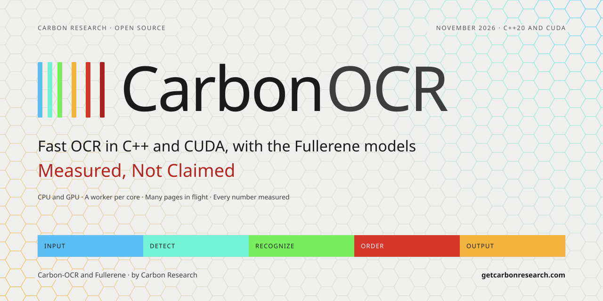
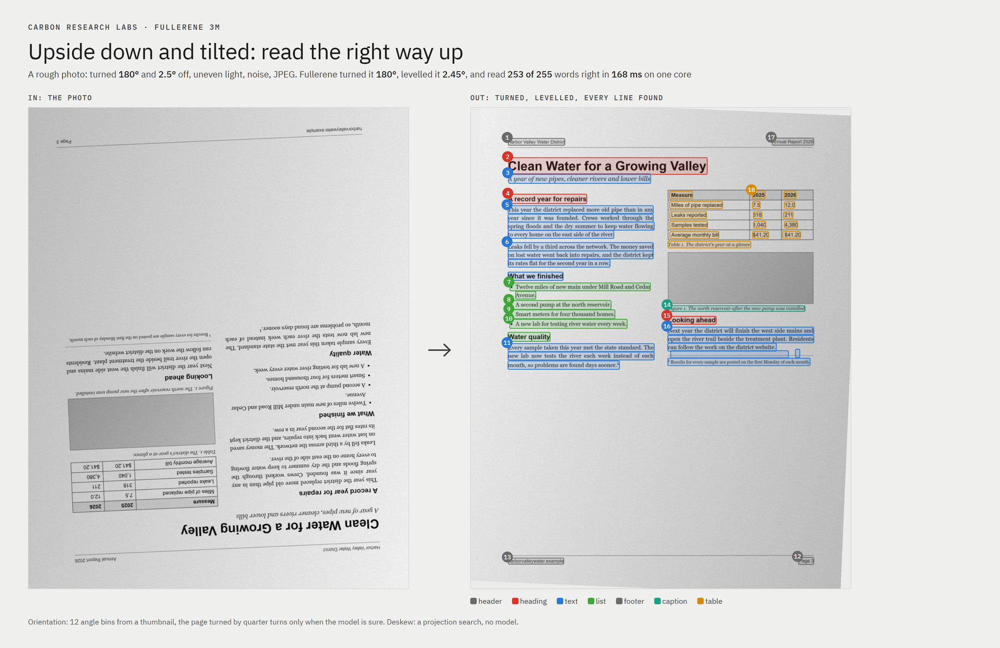
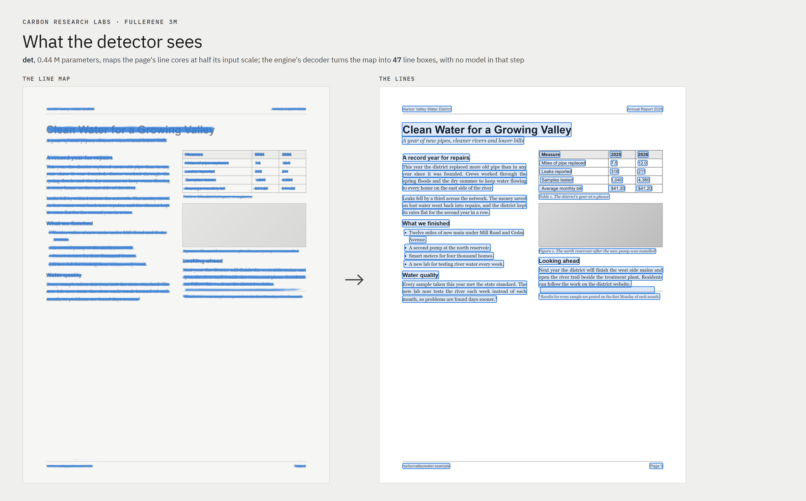
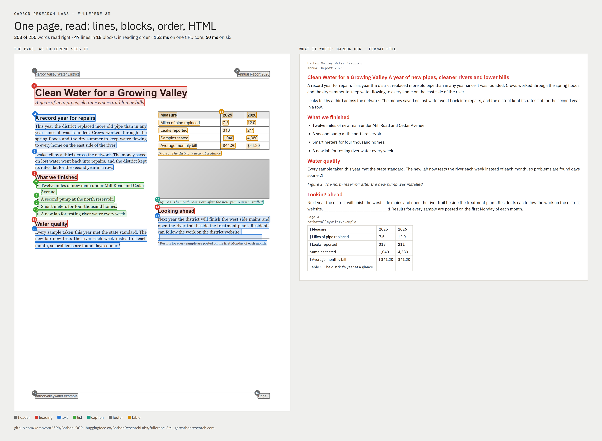
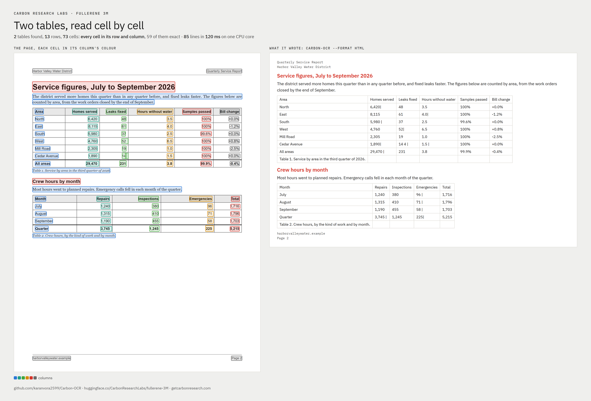
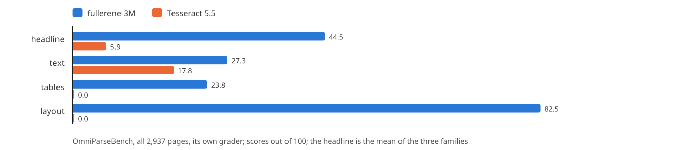

<picture>
  <source media="(prefers-color-scheme: dark)" srcset="assets/banner-dark.svg">
  
</picture>

# Fullerene at work: pages, read

<p>
  
  
  
  
</p>

**What `fullerene-3M` does with a page, shown on three: a page of an annual report, a page of two tables, and a rough photo of the first, upside down and tilted.** Every picture here is drawn from the engine's own output for that page, and every number is measured on a laptop's CPU. The pages are invented for this report, so their text is known word for word and none of it was ever trained on. The scripts that made them are in [demo/](demo/), so anyone with the engine and the set can make them again (section 9).

On the report page the engine found every line, read 253 of its 255 words right (the two it missed are one footnote mark, read into the word before it), labelled its blocks, put them in reading order and wrote HTML, in 152 ms on one core and 60 ms on six. On the page of tables it found both tables and put all 73 cells in their row and column, 59 of them character for character. The photo it turned the right way up, levelled to within 0.05° and read as well as the clean page. It also gets some of the pages' structure wrong: section 7 lists each fault, where it comes from, and what fixes it.

##  The run

| | |
|---|---|
| the models | `fullerene-3M` from [Hugging Face](https://huggingface.co/CarbonResearchLabs/fullerene-3M): `orient`, `det`, `rec-latin` and `order`, 2.77 M parameters, under the Carbon-OCR OpenRAIL-AMS license; the FP32 files on ONNX Runtime, the engine's choice on a CPU for a set without int8 files |
| the engine | Carbon-OCR as of 3 November 2026, through its Python module: `carbon_ocr.Engine(set, workers=1)` and `workers=6`, `ocr(pages, html=True)` |
| the machine | a laptop: Intel Core i7-13620H (6 performance cores, 4 efficient), Windows 11, CPU only |
| the inputs | `page.png` and `tables.png`, the two HTML pages printed by headless Chrome at 1700 × 2200 (a Letter page at 200 dpi); `photo.png`, 1796 × 2274, made from `page.png` (below) |
| the times | medians of seven runs after a warm-up. The laptop's clock follows its power limit and its heat, so the same page took 135 to 164 ms on one core across the day's runs; the numbers here are the run that drew the pictures |

The report page ([demo/page.html](demo/page.html)) is a page of a water district's annual report in two columns: a running header and footer, a title and a subtitle, four headings, five paragraphs, a list of four items, a three-column table, a figure with its caption, and a footnote. The page of tables ([demo/tables.html](demo/tables.html)) is the same district's quarterly figures: a title, two short paragraphs, a heading, a table of six columns and eight rows with a bold total, a table of five columns and five rows, and their captions. The photo is the report page turned 182.5°, so upside down and 2.5° off, on paper tinted under a light that brightens to the right, with noise, a slight blur and JPEG at quality 60.

##  Turned and levelled

<picture>
  <source media="(prefers-color-scheme: dark)" srcset="assets/demo-photo-dark.png">
  
</picture>

Before it looks for a line, the engine scales the page to the detector's size once, and `orient` reads a 512 × 512 thumbnail of that copy: 12 angle bins and a vertical flag. The engine turns the page only by a quarter turn, and only when the winning bin is 90°, 180° or 270° and its probability passes the threshold stamped in `orient.onnx` (0.65). The photo scored 180° and was turned; the clean pages scored upright and were left alone.

What is left of a tilt is found without a model: a projection search over small angles on the detector-scale copy, kept when the level angle clearly wins. It found 2.45° of the 2.5° the photo was off, and levelled the page and its copy by it. This whole step (the scaling, the thumbnail, the model, the turn and the levelling) is 11 ms on a clean page and 27 ms on the photo, where the whole page is turned and then rotated.

The photo's reading is as good as the clean page's: the same 253 of 255 words, 48 lines against 47, and a mean line confidence of 0.986 against 0.992.

##  What the detector sees

<picture>
  <source media="(prefers-color-scheme: dark)" srcset="assets/demo-detector-dark.png">
  
</picture>

`det` reads the page at 1024 px on its long side (791 × 1024 here, padded to 800 × 1024) and writes four maps at half that scale: each line's core band (the middle 40% of its height, shortened at both ends), the distances from the band to the line's top and bottom, and pictures. The left half of the figure is the core map over the page. The engine's decoder thresholds it, takes the connected bands, and sets each line's top and bottom from the distance maps, in C++ with no model: 0.6 ms for the page.

It found 47 lines on the report page, every printed line and one more: the footnote's rule, a thin line the recognizer then reads as underscores (confidence 0.69, the page's lowest). The figure is found as a picture, one box on the grey panel, so no line is looked for inside it. On the page of tables it found 85 lines, a line for every cell. Detection is 44 ms on one core and 15 ms on six, where the page's detection runs on the cores the other workers leave idle.

##  Lines, blocks and reading order

<picture>
  <source media="(prefers-color-scheme: dark)" srcset="assets/demo-read-dark.png">
  
</picture>

`order` reads 16 numbers for each line (its box, its size and shape against the page's, and a few things about its text: its length, its share of digits, a list marker, a trailing hyphen, a sentence end, a capital start) and gives, for every pair of lines, how likely one follows the other and whether they share a block; for each line one of 13 block labels; and the table structure, as which lines share a row, a column, a cell. The engine decodes it in C++: a chain through the lines from the most likely first one, repaired by moving a line wherever the chain's probability rises most; blocks as the runs of that chain whose neighbours share a block; and each block's label as the mean of its lines'. When the chain is not sure enough the XY-cut, a rule on the boxes alone, orders the page instead; on all three pages the model's order was kept.

The report page's 18 blocks, in the order the engine gave them:

| # | label | what it holds | block confidence |
|---|---|---|---|
| 1, 2 | page header | the district's name; "Annual Report 2026" | 1.00, 1.00 |
| 3 | heading | the title and the subtitle together | 0.62 |
| 4 | text | the heading "A record year for repairs" and the paragraph under it | 0.70 |
| 5 | text | the second paragraph | 0.94 |
| 6 | heading | "What we finished" | 0.98 |
| 7 to 10 | list | the four items, one block each | 0.99 to 1.00 |
| 11 | heading | "Water quality" | 0.97 |
| 12 | text | its paragraph | 0.95 |
| 13 | caption | the figure's caption | 0.95 |
| 14 | heading | "Looking ahead" | 0.68 |
| 15 | text | its paragraph, then the footnote's rule and the footnote | 0.95 |
| 16, 17 | page footer | "Page 3"; the site | 1.00, 0.99 |
| 18 | table | the table's 15 cells and its caption | 0.98 |

The columns are read in order, left then right, and the figure's caption, the headings and the list are where a reader would put them. The faults are in the same table: the blocks that joined two kinds of line (3, 4 and 15) and the table's place at the end (section 7). The blocks that joined lines wrongly are also the ones the model was least sure of.

##  Tables

<picture>
  <source media="(prefers-color-scheme: dark)" srcset="assets/demo-tables-dark.png">
  
</picture>

Each table is a block whose lines `order` groups into rows, columns and cells; the engine reads the groups as a grid and writes it as an HTML table, row by row. On the page of tables both tables were found as tables, and all 73 cells landed in their own row and column, the header rows and the bold totals included:

| | table 1 | table 2 | both |
|---|---|---|---|
| rows, columns | 8 × 6 | 5 × 5 | 13 rows |
| cells | 48 | 25 | 73 |
| in their row and column | 48 | 25 | **73** |
| exact, character for character | 39 | 20 | **59** |
| right but for the column rule's `\|` beside the number, or a stray space | 8 | 5 | 13 |
| right, with a stray fragment beside it | 1 ("14 4 \|" for 14) | 0 | 1 |
| rows written | 9 (the caption as a ninth) | 6 (the same) | |

On the report page the three-column table is read the same way: its 15 cells in place, five of them with a `|`.

##  The HTML it writes

The report page as `ocr(pages, html=True)` (or `carbon-ocr ocr --format html`) wrote it, its long lines wrapped here:

```html
<header><p>Harbor Valley Water District</p></header>
<header><p>Annual Report 2026</p></header>
<h2>Clean Water for a Growing Valley A year of new pipes, cleaner rivers and lower
  bills</h2>
<p>A record year for repairs This year the district replaced more old pipe than in any year
  since it was founded. Crews worked through the spring floods and the dry summer to keep
  water flowing to every home on the east side of the river.</p>
<p>Leaks fell by a third across the network. The money saved on lost water went back into
  repairs, and the district kept its rates flat for the second year in a row.</p>
<h2>What we finished</h2>
<ul><li>Twelve miles of new main under Mill Road and Cedar Avenue.</li></ul>
<ul><li>A second pump at the north reservoir.</li></ul>
<ul><li>Smart meters for four thousand homes.</li></ul>
<ul><li>A new lab for testing river water every week.</li></ul>
<h2>Water quality</h2>
<p>Every sample taken this year met the state standard. The new lab now tests the river each
  week instead of each month, so problems are found days sooner.1</p>
<figure><figcaption>Figure 1. The north reservoir after the new pump was
  installed.</figcaption></figure>
<h2>Looking ahead</h2>
<p>Next year the district will finish the west side mains and open the river trail beside
  the treatment plant. Residents can follow the work on the district website.
  ___________________________ 1 Results for every sample are posted on the first Monday of
  each month.</p>
<footer><p>Page 3</p></footer>
<footer><p>harborvalleywater.example</p></footer>
<table>
<tr><td>| Measure</td><td>2025</td><td>2026</td></tr>
<tr><td>| Miles of pipe replaced</td><td>7.5</td><td>12.0</td></tr>
<tr><td>| Leaks reported</td><td>318</td><td>211</td></tr>
<tr><td>Samples tested</td><td>1,040</td><td>4,380</td></tr>
<tr><td>| Average monthly bill</td><td>| $41.20</td><td>$41.20</td></tr>
<tr><td>Table 1. The district's year at a glance.</td><td></td><td></td></tr>
</table>
```

Each block becomes one element by its label: page headers and footers `<header>` and `<footer>`, headings `<h2>`, text `<p>`, a list `<ul>`, a caption a `<figure>` with its `<figcaption>`, a table a `<table>`. A block's lines are joined into one paragraph, and a word broken by a hyphen at a line's end is joined again. The bullets are dropped from list items, where the list's own markers stand for them. The same page as plain text, markdown, JSON (with every line's box and confidence), hOCR, ALTO, PAGE XML or a searchable PDF is one option away.

##  The numbers

| | report page | its photo | page of tables |
|---|---|---|---|
| words in the source | 255 | 255 | 173 |
| words read | 264 | 262 | 182 |
| words read right | **253 (99.2%)** | **253 (99.2%)** | 168 (97.1%) |
| of the words read, right | 95.8% | 96.6% | 92.3% |
| lines | 47 | 48 | 85 |
| blocks | 18 | 18 | 10 |
| mean line confidence | 0.992 | 0.986 | 0.988 |
| turned, levelled | 0°, 0° | 180°, 2.45° | 0°, 0° |

Words are counted as runs of characters between spaces, as a multiset, order aside, and strictly: a word with anything stuck to it is wrong. The misses are what is stuck to words. On the report page both are one footnote mark, read as a plain 1 into the word before it ("sooner.1" for "sooner." and its mark); on the page of tables, the five misses are numbers with a column rule's `|` against them ("6,420|"). The extra words are marks with no word in the source: the list's four bullets, the table rules read as `|` (five on the report page, two on the photo, eight on the page of tables), the footnote's rule as underscores (and a second short run of them on the photo), and one stray "4".

Time, in milliseconds, each stage by the engine's own clock and the whole call from Python:

| stage | report, one core | report, six | photo, one core | photo, six | tables, one core | tables, six |
|---|---|---|---|---|---|---|
| scale, orient, turn, level | 11.5 | 11.5 | 27.1 | 26.9 | 10.5 | 11.5 |
| detect | 44.1 | 15.0 | 44.2 | 15.7 | 38.4 | 14.7 |
| decode the maps | 0.6 | 0.6 | 0.8 | 0.9 | 0.5 | 0.5 |
| recognize | 97.7 | 31.3 | 91.0 | 33.1 | 69.2 | 38.1 |
| **the page** | **151.8** | **60.5** | **168.3** | **77.3** | **120.2** | **67.3** |

Each row is a median of its own, so the rows do not add up to the page exactly; what follows recognition (the order model, 22 MMAC a page, and the output) is inside that rounding. One page alone uses all six workers: its detection runs on the idle cores, and its lines are split among them, so the report page reads 2.5 times as fast on six as on one. Recognition is the most work: 47 lines, about two-thirds of the report page's time on one core. The page of tables has more lines (85) but shorter ones, so it reads faster.

##  What it gets wrong

| fault | where | where it comes from | what fixes it |
|---|---|---|---|
| the title and the subtitle are one heading | report page | `order` put the two lines in one block, and the block's label is their mean (block confidence 0.62) | in the engine: split a block where the line height or the label changes sharply between two lines; in training, more titles with subtitles |
| a heading inside the paragraph under it | report page: "A record year for repairs" (0.70); photo: "What we finished" in a paragraph (0.83), "Water quality" in the last list item (0.53) | the same: one block for two kinds of line, the heading outvoted by the lines under it | the same split; the model's low block confidence marks every one of these blocks |
| the footnote inside the last paragraph, its rule as underscores | report page and photo | `det` finds the rule as a line, and `order` puts the rule and the footnote in the paragraph's block | in the engine: drop a line that is only underscores or dashes before ordering; in training, footnotes under their rule |
| the table comes last, after the footers | report page and photo | the order's chain puts the table's lines at the end | in training: tables mid-column, the layouts the XY-cut also gets wrong |
| a `\|` in a cell, beside its text | 5 cells on the report page, 2 on the photo, 13 on the page of tables | a cell's crop takes in the column rule beside it, and `rec-latin` reads the rule as `\|` | in the engine: trim a `\|` at a cell's edge, or crop cells inside their rules |
| a stray fragment in a cell | one cell of 73 ("14 4 \|") | a second, partial line found at the cell's rule | the same trimming, and dropping a cell's line that overlaps another |
| a table's caption written as its last row | both pages | `order` puts the caption's line in the table's block | in the engine: a line under a table that spans its columns and fills only the first is its caption |
| each list item a list of its own | report page and photo | each item is its own list block, and the writer makes a `<ul>` of each | in the engine: the writer joins adjacent list blocks into one `<ul>` |
| eight picture regions that are not pictures, one of them the right half of the page | photo | `det`'s picture map takes the paper's edge and the light falling off it for a picture | in training, photographed pages, their edges and backgrounds; the lines inside are still found and read |
| on the photo the order slips: "Annual Report 2026" read 17th, the footers before the figure's caption | photo | the order's chain on a page whose lines, after levelling, sit slightly off their rows | in training, levelled photographs |
| a footnote mark read as a plain 1 | all | plain text has no superscript, and `rec-latin` reads the mark as 1 | a later change: mark raised characters, and write them as `<sup>` |

Seven of the eleven can be fixed in the engine, with no new training: the block splits, dropping rule lines, trimming the cells, finding the captions and joining the lists. Three are training: the order of tables and of photographed pages, and pictures on photographs. The last, the superscript, is a later change to the recognizer and the writer. The words themselves are almost all right; what is left is the page's structure.

##  Three pages, and 2,937

<picture>
  <source media="(prefers-color-scheme: dark)" srcset="assets/fig-bench-dark.svg">
  
</picture>

Three invented pages show what the engine does; they do not measure how well. That is OmniParseBench, read end to end on all its 2,937 pages and graded by its own grader: `fullerene-3M` scores a headline of 44.5 against Tesseract 5.5's 5.9 (text 27.3 against 17.8; tables 23.8 and layout 82.5, which Tesseract, writing text alone, scores 0; the engine as of 5 November), and reads 4.06 pages a second on one core against 0.76 ([the model card](https://huggingface.co/CarbonResearchLabs/fullerene-3M) has every score). Tables are where it leaves the most points, which is what these pages show: tables found and their cells placed, but with rules in their cells, captions as rows, and their place in the page's order.

##  Run it yourself

```bash
# the set, from Hugging Face
pip install huggingface_hub
huggingface-cli download CarbonResearchLabs/fullerene-3M --local-dir models/fullerene-3M

# the engine's Python module (the README's Build section), then numpy and Pillow
python docs/demo/run.py models/fullerene-3M    # the pages, the output, the numbers
python docs/demo/render.py                      # the pictures, dark and light

# or one page from the command line
carbon-ocr ocr docs/demo/out/page.png --set models/fullerene-3M --format html
```

`run.py` prints the pages with headless Chrome (set `CHROME` if it is not at the Windows default), makes the photo with a fixed seed, runs the engine on one worker and on six, and writes `page.json`, `photo.json` and `tables.json` (the engine's pages: every line's box, text and confidence, the blocks, the cells, the text and the HTML) and `metrics.json` (the numbers above). Those four files, as this run wrote them, are in [demo/out/](demo/out/). `render.py` draws the pictures from them, in the Carbon theme, at their size into `docs/assets/` and, with `--big DIR`, at twice it. On another machine the words and the structure come out the same; the times follow its cores and clock.
