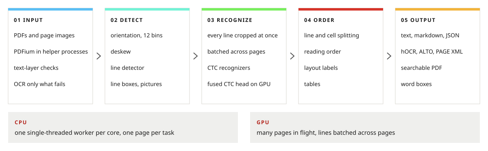
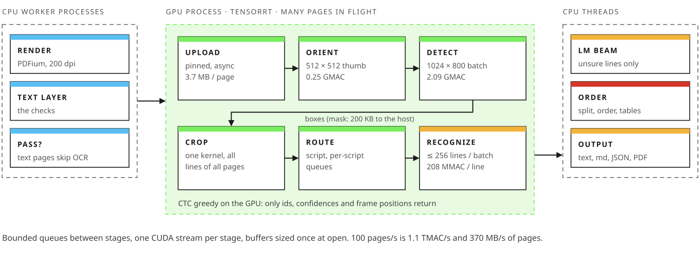

# The Carbon-OCR engine

**Carbon-OCR reads page images and PDFs with the Fullerene models and gives each page's lines, words, blocks and tables in reading order, with their boxes and confidences.** It is a C++20 library (`carbon/`), a command line (`carbon-ocr`), an HTTP server (`carbon-ocr serve`), a Python module (`carbon_ocr`) and an OCRmyPDF plugin. On a CPU it runs the models on its own int8 kernels or on ONNX Runtime, with a pinned worker per physical core. On an NVIDIA GPU it runs them through TensorRT, with many pages in flight and every model batched across them. On either, a model runs in FP32, FP16 or INT8, from the set's file of that precision.

This document follows a page through the engine, step by step, then covers how the engine spreads its work over CPU cores and serves pages over HTTP, the backends it runs models on and their precisions, the batched GPU pipeline and the options that matter. The models themselves are described in [MODELS.md](MODELS.md). The first Fullerene set, `fullerene-3M`, is out on [Hugging Face](https://huggingface.co/CarbonResearchLabs/fullerene-3M). The speed figures here come from sets with random weights, since speed does not depend on the weights; the engine at work on real pages with the trained set is [DEMO.md](DEMO.md).

**Contents**

1. A page's path
2. Inputs: images, PDFs and text layers
3. Orientation and deskew
4. Detection
5. Crops, recognition and CTC decoding
6. Splitting, reading order and tables
7. Outputs
8. The CPU layout
9. Backends and the files they run
10. The GPU batched pipeline
11. Options
12. Measured so far

##  A page's path

<picture>
  <source media="(prefers-color-scheme: dark)" srcset="assets/pipeline-dark.svg">
  
</picture>

| step | what happens | header |
|---|---|---|
| input | an image decoded to gray, or a PDF page rendered in a helper process; a born-digital page whose text layer passes the checks is read from that layer instead | `image.h`, `pdf.h`, `textlayer.h` |
| scale | the page resampled once to the detector's scale (long side 1024 px), and a 512 × 512 thumbnail made from that copy | `image.h` |
| orient | `orient` reads the thumbnail; the page is turned by a quarter turn, only when the model is sure and the recognizer's readings of its widest lines bear the turn out | `engine.h` |
| deskew | a projection search levels what is left, up to 45° | `deskew.h` |
| detect | `det` reads the upright page; the line decoder turns its maps into line and picture boxes; a page of tiny text is detected again at twice the scale | `detect.h` |
| crop | each line cropped to 32 px high by the crop rule, the lines batched by width | `lines.h` |
| recognize | the recognizer gives class scores every 4 px; greedy CTC decoding gives the text, each character's position and probability | `lines.h` |
| split | lines split at wide gaps: column gutters, a table row's cells | `engine.h` |
| order | the order model's reading order and labeled blocks, or the XY-cut's order; tables laid out by geometry | `order.h`, `engine.h` |
| output | text, JSON, hOCR, ALTO, PAGE XML, markdown, HTML or a searchable PDF | `output.h` |

Two classes run these steps. `carbon::Engine` (`carbon/engine.h`) reads a list of pages on the CPU, in parallel, or a stream of them (`submit` and `next`, section 8). `carbon::Pipeline` (`carbon/pipeline.h`) reads a stream of pages with every model batched across the pages in flight, on the CPU or a GPU. Both use the same code for every step, and on the CPU a page comes out of the pipeline exactly as it comes out of the engine. `carbon::Server` (`carbon/server.h`) puts either behind HTTP/1.1 (section 8). `carbon/carbon.h` includes the whole public API but the server's, which is a library of its own.

```shell
carbon-ocr ocr page.png scan.jpg --set models/fullerene-3M         # text, pages apart by \f
carbon-ocr ocr report.pdf --set models/fullerene-3M --format json  # boxes, words, blocks
carbon-ocr ocr scans/*.png --set models/fullerene-3M --device cuda --engine-cache .engines
```

```python
import carbon_ocr

engine = carbon_ocr.Engine("models/fullerene-3M")   # a worker per physical core
page = engine.ocr([carbon_ocr.load_image("page.png")])[0]
print(page["text"])
```

**Not in the engine yet.** These parts of the design are still to come: the script classifier that routes each line to the recognizer of its script group (today a page is read by one recognizer, `EngineOptions::rec`), the second detection pass on a GPU (section 4), the language models of the script groups past Latin (Latin's are in: section 5), the path for vertical CJK columns, bidirectional reordering for right-to-left text, and TIFF input.

##  Inputs: images, PDFs and text layers

**Images.** `carbon::load_image` reads PNG, JPEG, BMP, PNM, GIF (its first frame) and WebP files, each told by its first bytes (`carbon::file_kind`), not its name, and converts them to 8-bit gray, paper 255 and ink 0. It refuses an image more than 32,768 px on a side. Every later step works on gray pixels. A PNG goes through the engine's own decoder (`carbon/src/png.cpp`): libdeflate's inflate, the rows unfiltered with SIMD and turned gray as they come, giving stb_image's bytes about three times as fast; A WebP, lossy or lossless (an animation's first frame), goes through libwebp's decoder to RGB, then to gray as stb_image weighs RGB, so a WebP and a PNG of the same pixels give the same page. stb_image reads every other image, and any PNG the decoder would not read byte for byte as it does (interlaced files, for one). A page with transparency is laid on white paper by its alpha, by every decoder alike. `carbon::decode_image_resized` decodes a page straight to another scale: a PNG's rows are resampled as they are unfiltered, a block at a time, so the page is never whole in memory.

**PDFs.** PDFium renders a PDF's pages and reads their text, and it runs only in helper processes. `carbon::PdfPool` starts `carbon-pdf` helpers, one per physical core by default, each with its own PDFium, and gives each one request at a time. A page's pixels come back through a shared memory region of the helper's (48 MiB, enough for a Letter or A4 page at 600 dpi); a larger page comes down the helper's pipe. PDFium is not thread-safe, so the helpers are how many pages render at once. A PDF that crashes PDFium takes down one helper, which is started again; the page it was on fails with `carbon::Error`, and the calling program carries on. A page is rendered as shown (its `/Rotate` applied, its annotations drawn, on white paper), into one buffer the helper keeps, grown to the largest page up to 64 MiB, so a helper allocates it once, not a page. `carbon-ocr ocr` renders PDF pages at `--dpi`, 200 by default; `--dpi auto` renders each at the resolution its small print or its scan needs (`PdfDocument::auto_scale`): the 10th percentile of its drawn characters' font sizes brought to 25 px, or, for a page without text, its largest image's own resolution, from 200 to 400 dpi either way. A page's image, characters, pictures and structure tree come from one load of the page and one request to its helper, and `carbon-ocr ocr` and `carbon-ocr serve` render and decode pages beside the reading, through one document stream (section 8), holding only those in flight.

**Text layers.** A born-digital page carries its own text. `carbon::read_text_layer` (`carbon/textlayer.h`) turns the characters PDFium reads into lines, and checks them before trusting them (`TextLayerRule`):

| check | the layer is not used when | default |
|---|---|---|
| enough | the page draws fewer characters than `min_chars`: it is pictures or a scan | 4 |
| bad | more than `max_bad` of them have broken Unicode maps, or are U+FFFD, controls or private-use code points (legacy font encodings, symbol fonts); a character past U+FFFF given as its UTF-16 surrogates reads as itself | 2% |
| invisible | more than `max_invisible` are drawn neither filled nor stroked: an OCR layer over a scan, read again rather than trusted (a few, a watermark's or a form field's, leave the layer read) | 1% |
| no ink | more than `max_no_ink` show no ink on the rendered page: their box and its surround hold no two tones `contrast` (32) levels apart. White text, clipped text, text under something drawn over it and glyphs that are not the codes they claim fail; gray or coloured text passes | 5% |

A page that passes skips recognition. Its lines end at PDFium's line breaks and wherever the next character leaves the band of the one before. A line's box is the union of its characters' loose boxes (the font's whole height), its words' boxes are their characters', and its confidence is 1. Its lines are split at wide gaps, a table row's cells or a column gutter, not a justified line's stretched spaces, and put in reading order like OCR's (section 6); a line-end hyphen PDFium marks reads as a hyphen. Its `source` is `"text layer"`. A PDF page read by OCR says why its layer was not used (`text_layer` in the JSON). A line runs on through a raised or lowered character: a step the way the line runs is held to the line's running band, the union of its characters' heights so far, so a script and the text after it stay in the line.

**Text layers turned upright.** A page whose text layer runs sideways or upside down, where over half the characters it draws run one quarter turn on the page as shown (PDFium's character angles, the page's `/Rotate` counted: `carbon::upright_turn`), is rendered and read turned upright (`kPdfUpright`). Its `rotation` is the turn and its boxes are the upright page's, as for a page `orient` turned, so the writers place them on the page as shown. A page read by OCR is given as shown.

**Sub- and superscripts.** A character set at most 0.8 of its line's median size as drawn (`script_size`), its centre more than 0.15 of the line's body height above or below the body's (`script_shift`), is a script, marked in its words and its line (`OcrWord::scripts`, `OcrLine::scripts`). The HTML writes scripts as `<sup>` and `<sub>`, in paragraphs, lists and table cells alike; markdown writes them as plain text.

**Bad-code runs set aside.** A layer refused for its bad codes keeps the rest where every bad code sits in a run of its own (a text object) that holds no letter, as a math extension font's pieces or a symbol font's do (`set_aside_bad_runs`, which `carbon-ocr ocr` and the server turn on with the pictures pass): the lines those runs touch are left out of the layer and read by OCR with the page's pictures, and the checks run on the rest. Not where a bad run holds a letter (a broken encoding), nor where the lines it touches are over half the layer's.

**The detector's lines for a text layer.** PDFium's lines are not always the lines a reader sees: one can run across a table row's cells or two columns. So `carbon-ocr ocr` runs the detector alone on an untagged page's render (`carbon::LineFinder`) and puts the layer's words into the lines it finds (`lines_from_detection`): each word into the smallest detected line that holds its centre, the words of a line left to right, a superscript or subscript with the words of its own line, and words no detected line holds kept as the layer had them. The order model and the tables then see the lines OCR would. A page whose text does not read across, upright (`reads_across`: a page turned, or text set down the page), keeps the layer's own lines. It costs about a tenth of the text pages' speed; `--layer-lines layer` keeps PDFium's lines everywhere.

**Tagged PDFs.** Where at least 75% of a page's line characters are in marked content its structure tree holds (`page_from_tagged_layer`), its lines go in the tree's reading order, a line's pieces together, and each run of lines under one element is a block labelled by its role: P Text, H and H1 to H6 Section-Header, L and LI List-Group, Table and its rows and cells Table, Caption, Note Footnote, TOC Table-Of-Contents, Figure Picture, Formula, Form. Lines outside the tree (artifacts, as running heads and page numbers are marked) come after, Page-Header in the top 15% of the page, Page-Footer in the bottom 15%. The page's order is `"tagged"`, and the order model does not reorder it.

**Hybrid pages.** A page read from its text layer can still hold text the layer does not: a chart's labels, a scanned table, a screenshot. Its image objects at least 32 px on both sides (`HybridRule::min_side`) are kept on an otherwise blank copy of the page, and that copy is read by OCR at the page's own scale. The lines found join the layer's, except those at least half covered by the layer's own lines (text drawn over a picture), and the page's `source` becomes `"hybrid"`. Ink the layer does not account for (outlined text, a chart's labels drawn as paths, an image inside a form XObject) is found by a coverage test, runs of rows at least two of the layer's line heights tall with ink outside every character's box and every picture, and read by OCR as the pictures are. Where the detector found the page's lines for its layer (above), the pass reads the lines it found there, those at least half inside the regions to read and less than half under the layer's own lines, rather than detect the pictures' page again (`picture_lines`; none: the pass is not run); a page with lines set aside takes the pass on its pictures' page. `carbon-ocr ocr --text-layer off` reads every page by OCR, `--hybrid detect` detects the pictures' page again in every case, and `--hybrid off` leaves pictures unread and reads by OCR a page whose layer was refused for its bad codes.

##  Orientation and deskew

Each page is resampled once to the detector's scale, its long side 1024 px (`det_long_side`), with the crop rule's antialiased bilinear filter (section 5). Orientation reads a thumbnail of that copy, fitted into 512 × 512 (`orient_side`) at the top left, as an ink map (1 − gray / 255: ink 1, paper 0) with paper around it. The resampling runs on the CPU's vectors (AVX2 or NEON), the scalar code's bytes.

`orient` gives 13 class scores: 12 bins of 30° (bin k: the text turned 30k° clockwise) and one for vertical CJK columns. The engine turns a page only by a quarter turn, for the 90°, 180° and 270° bins, and only when that bin's softmax probability reaches the turn threshold. The threshold is `EngineOptions::turn_probability` when it is set, else the one stored in the set's orientation model (`carbon.orient.turn_probability`, see [MODELS.md](MODELS.md)), else 0.95. Any other answer leaves the page as it is, since a wrong turn loses the whole page. `OcrPage::rotation` records the turn.

**Turns read before they are made** (`carbon::TurnCheck`, `turn_check`, on by default; `--turn-check off`). The recognizer reads the page's 8 widest lines as orientation would turn it, as they stand and turned half round, and a reading's sureness is the mean probability of its characters, spaces aside. The readings judge a turn only where one of them reaches 0.8 (`floor`): `rec-latin` reads a script it was not trained on unsurely either way up, so there neither reading is evidence. A half turn orientation is sure of is made where the turned reading is at least as sure as the page's as given, else the page is read as given, so upright Latin text the model takes for upside down stays as it is; where no reading reaches 0.8, orientation's turn stands as it makes it without the check. A quarter turn goes the other way round where that reading is the surer and reaches 0.8. A page the model is not sure enough to turn whose sideways bins (60° to 120°, 240° to 300°) hold 0.8 of its probability is read as given and turned to its likelier side both ways, and turned where a sideways reading is the surest and reaches 0.8. Where turns are read, a quarter turn's probability is its three bins' sum (60°, 90° and 120° for 90°), since the readings bear out what the sums risk; where they are not (the batched pipeline, `--turn-check off`), a bin's alone, unless `turn_by_quarters` (`--turn quarters`) sums them there too, as no threshold is calibrated for the sums, which run higher than a single bin's. Each reading is in the page's JSON (`turn_reads`). The check is the CPU engine's: the batched pipeline turns by the model alone.

Deskew (`carbon/deskew.h`) levels what is left, without a model. On the page at the detector's scale, it finds the ink (Otsu's threshold), samples it to a fixed number of pixels and projects it onto the rows of the page turned by each candidate angle. The sum of the squared row counts is largest when the lines are level, because their ink falls in few rows and the gaps between them are empty. The search takes 0.5° steps within ±5°, then, up to `max_skew` (45° by default: a page photographed or scanned askew), whole-degree steps on a quarter of the ink, a best at the search's edge taken for no peak; then 0.05° steps around the best angle. The page is levelled only when the angle is at least 0.2° (`min_skew`) and its score beats the level page's by 5% (`min_skew_gain` 1.05), or by 25% past 5° (`wide_skew_gain` 1.25). On real pages turned by known angles from 8° to 40°, the angle is found within a degree on most of them, and 0.68 to 0.80 of the upright page's text reads back, against 0.15 to 0.45 with the search kept to 5°; an upright page reads the same either way. `--max-skew 5` keeps to the narrow search. `OcrPage::skew` records the angle. The turn runs in AVX2 or NEON doubles and the quarter turns by tile transposes, each the scalar code's bytes. With fast cores idle (a page alone), the search runs on the page as given beside orientation (a page orientation turns is searched again), and the levelling turns the page in row bands on the idle workers, each row the same bytes however the rows are cut.

A page's boxes are in the pixels of the page as turned upright and levelled. `carbon-ocr ocr --as-given` skips both steps, so the boxes are the given page's; the OCRmyPDF plugin uses it, because OCRmyPDF turns and levels pages itself.

##  Detection

`det` reads the upright page at the detector's scale as an ink map, padded with paper to a multiple of 32 (its largest stride), and gives four maps at stride 2:

| map | value |
|---|---|
| core | a logit: the line's core band, the middle 40% of its height, shortened at both ends by 0.15 of its height, so the bands of neighboring lines never touch |
| top | at a core pixel, the distance in input pixels from the pixel's center up to the line's top |
| bottom | the same, down to the line's bottom |
| picture | a logit: inside a picture |

**The detector's head on the CPU's vectors.** The detector's last layers, its head (a 1 × 1 convolution and ReLU, a nearest 2× upsample, a depthwise 3 × 3 and ReLU, and a 1 × 1 convolution to the four maps), make two tensors at stride 2, 12.5 MB each for a Letter page in FP32, that only they read. When `carbon::Engine` opens the detector on the CPU (its FP32, FP16 or int8 file, on ONNX Runtime or its own kernels), it cuts the model before its head and computes the head itself (`cpu::det_head`, AVX2 or the scalar reference) from the stride-4 features, in row bands that stay in the cache, on the idle fast cores when there are some. Those two tensors are never written. The head's arithmetic is FP32 whatever the file's, and a row's maps are the same however the rows are cut.

The line decoder (`carbon::decode_det`) is C++, not a model. It thresholds the core and picture maps at a probability of 0.5, 8 pixels a compare on the CPU's vectors, and takes the 8-connected components of the core band (runs found a 32-pixel word at a time, joined by union-find). A line's top and bottom are the 5% and 95% quantiles of its band pixels' edges, so a slightly slanted line keeps both ends, and its ends lie 0.15 of its height beyond the band's. A band under 2 map pixels is noise unless its one pixel is at least 0.8 sure (`single_pixel`): a line under about 5 px at the detector's scale has only one. A picture under 16 is noise too. The decoder keeps the picture map, a bit a map pixel, for dropping lines that are not text (section 6). A line's `det_score` is the mean probability over its pixels. The boxes are scaled back to the upright page's pixels, top to bottom, then left to right. `DetRule` holds all of these numbers.

On a GPU the threshold runs on the device (`cuda::threshold_det`) in three launches: a warp votes each 32-pixel word's bits, a scan gives every set pixel its place, and a scatter writes the set pixels' values. Only the bits and those values cross to the host, in two bulk copies (the bits, then as many values as are set), the same `DetMasks` that `carbon::threshold_det` makes on the CPU, and the host decodes them. The batched pipeline's detect stage keeps the buffers it thresholds in, on the device and pinned on the host, reserved at its largest batch (`cuda::DetScratch`), so no call allocates.

**Detection on idle cores.** When fast cores are idle, `carbon::Engine` detects a page on a shared multi-threaded ONNX Runtime session of `det.onnx` (2, 4 or 6 threads, the widest the idle fast cores fit) instead of the worker's own single-threaded one. It opens that session only where the workers' own detector is `det.onnx` too (`detail::wide_detector_allowed`): at `auto` a set that ships `det.int8.onnx` runs that on every worker and has none, so a page reads the same alone or in a batch. `carbon/strips.h` offers a second way: the page's rows cut into strips that run side by side and are stitched back together. Each strip runs on its own rows plus 128 rows of the page above and below (the detector sees 127 px around a pixel), and every cut falls on a multiple of 32, so the stitched maps are the whole page's, byte for byte. The halos cost compute (8 strips of a 1024-row page run 2.5 times the rows), so strips pay only when many cores are idle. `carbon-ocr pages --det auto|one|wide|strips` times one against the other.

**Tiny text: a second pass.** At stride 2, a line under 9 px high at the detector's scale has a core band one or two map rows high, so the detector misses some such lines and places the rest coarsely. When the first pass's median line is under 9 px (`DetRule::second_pass_below`), the engine detects the upright page again at twice the scale (`second_pass_scale`), its long side at most 2048 px (`EngineOptions::second_pass_long_side`), where those lines are about 18 px high. A page that large runs in strips of about a first pass's pixels, one after another (`carbon::run_in_strips`), so a worker's detector holds about a first pass's memory while the stitched maps stay the whole page's. On a page of ordinary print the second pass would only find the same lines again, and where the passes disagree it costs precision, so the median gates it. The pass runs on the bands of rows that hold the first pass's tiny lines, not the whole page (`second_pass_bands`, on): each tiny line's rows at the second scale, widened either side by the tiny lines' median spacing (at least two of their heights), bands close together joined, each run with the strips' halo, a band's line kept where its centre lies in the band's own rows. A page whose tiny print fills it takes about the whole page; one with its tiny print in a corner (a title block, a legend, a footnote) only those rows.

The passes are merged line by line (`carbon::merge_passes`). A line of each pass whose boxes overlap by more than 0.5 IoU (`merge_iou`) is one line, kept from the pass whose scale suits it: the second's where its height is under 9 px at the first pass's scale, the first's otherwise. A line only one pass found is kept, one pass's miss being the other's find, except a first-pass box over text the second read as tiny lines (two or more of them mostly inside it, or one that fills most of it), whose text would otherwise be read twice. A box the other pass does not pair with, lying mostly (0.6) inside a box that pass keeps, is the same text found again and goes too: a second-pass box that is not tiny inside a kept first-pass box (a heading the larger scale split into pieces), and a tiny first-pass box inside a kept second-pass box. Pictures are merged the same way. `OcrPage::second_pass` records the pass and `ms.second_pass` its time; `carbon-ocr ocr --second-pass off` keeps one pass. The batched pipeline runs it on the CPU and on a GPU alike; on a GPU, whose first pass runs only at fixed sizes, its strips run on TensorRT at a profile of their own (section 10).

##  Crops, recognition and CTC decoding

**The crop rule** (`carbon::CropRule`, `carbon/lines.h`). A line box of height h becomes a crop 32 px high. The box gets h × 0.2 of padding above and below and h × 0.3 at each end, is scaled to 32 px, then is widened on both sides into the page to a multiple of 8, the recognizer's width step. The resampling is a triangle filter whose support widens with the downscale (an antialiased bilinear), in 22-bit fixed point: a horizontal pass into an 8-bit intermediate, then a vertical pass. Pixels outside the page read as paper. A crop of light text on a dark ground is flipped (255 − v), so a recognizer always reads dark ink on light paper: the test is whether more of its pixels are at least 48 levels lighter than its ground (the median of its border) than as much darker, counted on the CPU's vectors, and whether over half its pixels are dark as well (127 or less, `flip_needs_dark`): where both padding rows land on a table's rules, the ground reads dark though the crop is dark text on paper. Then the crop is padded to its batch's width with its own ground. The CUDA kernel (`cuda::crop_lines`, four launches for every line of every page) gives the same bytes as the CPU code, because the coefficients are computed in IEEE double precision without fused multiply-adds. A recognizer whose file carries its own crop rule (`carbon.crop.height`, `carbon.crop.pad_v`, `carbon.crop.pad_h`) sets those three values.

**Width buckets.** Lines are batched by width. A crop runs at the smallest bucket that holds it: 32, 48, 64, 88, 120, 160, 208, 272, 360, 472, 616, 808, 1056, 1376, 1792 or 2048 px, each at most 1.3 times the one before (`carbon::width_bucket`). A crop wider than 2048 px runs at its own width rounded up to 8. A run meets few shapes, and the padding stays small.

**Recognition.** The recognizer reads a batch of ink maps, `[N, 1, 32, W]`, and gives `[N, classes, W/4]`: a score for every class every 4 px of width, class 0 the CTC blank. Each line reads only the frames of its own crop width, not its bucket's.

**CTC decoding** (`carbon::ctc_greedy`). Greedy decoding takes the best class of each frame (ties go to the lower id), drops blanks and collapses repeats. Each character keeps the frame it starts at and its probability, the highest softmax probability over the frames of its run. On the CPU, `cpu::ctc_argmax` (AVX2 or NEON) reads a line's logits in their order, a class's frames after another's, keeping each frame's best so far in L1, then sums the softmax only for the frames where a character won, gathered 8 to a vector. Past a group's highest best class, each frame's sum is at least 1, so a class whose terms are all of logits more than 17 below their frames' bests, too small to change it, is passed over. The exponential is a polynomial in separate multiplies and adds, so every instruction set gives the same bits. A line's text is its characters' strings from the vocabulary, and its confidence is the mean probability of its characters, its spaces left out (`char_confidence`; false: of every id kept). A word is the characters between spaces; its box runs from the frame its first character starts on to the space after it, at the line's height. With `word_boxes_at_ink` (the CPU engine's) a word's box is at its ink: out from its first glyph to the blank before it, back from the gap to its last ink.

**The beam for unsure lines** (`carbon::ctc_beam`, `carbon/beam.h`; `beam`, `--beam 8`, off by default). Every line is decoded greedily first. With the beam on, a line whose confidence is under its gate (0.9 by default) is read again by a CTC prefix beam (8 prefixes) over each frame's likeliest classes (5, and the blank), and every other line keeps its greedy decoding at no cost. The beam has two guards: the greedy prefix so far is carried at every frame as a hypothesis of its own, so it is never pruned, and the reading returned is the survivor with the best exact score (the CTC forward sum over the frames' candidates), so without a language model it is never less probable than greedy's. A frame whose blank holds 0.999 of its probability starts no character. A language model plugs in through `carbon::LanguageModel` (`language_model`: a start state, a class's log-probability after a state, the line's end), asked once for each prefix the beam makes; a reading's score is its CTC log-probability, plus `alpha` times the model's, plus `beta` a character. The candidates come from a line's logits (`cpu::ctc_topk`, AVX2, the same bits as its scalar reference), from the CPU's fused head for that line alone (`cpu::rec_head_logits`), or on a GPU from the logits or the fused head's features (`cuda::ctc_topk`, `cuda::ctc_head_logits`), so only about 5.5 KB a line comes back, not its logits. The CPU engine beams a line in its worker; the batched pipeline beams them in each page's finish, on its CPU threads, and gives the CPU engine's pages. The search's cost is kept down exactly: a frame's candidates come from one pass for its top classes and one for the softmax's sum, the terms too small to move it passed over; the prefixes live in a flat table, and the search's memory stays on its thread from line to line; and a model that bounds its scores (the compact n-gram, from its codebooks: `NgramModel::max_score`) is asked about a frame's new prefix only where, at that bound, it could still be among the width's best. None of it changes a bit of what the beam reads.

**Two options of the beam, off by default.** Span-level decoding (`BeamRule::span`, `--beam-span P`): a frame whose likeliest class, a character or the blank, is at least P sure, with no less sure frame within `span_margin` frames (2, about a letter), is read as greedy reads it, so the beam searches the unsure spans and their margins alone, and a language model cannot trade a sure character for a likelier spelling. Weights by the kind of line (`EngineOptions::lm_kinds`, `--lm-kind KIND=ALPHA,BETA,GATE`): each line's greedy reading is prose (at least 60% letters and at most 10% digits), digits and codes (a digit, and at most half letters: amounts, dates, IDs) or mixed (`carbon::line_kind`), and a kind given its own alpha, beta or gate is read by them, every other line by the beam's own. Without a language model the beam changes little: on `fullerene-1.1-3M`'s held-out lines it takes the mean character error rate from 11.86% to 11.58%, against 10.30% with the 7-gram (19 November, its default precision).

**The language models** (`lm_mode`, `--lm-mode`; `carbon/lm.h`, `carbon/tlm.h`). Two models plug into the beam, each a file beside the set's recognizer for its script group (`lm-latin.bin` and `tlm-latin.bin` for `rec-latin`), and the engine refuses one made on another vocabulary. The n-gram (`carbon::NgramModel`, `lm-<group>.bin`) is a character n-gram over the recognizer's classes, memory-mapped, so every worker and process shares one copy in the page cache. Its file is compact (version 2 of `carbon/lm.h`): each order's table is at most three quarters full, and a slot keeps a 32-bit tag of its n-gram's key and its log-probability and back-off weight as 8-bit codes into the order's codebooks, 6 bytes where the first version, still read, took 16 in tables at most half full; the beam asks it about a frame's new prefixes in one batch, their tables' slots prefetched a round ahead of the probes that read them. The transformer (`carbon::TransformerLM`, `tlm-<group>.bin`) rescores the beam's best readings of a line (`carbon::ctc_beam_nbest`, as many as the beam's width) with the line above it as context: the nearest line whose box ends above its middle, within 1.5 of its heights and overlapping it across, that line's text as read (its last 96 characters at most), else the line's start. A gated line waits for it until the page's lines are read; then the page's waiting lines are rescored in one call (`carbon::LineRescorer::score_lines`), each reading's score gaining `beam.rescore` times its log-probability. On the CPU it runs on the engine's own kernels (`cpu::gemm_f32` on packed weights, `cpu::layer_norm_rows`, `cpu::attend` and `cpu::log_softmax_pick`; an FP16 file on `cpu::gemm_f16`, an INT8 one on `cpu::gemm_u8s8`), the context and the readings' common prefix run once and their keys and values kept for the rest. On a GPU (`carbon::cuda_transformer_lm`; `tlm_gpu`, `--tlm-gpu N`) a page's lines run together on the tensor cores, in batches of at most 8,192 tokens a pass so each worker's GPU memory stays bounded (FP16 in, FP32 sums), within a few hundredths of a nat of the CPU's; the batched pipeline runs it on its own GPU by default. `lm_mode` switches both at once: `none` (greedy), `ngram`, `transformer` or `both` turn on the beam (width 8 where none is set) and the set's models the mode names, each at the weights and gate tuned into its file for the set's recognizer (the gate the n-gram's where it reads, else the transformer's; `lm_gate` over it); `auto`, the default, leaves the beam and the models to `beam`, `lm` and `tlm` as they are set: a beam set by hand reads with the set's n-gram, and the transformer runs only where `tlm` names a file, since over the n-gram it gains little at about four times the CPU's time. A mode whose model the set lacks is an error. `fullerene-1.1-3M` reads with the 7-gram in the setting its model card gives (`--lm-mode ngram`); on the CPU it costs 6% of greedy's pages a second on one core and 8% on 30 workers (section 12).

**The fused CTC head on the GPU.** A recognizer's last layer, a 1×1 convolution to the classes, has its largest output: the logits of 256 lines of `rec-cjk` at 512 px are about 750 MB in FP16. On a GPU the engine runs the network up to that layer on TensorRT (`<rec>.features.fp16.onnx`). Then `cuda::ctc_head_argmax` computes the head on the tensor cores (FP16 in, FP32 accumulate; `head_fp16_accumulate`, `--head-accumulate fp16`, sums in FP16 at twice the rate on GeForce cards, the logits within about 1e-3, off by default) and reduces each frame to its best class and softmax probability as the logits are made, so they are never written. Each warp holds 16 frames of a line in registers while the weights stream through shared memory 32 classes at a time. Only ids and probabilities come back, `carbon::ctc_collapse` turns them into lines, and ties go to the lower id, as on the CPU. The kernel takes a head of 128, 192, 256 or 320 input channels. Without the trunk and head files, or at another precision (section 9), the GPU runs the whole recognizer and decodes its logits on the device (`cuda::ctc_greedy`).

##  Splitting, reading order and tables

**Lines that are not text** (`GateRule`). What the recognizer reads out of a photograph, a rule, a speck or a page's edge is dropped before the lines are ordered and written. Before splitting: a line that read nothing, or only rules and marks (`_ - — – . | = ~ · • / \`), or a sliver (taller than 1.6 times its width) that read at most 2 characters, narrow ones a rule reads as (`| l I 1 ! i j`, brackets, slashes, dots), or any where it is more than 4 times taller than wide (`sliver_thin`): a letter's box alone, a table's "P" or "n", is kept. After splitting: a piece at least 0.8 on the detector's picture map that read unsurely (its confidence under 0.9, or a character's probability under 0.5), and a piece of at most 3 letters and digits, its confidence under 0.6, with no other piece on its row within a line height. The JSON lists each dropped line with its reason (`dropped`); `carbon-ocr ocr --gate off` keeps every line. Two marks are kept from that: a list's bullet the detector found apart from its item joins the line on its right as its first word (within 2.5 line heights, `bullet_join`), and a dash alone between a table's cells, at least a line height from the text either side of it, is kept as an empty cell's mark (`dash_cell`; a hyphen at a line's end is not). After splitting, too: a piece of at most 2 characters whose box lies over a longer line on its row by more than a fifth of its own width is dropped (`overlap_chars`, `overlap_share`: a rule's piece the detector found beside a cell, which the cell's line read already), and a `|` at a line's edge, beside its text, is taken off (`edge_bars`: a column rule the line took in).

**Splitting** (`carbon::split_lines`, `SplitRule`). A detector or a text layer can run one line across a column gutter or a table row's cells. After recognition, a line is split between two words where the gap is wide: at least 1.5 line heights (`always`), or at least 2.5 times the line's word spacing (`ratio`) and never under 0.6 heights (`min_gap`). The word spacing is the median of the line's gaps under 0.6 heights, or 0.25 heights where it has none. A line's first word that is a list's bullet alone stays with the word after it within 2.5 line heights (`marker`), however wide the gap: its item's indent is no gutter. Each piece becomes a line of its own.

**The order model.** `order` reads 16 features for each line (its box, center, width, height and aspect against the page, and text cues such as a list marker or a sentence end) and gives pairwise scores for five relations and one of 13 block labels per line ([MODELS.md](MODELS.md)). `carbon::decode_order` (`carbon/order.h`) turns them into an order: a greedy chain from the page's start over the successor probabilities, then up to 4 repair sweeps (`OrderRule::sweeps`) that move a line wherever the chain's log probability rises. Blocks are the runs of that order whose neighbors are in the same block (a pairwise probability of at least 0.5, `join`), each labeled by the mean of its lines' label probabilities; an option, off by default (`OrderRule::blocks_first`, `--blocks-first on`), takes the same-block scores' clusters over all the lines instead. A table's lines join into cells, and cells into rows and columns, by the same rule, rows numbered top to bottom and columns left to right.

**The XY-cut.** When the chain's mean link probability is under 0.5 (`OrderRule::min_sure`), the engine takes the XY-cut's order instead, keeping the model's blocks over it. Without an order model (or with `use_order` false), the XY-cut alone orders the page (`carbon::reading_order`): the boxes are split again and again at the widest gap across them, a column gutter before the space between lines, then read top to bottom and left to right where no gap is left. `OcrPage::order` says which order a page has: `"model"` or `"xy-cut"`.

**Blocks by geometry** (`blocks_by_geometry`). The order model's blocks are then put in an order of their own: an XY-cut over the blocks' boxes, its gaps measured in the page's units (a gutter in character widths, a gap down the page in line heights), so a page's columns are read one after the other. Inside each block the model's order, its labels and its cells are kept. `--block-order model` keeps the model's order of the blocks.

**Tables by geometry** (`GridRule`, `grid`; `carbon/src/tables.cpp`). The order model says where a table is; the engine lays out its grid from the lines' places:

1. **One table, one block.** The model often cuts a table into several Table blocks: its header apart from its body, or a wide table down the middle. Two are joined where they overlap or lie within 1.5 line heights of each other down the page (`merge_gap`), or side by side with their rows in line, and never where another line, a caption or a paragraph, lies between them.
2. **Its extent.** A line of another block whose centre is in the table's box is the table's, where it lies wholly inside the box or is short (40 characters at most, `inside_chars`): a header the model took for a heading. So are the rows next to it whose lines fall each in a column of its own and are as short as cells. So is the row just above it within 2.5 line heights (`head_gap`), nothing between, where it heads the value columns (`heading_up`): each of its lines inside the table across, a phrase with a letter and no number alone, the whole of its block, each in a column of its own, one of them over two columns or more and not over the first. A caption line ("Table 3", "TABLE II.", "Tab. 2:") is never taken in, and the table's own caption lines above or below all its others leave it, a Caption block before or after it (`caption_out`).
3. **Rows and columns.** Lines share a row where their centres are within 0.6 line heights (`row_tol`). The columns are those of the fullest rows, each the median of their lines' edges; a line covering more than half of a column's width is in it, a heading over several columns spanning them, and a header line (in the rows above the first that holds a number) where it covers 0.15 of a column (`header_cover`), so a heading spans each column it lies over in part. Lines wholly left of the first column, two or more of them, are a column of their own before it (`label_band`): group labels set apart from the rows they head.
4. **A cell set on two lines** is one cell: a row whose lines each lie under a different line of the row above, in the header (at most 4 rows) or nearer than the table's rows are to each other, joins it; a number alone is never a cell's next line. A body row that does not join so goes on the cells of the row above where it reads as their next lines (`body_wrap`): fewer lines than that row, under half the columns, none a number alone, each under a different line of it within 0.6 line heights of white (`wrap_gap`), and each starting on a lowercase letter, a closing bracket, a percent sign or a unit, or under a line that ends open (a bracket left open, a hyphen, a comma, a slash, a joining word such as "and" or "of").
5. **Row labels.** A label in the first column set against a group of rows whose first cells are empty spans them, at the top of its group or in its middle, as the page sets them.
6. **Header cells between two header rows.** A header row whose cells each take only columns that neither the row above nor the row below has, set between them (a "Route" and a "Year" beside a heading that spans the quarters, level with neither it nor the quarters), joins the row above, each of its cells two rows tall.
7. **Section rows.** In a table of three columns or more, a body row of a single cell, not in the first column and under no cell that spans rows, whose text holds a letter, centred in the table (its middle within 0.15 of the table's width of the table's, `section_centre`) and not begun as a cell's next line, heads the rows below it and spans every column (`section_rows`).
8. **A title row.** Where the grid's first row is one cell, from the first column over two or more, its text with a letter and no line a number alone, over a row of two cells or more and another row, it is the table's title, not a row (`title_out`): the lines the table took from other blocks go back to them, its own lines become a Caption block before it, and the grid is laid out again without them.
9. **A false-table check** (`check`, an option, off by default). A logistic over the table's grid (its columns, rows, how full), its text (characters a cell, numbers, digits, sentences, words a line, mathematical signs, lowercase starts), its lines' geometry, the order model's label probabilities over its lines and the page's ruled lines over its rows and columns, with weights fitted on labelled pages in no benchmark (DocLayNet's and PubTables-1M's validation pages; one set for pages read by OCR, one for text layers: `carbon/src/table_check_weights.h`). A Table block whose probability is under `check_keep` (0.5) is written as text. It stays off: at its cut it takes false tables out, but writes too many real ones as text on pages unlike those it was fitted on.

A table with no two columns keeps the model's cells. A cell's lines are a line each in the writers (`<br>`), as printed. `--grid off` keeps the model's cells.

**Tables of text and spans.** A table the order model found whose median cell is a whole line of text (more than `max_cell_chars` characters) is read as text. Where the grid is the model's (`--grid off`), a cell that lies over more than half of two of the model's columns (a header over them) spans those columns, and rows likewise; a column made of such cells alone is removed, and every other cell keeps the model's row and column (`table_spans`; `--table-spans off`). The writers give the spans as `colspan` and `rowspan`, the JSON as `row_span` and `col_span`.

**Tables from geometry.** A page without the order model's blocks still gets its tables (`carbon::find_tables`, `TableRule`). Lines share a row where their heights overlap by half of the smaller's. A run of at least 2 rows, at most 2 line heights apart, each with 2 or more cells in columns of their own, is a table, unless its median cell holds more than 30 characters (columns of text, not a table). The page then gets blocks: each table a `Table` block with its cells, read row by row, and the other lines `Text` blocks, a new one where the gap between lines is wider than a line. These blocks have confidence 0, since no model made them.

##  Outputs

Each page comes out as a `carbon::OcrPage`: its size, the `rotation` and `skew` undone, its lines in reading order (box, text, confidence, `det_score`, words), its pictures, its blocks and their cells, its `source` and `order`, whether it took the second detection pass (`second_pass`), the turn check's readings (`turn_reads`), and its time per stage in ms (`orient`, which includes deskew, `detect`, `decode`, `second_pass`, `recognize`, `total`). `carbon/output.h` writes pages in the formats other tools read. Where a page has no blocks, it is written as one block of all its lines.

| format | `--format` | what |
|---|---|---|
| text | `text` | each page's lines in reading order, one line a row; pages apart by a form feed |
| JSON | `json` | `{"pages": [...]}`: per page its file and page number, size, rotation, skew, source, order, lines with words, pictures, blocks with cells and their spans, the lines dropped as not text with why, the turn check's readings, and timings |
| hOCR | `hocr` | hOCR 1.2 (XHTML), the format Tesseract writes and OCRmyPDF reads: `ocr_page`, then `ocr_carea` and `ocr_par` per block, `ocr_line` (`ocr_header` for a heading's line, `ocr_caption` for a caption's), `ocrx_word` with `x_wconf` |
| ALTO | `alto` | ALTO XML 4.4: `Page`, `PrintSpace`, `TextBlock` (its label a `LayoutTag`), `TextLine`, `String` (with `WC`) and `SP` |
| PAGE XML | `page` | PAGE XML (2019-07-15), one file a page in `--out-dir`: `TextRegion` (its type from the label), `TextLine`, `Word`, each with `Coords` and `TextEquiv` |
| markdown | `markdown` | headings, paragraphs (a block's lines joined, a word broken by a hyphen at a line's end joined again), lists, tables as HTML from their cells with their spans (a cell's lines apart by `<br>`), captions in italics; a text layer's sub- and superscripts as plain text; markdown's own characters escaped where a line would otherwise be read as markup; a picture's unsure lines left out, and a heading that reads as body text written as text; running headers and footers left out; pages apart by a rule |
| HTML | `html` | an HTML5 document, a `<section class="page">` per page: headings `<h2>`; paragraphs `<p>`, a block's lines joined and a word broken by a hyphen at a line's end joined again; lists `<ul>` and `<ol start>`; tables `<table>` from their cells; captions in `<figure><figcaption>`; running headers and footers `<header>` and `<footer>`, kept; footnotes, formulas and forms in elements of their own; a text layer's sub- and superscripts `<sub>` and `<sup>` |
| searchable PDF | `pdf` | each page's image (8-bit gray) with its words over it as invisible text, each stretched to its box, in a font with no glyphs and a ToUnicode map; `--text-only` writes the text alone |

Markdown and HTML write the same text. `carbon-ocr ocr` writes each page as soon as it and the pages before it are done, in their order (`html_head`, `html_page` and `markdown_page`, joined, are the whole document's bytes), so only the pages in flight are held; hOCR, ALTO and the searchable PDF, documents written whole, keep the pages, the PDF their images too. A page read as given (`--as-given`) has its hOCR, ALTO and PAGE boxes on the page as given, and a levelled page's text in the searchable PDF follows the skew of its image. A searchable PDF needs `--output FILE`. Its pages are a PDF's at `--dpi` and an image's at `--image-dpi` (300). `--text-out FILE` writes the plain text beside any format.

**OCRmyPDF.** `tools/ocrmypdf/carbon_ocrmypdf.py` makes Carbon-OCR the OCR engine of OCRmyPDF 17. For each page OCRmyPDF rasterizes, it runs `carbon-ocr ocr --as-given` and takes hOCR, or, with `--pdf-renderer sandwich`, a text-only PDF to graft onto the page. Its options are `--carbon-set DIR` (else `$CARBON_OCR_SET`), `--carbon-ocr PATH` (else `$CARBON_OCR`, else `PATH`) and `--carbon-workers N` (1 by default, since OCRmyPDF runs pages in parallel itself). It reads the Latin-script languages `rec-latin` covers, named by Tesseract's codes. OCRmyPDF's built-in Tesseract plugin still checks that `tesseract` is installed.

```shell
ocrmypdf --plugin tools/ocrmypdf/carbon_ocrmypdf.py \
    --carbon-set models/fullerene-3M in.pdf out.pdf
```

##  The CPU layout

**A pinned worker per physical core** (`carbon::WorkerPool`, `carbon/parallel.h`). The pool has one thread per physical core, not per hardware thread (a core's two threads share its FMA units), each pinned to its core. On Windows the workers take a class of cores in the order of the cores' scheduling class, the favored (highest-clocked) cores first, and the core that takes the most interrupts last. Each worker runs every model single-threaded on its own thread and allocates its buffers there, so they sit in its core's NUMA node. An ONNX Runtime model is one session that every worker runs (`share_sessions`): its weights are held once, in the caches the cores share, for 4 to 6% more pages a second on 6 and 10 workers than a session a worker, the same bytes; the native backend's sessions keep each run's buffers and stay a worker's own. On a machine of several NUMA nodes, `share_sessions = false` keeps a copy in each worker's node. Every worker computes with IEEE denormals, so a page reads the same on any worker. The sessions run with one thread each, so the pool is the only parallelism and the OS never juggles more threads than there are cores; the one exception is detection on idle fast cores (section 4). Idle workers sleep rather than spin.

`carbon::cpu_topology()` reads the machine once (`GetLogicalProcessorInformationEx` on Windows, `/sys` and the cgroup on Linux). It finds the physical cores; Windows processor groups, so a machine with more than 64 logical processors is used whole; the NUMA nodes, which workers alternate between; P-cores before E-cores on hybrid CPUs; and the process's affinity, a container's cpuset and its CPU quota. `carbon-ocr cpus` prints what it found.

**Tasks smaller than a page.** A page starts as one task: orientation, deskew, detection and the line decoder. Its lines then become tasks of their own: one per idle fast core, of about equal cost (a line costs its width bucket's width, so the tasks finish together), or 8 lines a task (`line_batch`) when every core is busy. The last line task to finish splits the page's lines and orders them. A worker runs the tasks it made newest first; with none left, it takes the oldest task of another worker before it starts a new page. So a large job runs about a page per worker, a few pages spread over every core, and the pages in flight finish first. Results come back in the order the pages were given.

**Fast cores first.** On a hybrid CPU, a worker on an E-core takes a task only while every P-core worker is running one, and only the tasks of pages already started (their lines), never a new page: a page's detection on an E-core runs 1.5 times as long and holds the page up. A lone page runs on the P-cores, and a full load on every core.

**A stream of pages.** `Engine::submit` gives the engine a page and returns its number, from 0 in the order given, and `Engine::next` returns each page's result in that order as soon as it is done, waiting for it (and rethrowing the error that page met; the stream goes on). Each page starts as soon as a worker is free, so a caller that streams pages, a server say, keeps every core busy with no wait for a batch to end. At most `in_flight` pages are being read at once (0: two a worker), past which `submit` waits; one thread may submit while another takes. `submit(file)` leaves the file's read and decode to the worker that takes the page (`ms.load`). The pages come out with the same bytes as from `ocr()`.

**Pages as they finish.** `Engine::submit_encoded(bytes, keep)` takes a page's encoded image (PNG, JPEG, BMP, PNM, GIF or WebP) and leaves its decode to the worker that takes the page, as `submit(file)` does; `keep` holds the bytes until then. `Engine::next_finished` gives the pages in the order they finish instead of the order given, each with its number and its result or the error it met (`unreadable` where its bytes or file did not decode), so a slow page holds back no other. A stream takes its results by `next` or by `next_finished`, not both. A page may come with a task of its own (`PageTask`): read as given, with no orientation run and no deskew, or from lines found on it already (`Engine::detect`'s), its detection skipped; and a page read otherwise, from its text layer, is put in reading order by a worker of the stream (`Engine::submit_order`).

**The document stream** (`carbon::DocumentStream`, `carbon/document.h`). `carbon-ocr ocr` and `carbon-ocr serve` read through one stream of pages, so a page reads the same either way. Page images, encoded images and rendered PDF pages go in from any thread, and each page comes out with the caller's tag as soon as it is finished whole. A PDF page's text layer is checked on the thread that gives it; a page read from its layer then has each step that follows (its words put into the detector's lines, its pictures pass, its reading order) as a task of the engine's stream as it comes up, so it finishes inside the stream as an OCR page does, and only the pages in flight are held. On a GPU those steps are the batched pipeline's (section 10).

**The server** (`carbon::Server`, `carbon/server.h`; `carbon-ocr serve`). It keeps a set's models loaded and reads pages sent over HTTP/1.1, through the same document stream as `carbon-ocr ocr`: `POST /ocr` with a page's image (PNG, JPEG, BMP, PNM, GIF or WebP) or a PDF as the body, each told by its first bytes, answered in any format of section 7 by the same writers as `carbon-ocr ocr`; a PDF's pages rendered by the helper processes at `?dpi=` (200), read as `carbon-ocr ocr` reads them and answered together once the last is done. `POST /parse` is a route for document-parsing benchmark clients (a JSON body of the page's file in base64), and `GET /served`, `GET /health` and `GET /info` say what it serves and how it is ("Serving pages over HTTP" in [USAGE.md](USAGE.md)). One thread polls the listening socket and every connection (`WSAPoll` on Windows, `poll` elsewhere); a few give the pages to the stream (`decoders`: on a GPU decoding the images, a PDF's pages rendered on them one at a time); one takes them as they finish, and a few write the answers. The engine's workers do the rest, so every client's pages share them as one stream's would; with `cuda` set, every client's pages share the batched GPU pipeline's batches (section 10). Requests past the pages in flight wait in a queue of `queue` (64); past it, the server answers 503 with `Retry-After: 1` and goes on. A page that fails is answered with its error (422 where its image does not decode or its PDF does not open, 500 otherwise), and the pages after it are read as ever, on either device. The server is a library of its own (`carbon_serve`, `carbon::serve`), so the engine library and the Python module carry no sockets, and `carbon-ocr ocr` reads as before.

**Memory kept.** A tensor of 256 KB or more takes its memory from a cache kept by each thread (up to 48 MB), where the blocks of the tensors it made before wait, instead of a fresh block from the system: on Windows a fresh block is first touched at about half a millisecond a megabyte, and a page makes tens of megabytes of them. The recognizer's logits and the detector's features are read where ONNX Runtime wrote them, not copied.

**The engine's own kernels** (`carbon/cpu.h`). Each kernel has a scalar reference and a version per instruction set, chosen at run time from what the CPU reports (`cpuid` and `xgetbv` on x86-64, the OS on Arm), so one binary runs at its best on Intel, AMD and Arm:

| name | instructions | CPUs |
|---|---|---|
| `avx2` | AVX2 and FMA: FP32, int8 through exact 16-bit products (`vpmaddwd`), FP16 widened by F16C (`vcvtph2ps`) | AMD Zen 2 and 3, Intel before Ice Lake |
| `avx-vnni` | AVX-VNNI: `vpdpbusd` on 256 bits | Intel Alder Lake and later clients, AMD Zen 5 |
| `avx512` | AVX-512 F, BW, VL, DQ and VNNI: `vpdpbusd` on 512 bits | Intel Ice Lake and later servers, AMD Zen 4 and 5 |
| `avx512-fp16` | AVX-512 FP16: FP16 arithmetic (`vfmadd231ph`, 32 halves a vector) | Intel Sapphire Rapids and later servers |
| `neon` | Armv8-A Advanced SIMD: FP32, FP16 widened (`fcvtl`); int8 by the scalar reference | every Armv8-A |
| `neon-dot` | the dot product extension (`sdot`) | Armv8.2-A and later: Graviton 2 to 4, Apple M, Neoverse, Cortex-A76 on |
| `neon-fp16` | dotprod and FP16 arithmetic (`fmla` on 8 halves) | the same CPUs, but a few |

The kernels are an int8 GEMM (uint8 activations with a zero point, int8 weights packed once per instruction set), an FP32 GEMM, an FP16 GEMM and depthwise convolution, a depthwise convolution and CTC's argmax; and the page's own work: the crop rule's resampling (each output's taps as exact 32-bit integer products, the scalar code's bytes), the deskew's turn (bilinear in doubles, each operation rounded as the scalar code's), the quarter turns (tile transposes in registers) and PNG's row filters. A convolution reads its input in place, each row of A a list of pieces, one per tap of the kernel, so nothing is copied into columns (no im2col). The output stage runs inside the kernel while the sums are still in L1: scale, bias, a float or uint8 residual, ReLU, then out as float or requantized uint8 (rounded half to even). Every version gives the scalar reference's bits. Integer sums are exact, a float sum is one fused multiply-add after another in the order of k, and the output stage is the same float operations in the same order everywhere, so a page reads the same on Intel, AMD and Arm. Each instruction set's code is compiled with its own flags in its own file, and the rest of the library stays baseline x86-64 or Armv8-A. `CARBON_ISA=<name>` (or `SessionOptions::isa`) picks another set for tests and timing, and `carbon-ocr cpus --gemm` times the GEMM with each one.

##  Backends and the files they run

Every model runs through `carbon::Session` (`carbon/session.h`), so a step never knows which backend runs its model. `carbon-ocr version` lists the backends a build has.

| backend | name | runs | where |
|---|---|---|---|
| native | `native` | the convolutional networks from their ONNX files, int8 (Q/DQ), FP16 or FP32; `order` from `order.native.bin` | every build, on the CPU |
| ONNX Runtime | `ort` | any ONNX file on the CPU; the engine gives it the FP32 files | builds with ONNX Runtime (1.31.0, pinned) |
| TensorRT | `trt` | an ONNX file in its own precision: TensorRT 11 builds strongly typed networks, so an FP16 file runs in FP16 and a Q/DQ file in INT8 | builds with CUDA 12.9 or 13.x and TensorRT 11, on an NVIDIA GPU |

**The native backend.** It reads the ONNX file itself and compiles the nodes into fused layers: a convolution takes the ReLU after it and a residual Add, so its output stage does the bias, the residual and the ReLU while the sums are in L1. Its layers are Conv (dense or depthwise), Resize (nearest, whole scales), AveragePool, ReduceMean over the image, Gemm and Add, and it refuses any other op when the file is opened. Every tensor is NHWC with a border of zeros as wide as its readers' padding, so an output row of a convolution is one GEMM over a grid of its input. A Q/DQ file runs in int8: a first pass reads the QuantizeLinear and DequantizeLinear nodes away into int8 weights with per-channel scales and a uint8 scale and zero point for each tensor kept in uint8. Convolutions on uint8 inputs then run on the int8 kernels, and a residual Add joins its convolution in float, quantized once. `order`, a transformer, runs natively from `order.native.bin`: its weights, and its forward pass written out in C++ on the FP32 GEMM. `CARBON_NATIVE_PROFILE=1` prints each layer's time, and `carbon-ocr compare MODEL` runs a file on the native backend and on ONNX Runtime and prints how far apart their outputs are.

**Which file, on which backend** (`carbon::open_set_model`, `carbon::choose_set_model`). With no backend given, the engine picks per model:

| model | picked | `backend = native` | `backend = ort` |
|---|---|---|---|
| `orient`, `det`, the recognizer | native on `<m>.int8.onnx` where the set has it; else ONNX Runtime on `<m>.onnx` where it is built in; else native on `<m>.onnx` | native on `<m>.int8.onnx`, else `<m>.onnx` | ONNX Runtime on `<m>.onnx` |
| `order` | native on `order.native.bin`; else ONNX Runtime on `order.onnx` | the same | ONNX Runtime on `order.onnx` |
| `det` on idle cores | ONNX Runtime on `det.onnx`, 2, 4 or 6 threads, where the workers' `det` is `det.onnx` too | not used | the same |

**Precision** (`EngineOptions::precision`, `--precision`, `precision=` in Python): `auto` is the table above; `fp32` runs `<m>.onnx`, `fp16` `<m>.fp16.onnx` on the native backend and `int8` `<m>.int8.onnx`, each an error where the set lacks the file. An FP16 file's tensors are float32 at the session: where the CPU has no FP16 arithmetic (AVX2 with F16C, plain NEON) a layer's weights are widened to FP32 once a run and summed as FP32 (the FP32 kernels' bits), so FP16 runs at native FP32's speed with half the weights' memory; with FP16 arithmetic (AVX-512 FP16, Armv8.2 FP16) products are summed in FP16 at most 64 at a time, then in FP32, and the activations stay FP16 between layers. `order` stays FP32.

**On the GPU** (`carbon::gpu_set_model`), TensorRT's networks are strongly typed, so the precision picks the file it builds: `fp16` `<m>.fp16.onnx`, `fp32` `<m>.onnx` and `int8` `<m>.int8-sym.onnx` (symmetric Q/DQ), each an error where the set lacks the file; `auto` the FP16 file where the set has it, else the FP32 one. The recognizer at `auto` and `fp16` runs its trunk and the fused CTC head (section 5) from `<rec>.features.fp16.onnx` and `<rec>.head.bin` (at `fp16`, an error where the set lacks them). At `int8` it runs `<rec>.int8-sym.onnx` whole, and otherwise (`fp32`, `auto` without those files, or `fused_head` off) `<rec>.onnx` whole, its logits decoded on the device. The stages' buffers and kernels take each model's inputs and outputs in FP16 or FP32, as its file has them. `fullerene-3M` ships its FP32 and FP16 files, so on a GPU it runs at `auto`, `fp16` and `fp32`.

`EngineOptions::order_model` names another order model: a `.bin` file runs natively, an ONNX file on ONNX Runtime. On a CPU with an int8 dot product (AVX-VNNI, AVX-512 VNNI, Arm's `sdot`) the native int8 recognizer runs about 2.5 times as fast as ONNX Runtime in FP32 on one core, and a native FP32 run is slower than ONNX Runtime's, so the int8 files are the CPU's path. Where the int8 products widen to 16 bits (AVX2 without VNNI: `cpu::int8_widens`), INT8 is no faster than FP32 an instruction and wins by its smaller memory traffic alone: one worker reads a page sooner in FP32, many workers more pages in INT8, so `auto` stays INT8 and `--precision fp32` is the one-worker latency choice there. `carbon-ocr cpus` says which a CPU is. ONNX Runtime sessions keep their memory arena on (`SessionOptions::cpu_arena`): a session reuses its runs' activation memory, which grows to the largest batch it has run, a size the width buckets bound.

**TensorRT.** A model with free dimensions needs optimization profiles, each a range for every free input. Each profile gets an execution context of its own, so a run never switches profiles, and a run takes the first profile exact for its shapes, else the first that holds them. A profile whose ranges are all exact is a bucket: TensorRT tunes for its one shape, and its runs are captured as CUDA graphs on the first run and replayed after (a graph per set of buffer addresses, up to 8). `Session::enqueue` runs on device buffers, queued on the caller's stream, and returns without waiting.

**Engine caches.** Building a TensorRT engine takes minutes. With `SessionOptions::engine_cache` (`--engine-cache DIR`), built engines are kept on disk, keyed by the model's bytes, the profiles, the build settings (workspace and optimization level), the GPU (its name and compute capability) and TensorRT's version, beside a timing cache that makes rebuilds quicker. A key that changes builds a new engine; without a cache directory, every open builds. `optimization_level` (0 to 5, default 3) trades build time for kernel search, and `cuda_graphs` turns the graph replay off.

##  The GPU batched pipeline

<picture>
  <source media="(prefers-color-scheme: dark)" srcset="assets/fig-gpu-flow-dark.svg">
  
</picture>

`carbon::Pipeline` (`carbon/pipeline.h`) takes pages with `submit` and gives their results with `next`, in the order given (or with `next_finished`, each page as it finishes, so a slow page holds back no other), while its stages work on the pages in flight. At most `in_flight` pages (32) are in it at once, and `submit` waits for room. Each model stage is a thread of its own, on a GPU with a CUDA stream of its own, joined to the others by queues, so orientation, detection and recognition of different pages run at the same time. `ocr(pages)` does it all for a list. The figure shows the whole design; script routing is not in the engine yet.

| stage | runs on | what |
|---|---|---|
| prepare | CPU threads | each page at the detector's scale, and its thumbnail |
| orient | a thread and a stream | up to `page_batch` thumbnails in one run, made the file's FP16 or FP32 on the device; the turn each page asks for, by the model alone (the turn check is the CPU engine's) |
| upright | CPU threads | the quarter turn and deskew; the detector's padded size |
| detect | a thread and a stream | up to `page_batch` pages of one padded size in one run, uploaded as uint8 and made an ink map on the device, in the file's FP16 or FP32 (`cuda::ink_map`); the maps thresholded on the device, in buffers kept at the largest batch, and only the masks decoded on the host; a page of tiny text's second pass, its strips at a profile of their own |
| recognize | a thread and a stream | every line of the pages waiting, from any of them, by width bucket, up to `line_batch` a run: the pages uploaded once for the group, every line cropped in one set of launches, the trunk and the fused CTC head (or the whole recognizer and `cuda::ctc_greedy`); only ids and probabilities come back; a line wider than the widest bucket read by the CPU's recognizer |
| assemble | CPU threads | lines split, the order model (on the CPU) or the XY-cut, blocks and tables |

**Exact shapes.** On a GPU every model runs on TensorRT from the set's files at the engine's precision (section 9), the FP16 files by default. Detection pads each page to one of three sizes at a long side of 1024: 1024 high by 800 wide (portrait), 800 high by 1024 wide (landscape), or 1024 square. Pages batch only with pages of the same size, in powers of two up to `page_batch` (1, 2, 4 and 8 by default). Each size and batch is an exact profile, and so a CUDA graph. Orientation has an exact profile per batch size too. The recognizer has a profile per width bucket, 32 to 2048 px, for batches of 1 to `line_batch` (256). Every buffer a model reads or writes is allocated at open at its largest, so its address stays fixed and the graphs replay. A page goes to the device as its thumbnail, its copy at the detector's scale and its upright self, each once and the last two as uint8 pixels; only detection's masks and recognition's ids and probabilities come back.

**Uploads and errors.** The next group's pages are uploaded while the GPU reads the current group's (`prefetch`), on a thread of their own, and of a page's upright copy only the rows its lines' crops read. They go through a ring of pinned memory: each upload takes the next room of up to 1 MiB, which the copy engine sends as soon as it is full while the host fills the next, so the host's pinned memory is the ring's few MB whatever the groups hold; the small uploads of a call's tables go through each thread's own ring, and no thread waits for their copies. A CUDA error that leaves the device unusable stops the pipeline: every page in it fails with the error, and the server's `/health` answers 503. FP32 files are built without TF32, so FP32 on TensorRT computes in FP32.

**Past the fixed shapes.** A page of tiny text takes the second detection pass as the CPU engine does (section 4): the same trigger, resample, strips and merge, the strips running on a session of `det`'s file of their own at one profile that holds every size they come in (to `second_pass_long_side` square), so the first pass's exact profiles and their cached engines stay as they are. A line whose crop is wider than the widest bucket (2048 px) has no profile; it goes to the CPU device's recognizer, opened at the first one, so the GPU reads every line the CPU reads.

**Errors.** A page that meets an error, in any step of its own or in a model run that held it, comes out with that error: `next` throws it and the stream goes on, as `Engine::next` does, on either device. Every page of a failed run fails with it, and `ocr(pages)` takes every page through before it throws the first page's error, so the pipeline takes the next call. `Pipeline(set, options, models)` takes models of the caller's own (`PipelineModels`): a device of its own, or a wrapper of `cpu_pipeline_models` or `cuda_pipeline_models`, as the tests' wrapper that fails each kind of run.

**On the CPU** (`Device::kCpu`), the same stages run the set's files as the CPU engine opens them, each model run on `model_threads` threads, and every page's result is the CPU engine's. With no `device` given, the pipeline runs on a GPU where the build has CUDA and TensorRT and a GPU is present (`carbon::cuda_pipeline_available()`), else on the CPU. `carbon-ocr ocr --device cuda` reads its pages through the pipeline on the GPU (`--precision` picks the files, `--batch` sets `page_batch`, `--in-flight` and `--engine-cache` the others), with PDF pages rendered by the helpers as on the CPU, and `carbon-ocr serve --device cuda` puts every client's pages in its batches (section 8). A text layer's page's steps are the pipeline's too: its lines found in the detect stage's batches (`Pipeline::submit_detect`), its pictures read as given or from the lines found (`submit` with a `PageTask`), its order on the pipeline's CPU threads (`submit_order`); `--text-pages cpu` (`DocumentOptions::text_on_gpu` false) gives them to a CPU engine of their own, made at the first such page. `stats()` counts the runs and what they held. The Python module's `Pipeline` runs on the CPU, because the module is built without TensorRT for now.

##  Options

`carbon::EngineOptions` (`carbon/engine.h`):

| field | default | what |
|---|---|---|
| `pool` | one worker per physical core, pinned | `PoolOptions`: `workers` (0: one per physical core, at most a CPU quota), `pin`, `fast` (the workers that count as fast; -1: those on the fastest class of core) |
| `backend` | none: per model, as in section 9 | one backend for every model: `kNative` or `kOnnxRuntime` |
| `precision` | `kAuto` | the files the models run, on the CPU and the GPU: `kAuto`, `kFp32`, `kFp16` or `kInt8` (section 9) |
| `rec` | `"rec-latin"` | the recognizer: `<set>/<rec>.onnx` and `<rec>.vocab.json` |
| `det_long_side` | 1024 | the page's long side at detection, padded to a multiple of 32 |
| `second_pass_long_side` | 2048 | the page's long side at most, in the second detection pass |
| `orient_side` | 512 | the side of the thumbnail orientation reads |
| `turn_probability` | none: the set's own, else 0.95 | how sure orientation must be to turn a page |
| `turn_by_quarters` | false | a quarter turn read by the sum of its three bins wherever pages are turned (the batched pipeline's too); false: the sums where the turn is read (`turn_check.sum_bins`), a bin's elsewhere |
| `turn_check` | `TurnCheck` | turns read before they are made (section 3): `lines` 8, `floor` 0.8, `sideways` 0.8, `quarters` true, `sum_bins` true; none: orientation's turn alone |
| `deskew`, `max_skew`, `min_skew`, `min_skew_gain`, `wide_skew_gain` | true, 45°, 0.2°, 1.05, 1.25 | deskew, and when it levels a page (past 5°, `wide_skew_gain`) |
| `line_batch` | 8 | lines a recognition task holds when every core is busy |
| `in_flight` | 0: two a worker | pages the stream (`submit`) reads at once, past which `submit` waits |
| `use_order`, `order_model` | true, empty | the order model, or another file in its place; without one, the XY-cut |
| `gate` | `GateRule` | `sliver` 1.6, `sliver_chars` 2, `sliver_thin` 4, `picture_share` 0.8, `picture_sure` 0.9, `picture_least` 0.5, `lone_chars` 3, `lone_sure` 0.6, `bullet_join` 2.5, `dash_cell` 1.0, `overlap_chars` 2, `overlap_share` 0.2, `edge_bars` true; none: every line kept (section 6) |
| `blocks_by_geometry` | true | the order model's blocks ordered by their geometry, columns first; false: the model's order |
| `table_spans` | true | the order model's tables with their spanning cells, where the grid is the model's |
| `grid` | `GridRule` | the order model's tables laid out by geometry (section 6): `merge_gap` 1.5, `side_rows` 0.6, `side_tol` 0.3, `inside_chars` 40, `grow_gap` 1.5, `grow_chars` 30, `row_tol` 0.6, `cover` 0.5, `wrap_pitch` 0.75, `header_rows` 4, `heading_up` true, `head_gap` 2.5, `caption_out` true, `title_out` true, `header_cover` 0.15, `label_band` true, `body_wrap` true, `wrap_gap` 0.6, `section_rows` true, `section_centre` 0.15, `check` false, `check_keep` 0.5; none: the model's cells |
| `share_sessions` | true | one ONNX Runtime session a model for every worker; false: one a worker |
| `bucket_ratio` | 1.3 | the CPU's width buckets, each this much wider than the last |
| `char_confidence` | true | a line's confidence its characters' mean probability, its spaces left out; false: over every id the decoder kept |
| `word_boxes_at_ink` | false | each word's box at its ink, the CPU engine's (section 5) |
| `beam` | `BeamRule` | the CTC prefix beam for unsure lines (section 5): `width` 0 (under 2: off), `topk` 5, `gate` 0.9, `blank_skip` 0.999, `alpha` 0, `beta` 0, `rescore` 0, `span` 0 (span-level decoding; 0: off), `span_margin` 2 |
| `lm_kinds` | none set | the beam's `alpha`, `beta` and `gate` for prose, mixed and code lines (`line_kind`), each one set replacing the beam's own for its kind |
| `language_model` | none | a `carbon::LanguageModel` the beam scores its readings with (`alpha` its weight, `beta` a character's bonus) |
| `lm`, `lm_alpha`, `lm_beta` | empty, none, none | the n-gram the beam reads with where `language_model` is not given: this file, else the set's `lm-<group>.bin` where it has one; `"off"`: none. Opened only while the beam is on. The weights set `beam.alpha` and `beam.beta`; none: the file's tuned ones (section 5) |
| `rescorer`, `tlm`, `tlm_alpha` | none, empty, none | what rescores the beam's best readings after the line above (`carbon::LineRescorer`): `rescorer`, else this file, else, under `lm_mode` transformer or both, the set's `tlm-<group>.bin`; `"off"`: none. `tlm_alpha` sets `beam.rescore`; none: the file's tuned weight |
| `tlm_gpu` | none | the GPU the transformer runs on (`cuda_transformer_lm`); -1: the CPU; none: the batched pipeline's own GPU where it runs on one, else the CPU |
| `lm_mode`, `lm_gate` | `kAuto`, none | the language models as one switch: `kNone` greedy; `kNgram`, `kTransformer` and `kBoth` the beam on (width 8 where it is under 2), the models the mode names at their files' weights and gate (`lm_gate` over it), a missing one an error; `kAuto` leaves them to the fields above (a beam by hand: the set's n-gram; the transformer only from `tlm`) |
| `det_area` | 0 | a page whose long side's fit leaves it under half this many pixels (a receipt, a strip) detected at this many instead, at most its own; 0: by the long side alone |
| `det_pitch` | 0 | a page whose line pitch at the detector's scale is over this many pixels (slides, posters) detected at the scale that makes it so, at least half the detector's side; 0: every page at `det_long_side` |
| `det_stem` | false | an FP32 detector's first two convolutions run by the engine in row bands, ONNX Runtime fed the stride-4 tensor |
| `fused_rec_head` | false | an FP32 recognizer's last 1×1 convolution and CTC's argmax fused on the CPU (AVX2), the logits never written |
| `spaces` | none | `SpaceRule` (`sure` 0.7, `wider` 2.0, `min_gap` 0.08): a space under `sure` dropped where the line's ink shows no gap `wider` times its median gap between inks, on the CPU |
| `order` | `OrderRule` | `min_sure` 0.5, `sweeps` 4, `join` 0.5, `blocks_first` false |
| `split` | `SplitRule` | `min_gap` 0.6, `ratio` 2.5, `space` 0.25, `always` 1.5, `marker` 2.5 (line heights), `justified` false (a line whose gaps are all wide takes its smallest as its word space); none: no splitting |
| `tables` | `TableRule` | `min_rows` 2, `min_cols` 2, `row_overlap` 0.5, `max_row_gap` 2.0, `max_cell_chars` 30; none: no tables from geometry |
| `det` | `DetRule` | `core_threshold` and `picture_threshold` 0.5, `min_core_pixels` 2, `min_picture_pixels` 16, `edge_quantile` 0.05, `single_pixel` 0.8; the second pass: `second_pass_below` 9 px (0: never), `second_pass_scale` 2, `merge_iou` 0.5, `second_pass_share` 0 (where at least this share of the lines, and `second_pass_lines` 8 of them, are tiny; 0: by the median alone), `second_pass_bands` true (the second pass on the bands of rows that hold the tiny lines, not the page), `second_pass_target` 0 (the tiny lines' median height the second pass scales to; 0: `second_pass_scale`) |
| `crop` | `CropRule` | `height` 32, `width_step` 8, `frame_px` 4, `pad_v` 0.2, `pad_h` 0.3, `flip_margin` 48, `flip_needs_dark` true; a recognizer's own `carbon.crop.*` values set `height`, `pad_v` and `pad_h` |

`carbon::PipelineOptions` (`carbon/pipeline.h`) adds:

| field | default | what |
|---|---|---|
| `engine` | `EngineOptions{}` | the recognizer, crop rule, orientation, deskew, order, splitting and tables; `engine.backend` for the CPU device |
| `device` | none: the GPU where available, else the CPU | `Device::kCpu` or `Device::kCuda` |
| `page_batch` | 8 | pages an orientation or detection run holds at most |
| `line_batch` | 256 | lines a recognition run holds at most |
| `in_flight` | 32 | pages in the pipeline at once |
| `threads`, `model_threads` | 0, 0 | CPU threads preparing and assembling pages, and a CPU model run's threads; 0: the physical cores |
| `gpu` | 0 | the CUDA device |
| `engine_cache` | empty | where TensorRT's built engines are kept; empty: built at every open |
| `prefetch` | true | the next group's pages uploaded while the current group's are read |
| `fused_head` | true | at `kAuto` and `kFp16`, the recognizer's trunk and the fused CTC head where the set has `<rec>.features.fp16.onnx` and `<rec>.head.bin`; off, the whole recognizer in FP32 |
| `head_fp16_accumulate` | false | the fused CTC head's products summed in FP16 on the tensor cores |

`carbon::ServerOptions` (`carbon/server.h`) sets the server:

| field | default | what |
|---|---|---|
| `host`, `port` | `"127.0.0.1"`, 8080 | where it listens: `0.0.0.0` for every interface; port 0 a free one (`Server::port()`) |
| `max_body` | 64 MB | a request's body, past which 413 |
| `queue` | 64 | requests waiting past the pages in flight, past which 503 |
| `engine` | `EngineOptions{}` | the engine's options, as above |
| `cuda`, `pipeline` | false, `PipelineOptions{}` | the batched pipeline on the GPU, with `pipeline`'s options (its engine options are `engine`) |
| `decoders` | 0: half the physical cores, at least 4 on a GPU and 2 on the CPU | the threads that give the pages to the stream: on a GPU decoding the images; a PDF's pages rendered on them |
| `text_layer`, `pictures`, `layer_lines` | true, `PictureRead::kFound`, true | a PDF's pages as `carbon-ocr ocr` reads them (`DocumentOptions`, below) |
| `pdf_helper` | empty: `carbon-pdf` beside the program | the PDF helpers' program |
| `image_dpi` | 300 | `format=pdf`: the page's image at this dpi |
| `log` | none | a line a request, called on several threads |

`Server::run()` serves until `Server::stop()`, which any thread or a signal handler may call: then no more requests are read, the pages being read are finished, and every connection is closed.

`carbon::DocumentOptions` (`carbon/document.h`) sets the document stream:

| field | default | what |
|---|---|---|
| `engine` | `EngineOptions{}` | the CPU engine's options, and the pipeline's engine options |
| `cuda`, `pipeline` | false, `PipelineOptions{}` | OCR pages on the GPU's batched pipeline, with `pipeline`'s options |
| `text_layer` | true | a PDF page whose text layer passes the checks read from it; false: every page by OCR |
| `pictures` | `PictureRead::kFound` | a text layer's page's pictures pass: `kFound` from the lines the detector found for its layer (else as `kDetect`), `kDetect` its pictures' page detected again, `kOff` none |
| `layer_lines` | true | a layer's words in the detector's lines; false: its own |
| `text_on_gpu` | true | on a GPU, a text layer's page's steps on the pipeline; false: on a CPU engine of their own |

The text layer's checks are `TextLayerRule` (`min_chars` 4, `max_bad` 0.02, `max_invisible` 0, `max_no_ink` 0.05, `ink` 160; and `script_size` 0.8, `script_shift` 0.15, `set_aside_bad_runs` false, `rules` false, the ruled lines the false-table check reads) and hybrid pages' are `HybridRule` (`min_side` 32, `max_covered` 0.5), both in `carbon/textlayer.h`. `SessionOptions` (`carbon/session.h`) sets a single model's `threads`, the CPUs those threads keep to (`thread_cpus`), `cpu_arena`, `isa`, the model's bytes to run in place of its file's (`model_bytes`, as the detector cut before its head), and for TensorRT its `device`, `profiles`, `engine_cache`, `workspace_bytes` (1 GiB), `optimization_level` and `cuda_graphs`. Two environment variables matter: `CARBON_ISA` picks the kernels' instruction set, and `CARBON_NATIVE_PROFILE=1` times the native backend's layers. A `carbon::Engine`'s `ocr` is called from one thread, and its stream from one thread that submits and one that takes; a `carbon::Session` is not safe to run from two threads at once, so each worker has its own.

##  Measured so far

**The engine as it is now** (Carbon-OCR from [[RELEASE_DATE]] on): `fullerene-1.1-3M` on an AMD Ryzen Threadripper 3970X (Zen 2, 32 cores; AVX2 without VNNI, so the int8 kernels' products widen to 16 bits) with two RTX A6000s, Linux, nothing else running. Its accuracy is read in the setting its model card gives: on the CPU its INT8 files (`order` in FP32) with the 7-gram (`--lm-mode ngram`), on the GPU its FP16 files on TensorRT with the 7-gram, each benchmark graded by its own grader. The engine's rules were tuned on OmniParseBench; olmOCR-Bench and OmniDocBench were held out, only graded. Tesseract 5.5 was not run on OmniParseBench 1.8 and not timed on this machine, so its accuracy is given only on the two held-out benchmarks (accuracy does not depend on the machine) and no speed ratio is given against it.

| what | measured |
|---|---|
| OmniParseBench 1.8, end to end | all 2,937 pages (2,149 PDFs, 788 images) through `carbon-ocr ocr`, the engine's HTML and layout blocks graded: a headline of 63.74 on the CPU (text 40.80, tables 63.00, layout 87.43) and 63.97 on the GPU (text 41.12, tables 63.20, layout 87.60); 1,238 pages read from their text layer, 476 from it with their pictures read by OCR, 1,223 by OCR |
| olmOCR-Bench, held out | its 1,403 PDFs on the CPU: 52.7 ± 0.9 read as page images, against Tesseract 5.5's 34.2 ± 1.0 on the same pages; 52.7 read as PDFs through `carbon-ocr ocr` |
| OmniDocBench v1.6, held out | its 755 English pages as images, on the CPU, the grader's page averages: text edit distance 0.147, where Tesseract reads better (0.129); tables 52.5 TEDS (62.6 on their structure alone), Tesseract none; reading order 0.272, Tesseract 0.253 |
| on the CPU, 8 and 30 workers | 900 of OmniParseBench 1.8's pages (662 PDFs, 238 images) through `carbon-ocr ocr`, a worker per core, each page's JSON with its HTML and markdown, sustained over about four minutes of passes: greedy 38.1 pages a second on 8 workers and 114.0 on 30; with the 7-gram 35.6 and 105.1 |
| on one CPU core | the same pages, one worker reading one page after another for three minutes after a minute's warm-up: greedy 4.19 pages a second (a median page of 168 ms), 3.95 with the 7-gram (176 ms); greedy with `--precision fp32`, 5.01, since the 3970X's int8 products widen |
| on the GPU | TODO (being measured): the batched pipeline on one RTX A6000, the FP16 files on TensorRT |

**Earlier measurements.** The trained `fullerene-3M`'s rows: on a desktop, a virtual machine with 8 CPUs of an Intel Core i5-13600KF, and an RTX 4060 Ti (16 GB), Linux, 18 November 2026, on the engine of that date and the OmniParseBench before 1.8; Tesseract 5.5 was measured on the same machine. The kernels' rows below them: on a laptop with an Intel Core i7-13620H (6 P-cores, 4 E-cores) and an RTX 4060 Laptop GPU, 27 to 30 October 2026, with random weights, since speed does not depend on them; their page timings are `carbon-ocr pages`, which runs a set's files the way the CPU engine runs a page.

| what | measured |
|---|---|
| the trained `fullerene-3M`, end to end | OmniParseBench, all 2,937 pages: a headline of 53.0 against Tesseract 5.5's 5.9, tables 49.7 (its default precision: on the CPU the INT8 recognizer and orientation model on the engine's own kernels, det and order in FP32 on ONNX Runtime; the engine's HTML and layout blocks graded); FP32 53.2, with det's INT8 file too (`--precision int8`; on the CPU `order` runs in FP32 at every precision) 51.4; 9.34 pages a second on one core against 0.92, 51.1 in eight processes against 6.00 (with det's INT8 file too: 11.12 and 65.7; FP32: 5.15 and 30.6) |
| the trained `fullerene-3M`, in one process | 8 workers with 16 pages in flight (`Engine::submit` and `next`): 48.2 pages a second on 300 pages, 53.2 sustained over five minutes after a minute's warm-up (with det's INT8 file too: 58.3 and 63.5; FP32: 30.5 and 30.8); one page at a time on 8 workers, 22.6 pages a second, the median page 36 ms |
| `fullerene-3M` served over HTTP | `carbon-ocr serve` on the CPU's 8 workers, 300 OmniParseBench pages sent over 32 connections and answered as JSON: 56.6 pages a second, each page's file read and decoded on the way; `carbon-ocr ocr` on the same pages, 8 workers, 36.3, run on batches of 64 pages with the models loaded for each |
| `fullerene-3M` on the GPU | OmniParseBench through `carbon-ocr serve --device cuda` on the RTX 4060 Ti (its FP16 files on TensorRT 11.4, pages of tiny text detected again, 32 pages in flight, detection batched 2 pages at most): a headline of 53.4, 209.9 pages a second sustained over five minutes. In INT8 (`--precision int8`, symmetric files that fail their gates): 50.1, 202.1 pages a second sustained (223.8 in a single pass over the benchmark, against FP16's 194.3), the recognizer whole without the fused CTC head |
| `fullerene-3M` on olmOCR-Bench and OmniDocBench | each by its own grader against Tesseract 5.5, the pages read as images: olmOCR-Bench's 1,403 PDFs 47.0 ± 1.0 to 34.2 (tables 54.3 to 0.5, running headers and footers left out 73.9 to 40.1, multi-column pages 68.7 to 52.3, long tiny text 63.8 to 60.6; Tesseract ahead on old scans, 20.7 to 15.6; math 0 for both); OmniDocBench v1.6's 755 English pages, tables 51.1 TEDS to none, text edit distance 0.164 to Tesseract's 0.129, reading order 0.287 to 0.253 (Tesseract's runs of 5 November) |
| `fullerene-3M` in FP16 on the CPU | the FP16 files: OmniParseBench's headline 53.4; 3.55 pages a second on one core against FP32's 5.15 (a CPU without FP16 arithmetic widens the weights to FP32) |
| `fullerene-3M` on PDFs, through `carbon-ocr ocr` | each PDF page from its text layer where the layer passes its checks (its words in the detector's lines), by OCR otherwise, at 200 dpi: OmniParseBench 58.8 (text 36.8, tables 55.5, layout 84.0), olmOCR-Bench 48.1 (tables 59.8) |
| `rec-latin` on one CPU core | 8 lines of 512 px in 11.4 ms in int8 on the engine's own kernels; 16 lines in 65 ms on ONNX Runtime 1.31 in FP32 (AVX2), 62 GMAC/s, about 80% of the core's peak |
| `fullerene-3M` on one CPU core | a Latin page in 98 ms, every model included, the set's int8 files on the engine's own kernels: 10.2 pages a second per core |
| `fullerene-10M` on one CPU core | a CJK page in 271 ms |
| across CPU cores | no loss per clock cycle up to 4 workers; 47.4 pages a second on 10 workers, where the laptop's power limit lowers its clock as cores load |
| one page alone | 40 ms on the 6 P-cores, 129 ms on one |
| `rec-latin` on the GPU | 256 lines of 512 px on device buffers in 5.1 ms in FP16 (12.8 TMAC/s), 13.6 ms in FP32 and 2.98 ms in INT8 (TensorRT 11.4, CUDA 13.4.1) |
| the fused CTC head | 1.6 to 2.1 times as fast as the cuBLAS GEMM and argmax it replaces, and it never writes the logits |
| CUDA graphs | one 224-px line in 0.164 ms instead of 0.242 ms |
