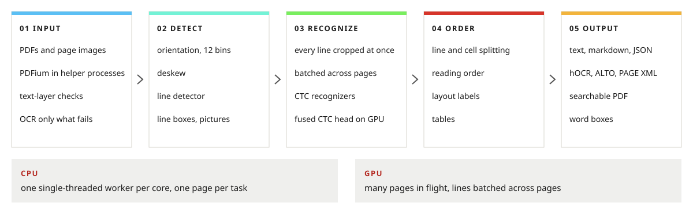
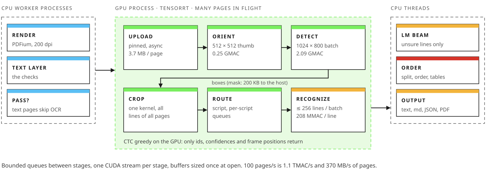

# The Carbon-OCR engine

**Carbon-OCR reads page images and PDFs with the Fullerene models and gives each page's lines, words, blocks and tables in reading order, with their boxes and confidences.** It is a C++20 library (`carbon/`), a command line (`carbon-ocr`), a Python module (`carbon_ocr`) and an OCRmyPDF plugin. On a CPU it runs the models on its own int8 kernels or on ONNX Runtime, with a pinned worker per physical core. On an NVIDIA GPU it runs them through TensorRT, with many pages in flight and every model batched across them.

This document follows a page through the engine, step by step, then covers how the engine spreads its work over CPU cores, the backends it runs models on, the batched GPU pipeline and the options that matter. The models themselves are described in [MODELS.md](MODELS.md). The Fullerene weights are not released yet. The speed figures here come from sets with random weights, since speed does not depend on the weights.

**Contents**

1. A page's path
2. Inputs: images, PDFs and text layers
3. Orientation and deskew
4. Detection
5. Crops, recognition and CTC decoding
6. Splitting, reading order and tables
7. Outputs
8. The CPU layout
9. Backends and the files they run
10. The GPU batched pipeline
11. Options
12. Measured so far

##  A page's path

<picture>
  <source media="(prefers-color-scheme: dark)" srcset="assets/pipeline-dark.svg">
  
</picture>

| step | what happens | header |
|---|---|---|
| input | an image decoded to gray, or a PDF page rendered in a helper process; a born-digital page whose text layer passes the checks is read from that layer instead | `image.h`, `pdf.h`, `textlayer.h` |
| scale | the page resampled once to the detector's scale (long side 1024 px), and a 512 × 512 thumbnail made from that copy | `image.h` |
| orient | `orient` reads the thumbnail; the page is turned by a quarter turn, and only when the model is sure | `engine.h` |
| deskew | a projection search levels what is left, up to 5° | `deskew.h` |
| detect | `det` reads the upright page; the line decoder turns its maps into line and picture boxes; a page of tiny text is detected again at twice the scale | `detect.h` |
| crop | each line cropped to 32 px high by the crop rule, the lines batched by width | `lines.h` |
| recognize | the recognizer gives class scores every 4 px; greedy CTC decoding gives the text, each character's position and probability | `lines.h` |
| split | lines split at wide gaps: column gutters, a table row's cells | `engine.h` |
| order | the order model's reading order, labeled blocks and table cells, or the XY-cut's order | `order.h` |
| output | text, JSON, hOCR, ALTO, PAGE XML, markdown, HTML or a searchable PDF | `output.h` |

Two classes run these steps. `carbon::Engine` (`carbon/engine.h`) reads a list of pages on the CPU, in parallel. `carbon::Pipeline` (`carbon/pipeline.h`) reads a stream of pages with every model batched across the pages in flight, on the CPU or a GPU. Both use the same code for every step, and on the CPU a page comes out of the pipeline exactly as it comes out of the engine. `carbon/carbon.h` includes the whole public API.

```shell
carbon-ocr ocr page.png scan.jpg --set models/fullerene-3M         # text, pages apart by \f
carbon-ocr ocr report.pdf --set models/fullerene-3M --format json  # boxes, words, blocks
carbon-ocr ocr scans/*.png --set models/fullerene-3M --device cuda --engine-cache .engines
```

```python
import carbon_ocr

engine = carbon_ocr.Engine("models/fullerene-3M")   # a worker per physical core
page = engine.ocr([carbon_ocr.load_image("page.png")])[0]
print(page["text"])
```

**Not in the engine yet.** These parts of the design are still to come: the script classifier that routes each line to the recognizer of its script group (today a page is read by one recognizer, `EngineOptions::rec`), the second detection pass on a GPU (section 4), the language models that read unsure lines again, the path for vertical CJK columns, bidirectional reordering for right-to-left text, and TIFF input.

##  Inputs: images, PDFs and text layers

**Images.** `carbon::load_image` reads PNG, JPEG, BMP and PNM files and converts them to 8-bit gray, paper 255 and ink 0. It refuses an image more than 32,768 px on a side. Every later step works on gray pixels.

**PDFs.** PDFium renders a PDF's pages and reads their text, and it runs only in helper processes. `carbon::PdfPool` starts `carbon-pdf` helpers, one per physical core by default, each with its own PDFium, and gives each one request at a time. A page's pixels come back through a shared memory region of the helper's (48 MiB, enough for a Letter or A4 page at 600 dpi); a larger page comes down the helper's pipe. PDFium is not thread-safe, so the helpers are how many pages render at once. A PDF that crashes PDFium takes down one helper, which is started again; the page it was on fails with `carbon::Error`, and the calling program carries on. A page is rendered as shown (its `/Rotate` applied, its annotations drawn, on white paper). `carbon-ocr ocr` renders PDF pages at `--dpi`, 200 by default.

**Text layers.** A born-digital page carries its own text. `carbon::read_text_layer` (`carbon/textlayer.h`) turns the characters PDFium reads into lines, and checks them before trusting them (`TextLayerRule`):

| check | the layer is not used when | default |
|---|---|---|
| enough | the page draws fewer characters than `min_chars`: it is pictures or a scan | 4 |
| bad | more than `max_bad` of them have broken Unicode maps, or are U+FFFD, controls or private-use code points (legacy font encodings, symbol fonts) | 2% |
| invisible | more than `max_invisible` are drawn neither filled nor stroked: an OCR layer over a scan, read again rather than trusted | 0 |
| no ink | more than `max_no_ink` have no pixel at gray 160 or darker under their box on the rendered page: white text, clipped text, glyphs that are not the codes they claim | 5% |

A page that passes skips detection and recognition. Its lines end at PDFium's line breaks and wherever the next character leaves the band of the one before. A line's box is the union of its characters' loose boxes (the font's whole height), its words' boxes are their characters', and its confidence is 1. Its lines are split at wide gaps and put in reading order like OCR's (section 6), and its `source` is `"text layer"`. A PDF page read by OCR says why its layer was not used (`text_layer` in the JSON).

**Hybrid pages.** A page read from its text layer can still hold text the layer does not: a chart's labels, a scanned table, a screenshot. Its image objects at least 32 px on both sides (`HybridRule::min_side`) are kept on an otherwise blank copy of the page, and that copy is read by OCR at the page's own scale. The lines found join the layer's, except those at least half covered by the layer's own lines (text drawn over a picture), and the page's `source` becomes `"hybrid"`. An image inside a form XObject, or a picture drawn as paths, is not seen. `carbon-ocr ocr --text-layer off` reads every page by OCR, and `--hybrid off` leaves pictures unread.

##  Orientation and deskew

Each page is resampled once to the detector's scale, its long side 1024 px (`det_long_side`), with the crop rule's antialiased bilinear filter (section 5). Orientation reads a thumbnail of that copy, fitted into 512 × 512 (`orient_side`) at the top left, as an ink map (1 − gray / 255: ink 1, paper 0) with paper around it.

`orient` gives 13 class scores: 12 bins of 30° (bin k: the text turned 30k° clockwise) and one for vertical CJK columns. The engine turns a page only by a quarter turn, for the 90°, 180° and 270° bins, and only when that bin's softmax probability reaches the turn threshold. The threshold is `EngineOptions::turn_probability` when it is set, else the one stored in the set's orientation model (`carbon.orient.turn_probability`, see [MODELS.md](MODELS.md)), else 0.95. Any other answer leaves the page as it is, since a wrong turn loses the whole page. `OcrPage::rotation` records the turn.

Deskew (`carbon/deskew.h`) levels what is left, without a model. On the page at the detector's scale, it finds the ink (Otsu's threshold), samples it to a fixed number of pixels and projects it onto the rows of the page turned by each candidate angle. The sum of the squared row counts is largest when the lines are level, because their ink falls in few rows and the gaps between them are empty. The search takes 0.5° steps within ±5° (`max_skew`), then 0.05° steps around the best. The page is levelled only when the angle is at least 0.2° (`min_skew`) and its score beats the level page's by 5% (`min_skew_gain` 1.05). `OcrPage::skew` records the angle.

A page's boxes are in the pixels of the page as turned upright and levelled. `carbon-ocr ocr --as-given` skips both steps, so the boxes are the given page's; the OCRmyPDF plugin uses it, because OCRmyPDF turns and levels pages itself.

##  Detection

`det` reads the upright page at the detector's scale as an ink map, padded with paper to a multiple of 32 (its largest stride), and gives four maps at stride 2:

| map | value |
|---|---|
| core | a logit: the line's core band, the middle 40% of its height, shortened at both ends by 0.15 of its height, so the bands of neighboring lines never touch |
| top | at a core pixel, the distance in input pixels from the pixel's center up to the line's top |
| bottom | the same, down to the line's bottom |
| picture | a logit: inside a picture |

The line decoder (`carbon::decode_det`) is C++, not a model. It thresholds the core and picture maps at a probability of 0.5 and takes the 8-connected components of the core band (runs found a 32-pixel word at a time, joined by union-find). A line's top and bottom are the 5% and 95% quantiles of its band pixels' edges, so a slightly slanted line keeps both ends, and its ends lie 0.15 of its height beyond the band's. A band under 2 map pixels is noise, as is a picture under 16. A line's `det_score` is the mean probability over its pixels. The boxes are scaled back to the upright page's pixels, top to bottom, then left to right. `DetRule` holds all of these numbers.

On a GPU the threshold runs on the device (`cuda::threshold_det`) in three launches: a warp votes each 32-pixel word's bits, a scan gives every set pixel its place, and a scatter writes the set pixels' values. Only the bits and those values cross to the host, the same `DetMasks` that `carbon::threshold_det` makes on the CPU, and the host decodes them.

**Detection on idle cores.** When fast cores are idle, `carbon::Engine` detects a page on a shared multi-threaded ONNX Runtime session of `det.onnx` (2, 4 or 6 threads, the widest the idle fast cores fit) instead of the worker's own single-threaded one. `carbon/strips.h` offers a second way: the page's rows cut into strips that run side by side and are stitched back together. Each strip runs on its own rows plus 128 rows of the page above and below (the detector sees 127 px around a pixel), and every cut falls on a multiple of 32, so the stitched maps are the whole page's, byte for byte. The halos cost compute (8 strips of a 1024-row page run 2.5 times the rows), so strips pay only when many cores are idle. `carbon-ocr pages --det auto|one|wide|strips` times one against the other.

**Tiny text: a second pass.** At stride 2, a line under 9 px high at the detector's scale has a core band one or two map rows high, so the detector misses some such lines and places the rest coarsely. When the first pass's median line is under 9 px (`DetRule::second_pass_below`), the engine detects the upright page again at twice the scale (`second_pass_scale`), its long side at most 2048 px (`EngineOptions::second_pass_long_side`), where those lines are about 18 px high. A page that large runs in strips of about a first pass's pixels, one after another (`carbon::run_in_strips`), so a worker's detector holds about a first pass's memory while the stitched maps stay the whole page's. On a page of ordinary print the second pass would only find the same lines again, and where the passes disagree it costs precision, so the median gates it.

The passes are merged line by line (`carbon::merge_passes`). A line of each pass whose boxes overlap by more than 0.5 IoU (`merge_iou`) is one line, kept from the pass whose scale suits it: the second's where its height is under 9 px at the first pass's scale, the first's otherwise. A line only one pass found is kept, one pass's miss being the other's find, except a first-pass box over text the second read as tiny lines (two or more of them mostly inside it, or one that fills most of it), whose text would otherwise be read twice. Pictures are merged the same way. `OcrPage::second_pass` records the pass and `ms.second_pass` its time; `carbon-ocr ocr --second-pass off` keeps one pass. The batched pipeline runs it on the CPU; on a GPU the detector runs only at its fixed batch sizes, so a page there takes no second pass yet.

##  Crops, recognition and CTC decoding

**The crop rule** (`carbon::CropRule`, `carbon/lines.h`). A line box of height h becomes a crop 32 px high. The box gets h × 0.2 of padding above and below and h × 0.3 at each end, is scaled to 32 px, then is widened on both sides into the page to a multiple of 8, the recognizer's width step. The resampling is a triangle filter whose support widens with the downscale (an antialiased bilinear), in 22-bit fixed point: a horizontal pass into an 8-bit intermediate, then a vertical pass. Pixels outside the page read as paper. A crop of light text on a dark ground is flipped (255 − v), so a recognizer always reads dark ink on light paper: the test is whether more of its pixels are at least 48 levels lighter than its ground (the median of its border) than as much darker. Then the crop is padded to its batch's width with its own ground. The CUDA kernel (`cuda::crop_lines`, four launches for every line of every page) gives the same bytes as the CPU code, because the coefficients are computed in IEEE double precision without fused multiply-adds. A recognizer whose file carries its own crop rule (`carbon.crop.height`, `carbon.crop.pad_v`, `carbon.crop.pad_h`) sets those three values.

**Width buckets.** Lines are batched by width. A crop runs at the smallest bucket that holds it: 32, 48, 64, 88, 120, 160, 208, 272, 360, 472, 616, 808, 1056, 1376, 1792 or 2048 px, each at most 1.3 times the one before (`carbon::width_bucket`). A crop wider than 2048 px runs at its own width rounded up to 8. A run meets few shapes, and the padding stays small.

**Recognition.** The recognizer reads a batch of ink maps, `[N, 1, 32, W]`, and gives `[N, classes, W/4]`: a score for every class every 4 px of width, class 0 the CTC blank. Each line reads only the frames of its own crop width, not its bucket's.

**CTC decoding** (`carbon::ctc_greedy`). Greedy decoding takes the best class of each frame (ties go to the lower id), drops blanks and collapses repeats. Each character keeps the frame it starts at and its probability, the highest softmax probability over the frames of its run. On the CPU, `cpu::ctc_argmax` reads along the frames in vectors (AVX2 or NEON), with the exponential as a polynomial in separate multiplies and adds, so every instruction set gives the same bits. A line's text is its characters' strings from the vocabulary, and its confidence is their mean probability. A word is the characters between spaces; its box runs from the frame its first character starts on to the space after it, at the line's height.

**The fused CTC head on the GPU.** A recognizer's last layer, a 1×1 convolution to the classes, has its largest output: the logits of 256 lines of `rec-cjk` at 512 px are about 750 MB in FP16. On a GPU the engine runs the network up to that layer on TensorRT (`<rec>.features.fp16.onnx`). Then `cuda::ctc_head_argmax` computes the head on the tensor cores (FP16 in, FP32 accumulate) and reduces each frame to its best class and softmax probability as the logits are made, so they are never written. Each warp holds 16 frames of a line in registers while the weights stream through shared memory 32 classes at a time. Only ids and probabilities come back, `carbon::ctc_collapse` turns them into lines, and ties go to the lower id, as on the CPU. The kernel takes a head of 128, 192, 256 or 320 input channels. Without the trunk and head files, the GPU runs `<rec>.onnx` and decodes its logits on the device (`cuda::ctc_greedy`).

##  Splitting, reading order and tables

**Splitting** (`carbon::split_lines`, `SplitRule`). A detector or a text layer can run one line across a column gutter or a table row's cells. After recognition, a line is split between two words where the gap is wide: at least 1.5 line heights (`always`), or at least 2.5 times the line's word spacing (`ratio`) and never under 0.6 heights (`min_gap`). The word spacing is the median of the line's gaps under 0.6 heights, or 0.25 heights where it has none. Each piece becomes a line of its own.

**The order model.** `order` reads 16 features for each line (its box, center, width, height and aspect against the page, and text cues such as a list marker or a sentence end) and gives pairwise scores for five relations and one of 13 block labels per line ([MODELS.md](MODELS.md)). `carbon::decode_order` (`carbon/order.h`) turns them into an order: a greedy chain from the page's start over the successor probabilities, then up to 4 repair sweeps (`OrderRule::sweeps`) that move a line wherever the chain's log probability rises. Blocks are the runs of that order whose neighbors are in the same block (a pairwise probability of at least 0.5, `join`), each labeled by the mean of its lines' label probabilities. A table's lines join into cells, and cells into rows and columns, by the same rule, rows numbered top to bottom and columns left to right.

**The XY-cut.** When the chain's mean link probability is under 0.5 (`OrderRule::min_sure`), the engine takes the XY-cut's order instead, keeping the model's blocks over it. Without an order model (or with `use_order` false), the XY-cut alone orders the page (`carbon::reading_order`): the boxes are split again and again at the widest gap across them, a column gutter before the space between lines, then read top to bottom and left to right where no gap is left. `OcrPage::order` says which order a page has: `"model"` or `"xy-cut"`.

**Tables from geometry.** A page without the order model's blocks still gets its tables (`carbon::find_tables`, `TableRule`). Lines share a row where their heights overlap by half of the smaller's. A run of at least 2 rows, at most 2 line heights apart, each with 2 or more cells in columns of their own, is a table, unless its median cell holds more than 30 characters (columns of text, not a table). The page then gets blocks: each table a `Table` block with its cells, read row by row, and the other lines `Text` blocks, a new one where the gap between lines is wider than a line. These blocks have confidence 0, since no model made them.

##  Outputs

Each page comes out as a `carbon::OcrPage`: its size, the `rotation` and `skew` undone, its lines in reading order (box, text, confidence, `det_score`, words), its pictures, its blocks and their cells, its `source` and `order`, whether it took the second detection pass (`second_pass`), and its time per stage in ms (`orient`, which includes deskew, `detect`, `decode`, `second_pass`, `recognize`, `total`). `carbon/output.h` writes pages in the formats other tools read. Where a page has no blocks, it is written as one block of all its lines.

| format | `--format` | what |
|---|---|---|
| text | `text` | each page's lines in reading order, one line a row; pages apart by a form feed |
| JSON | `json` | `{"pages": [...]}`: per page its file and page number, size, rotation, skew, source, order, lines with words, pictures, blocks with cells, and timings |
| hOCR | `hocr` | hOCR 1.2 (XHTML), the format Tesseract writes and OCRmyPDF reads: `ocr_page`, then `ocr_carea` and `ocr_par` per block, `ocr_line` (`ocr_header` for a heading's line, `ocr_caption` for a caption's), `ocrx_word` with `x_wconf` |
| ALTO | `alto` | ALTO XML 4.4: `Page`, `PrintSpace`, `TextBlock` (its label a `LayoutTag`), `TextLine`, `String` (with `WC`) and `SP` |
| PAGE XML | `page` | PAGE XML (2019-07-15), one file a page in `--out-dir`: `TextRegion` (its type from the label), `TextLine`, `Word`, each with `Coords` and `TextEquiv` |
| markdown | `markdown` | headings, paragraphs, lists, tables as HTML from their cells, captions in italics; running headers and footers left out; pages apart by a rule |
| HTML | `html` | an HTML5 document, a `<section class="page">` per page: headings `<h2>`; paragraphs `<p>`, a block's lines joined and a word broken by a hyphen at a line's end joined again; lists `<ul>` and `<ol start>`; tables `<table>` from their cells; captions in `<figure><figcaption>`; running headers and footers `<header>` and `<footer>`, kept; footnotes, formulas and forms in elements of their own |
| searchable PDF | `pdf` | each page's image (8-bit gray) with its words over it as invisible text, each stretched to its box, in a font with no glyphs and a ToUnicode map; `--text-only` writes the text alone |

A searchable PDF needs `--output FILE`. Its pages are a PDF's at `--dpi` and an image's at `--image-dpi` (300). `--text-out FILE` writes the plain text beside any format.

**OCRmyPDF.** `tools/ocrmypdf/carbon_ocrmypdf.py` makes Carbon-OCR the OCR engine of OCRmyPDF 17. For each page OCRmyPDF rasterizes, it runs `carbon-ocr ocr --as-given` and takes hOCR, or, with `--pdf-renderer sandwich`, a text-only PDF to graft onto the page. Its options are `--carbon-set DIR` (else `$CARBON_OCR_SET`), `--carbon-ocr PATH` (else `$CARBON_OCR`, else `PATH`) and `--carbon-workers N` (1 by default, since OCRmyPDF runs pages in parallel itself). It reads the Latin-script languages `rec-latin` covers, named by Tesseract's codes. OCRmyPDF's built-in Tesseract plugin still checks that `tesseract` is installed.

```shell
ocrmypdf --plugin tools/ocrmypdf/carbon_ocrmypdf.py \
    --carbon-set models/fullerene-3M in.pdf out.pdf
```

##  The CPU layout

**A pinned worker per physical core** (`carbon::WorkerPool`, `carbon/parallel.h`). The pool has one thread per physical core, not per hardware thread (a core's two threads share its FMA units), each pinned to its core. Each worker opens its own single-threaded session of every model on its own thread, so its memory sits in its core's NUMA node and running a model never takes a lock. The sessions run with one thread each, so the pool is the only parallelism and the OS never juggles more threads than there are cores; the one exception is detection on idle fast cores (section 4). Idle workers sleep rather than spin.

`carbon::cpu_topology()` reads the machine once (`GetLogicalProcessorInformationEx` on Windows, `/sys` and the cgroup on Linux). It finds the physical cores; Windows processor groups, so a machine with more than 64 logical processors is used whole; the NUMA nodes, which workers alternate between; P-cores before E-cores on hybrid CPUs; and the process's affinity, a container's cpuset and its CPU quota. `carbon-ocr cpus` prints what it found.

**Tasks smaller than a page.** A page starts as one task: orientation, deskew, detection and the line decoder. Its lines then become tasks of their own: one per idle fast core, down to a line a task, or 8 lines a task (`line_batch`) when every core is busy. The last line task to finish splits the page's lines and orders them. A worker runs the tasks it made newest first; with none left, it takes the oldest task of another worker before it starts a new page. So a large job runs about a page per worker, a few pages spread over every core, and the pages in flight finish first. Results come back in the order the pages were given.

**Fast cores first.** On a hybrid CPU, a worker on an E-core takes a task only while every P-core worker is running one. A lone page runs on the P-cores, and a full load on every core.

**The engine's own kernels** (`carbon/cpu.h`). Each kernel has a scalar reference and a version per instruction set, chosen at run time from what the CPU reports (`cpuid` and `xgetbv` on x86-64, the OS on Arm), so one binary runs at its best on Intel, AMD and Arm:

| name | instructions | CPUs |
|---|---|---|
| `avx2` | AVX2 and FMA: FP32, and int8 through exact 16-bit products (`vpmaddwd`) | AMD Zen 2 and 3, Intel before Ice Lake |
| `avx-vnni` | AVX-VNNI: `vpdpbusd` on 256 bits | Intel Alder Lake and later clients, AMD Zen 5 |
| `avx512` | AVX-512 F, BW, VL, DQ and VNNI: `vpdpbusd` on 512 bits | Intel Ice Lake and later servers, AMD Zen 4 and 5 |
| `neon` | Armv8-A Advanced SIMD: FP32; int8 by the scalar reference | every Armv8-A |
| `neon-dot` | the dot product extension (`sdot`) | Armv8.2-A and later: Graviton 2 to 4, Apple M, Neoverse, Cortex-A76 on |

The kernels are an int8 GEMM (uint8 activations with a zero point, int8 weights packed once per instruction set), an FP32 GEMM, a depthwise convolution and CTC's argmax. A convolution reads its input in place, each row of A a list of pieces, one per tap of the kernel, so nothing is copied into columns (no im2col). The output stage runs inside the kernel while the sums are still in L1: scale, bias, a float or uint8 residual, ReLU, then out as float or requantized uint8 (rounded half to even). Every version gives the scalar reference's bits. Integer sums are exact, a float sum is one fused multiply-add after another in the order of k, and the output stage is the same float operations in the same order everywhere, so a page reads the same on Intel, AMD and Arm. Each instruction set's code is compiled with its own flags in its own file, and the rest of the library stays baseline x86-64 or Armv8-A. `CARBON_ISA=<name>` (or `SessionOptions::isa`) picks another set for tests and timing, and `carbon-ocr cpus --gemm` times the GEMM with each one.

##  Backends and the files they run

Every model runs through `carbon::Session` (`carbon/session.h`), so a step never knows which backend runs its model. `carbon-ocr version` lists the backends a build has.

| backend | name | runs | where |
|---|---|---|---|
| native | `native` | the convolutional networks from their ONNX files, int8 (Q/DQ) or FP32; `order` from `order.native.bin` | every build, on the CPU |
| ONNX Runtime | `ort` | any ONNX file on the CPU; the engine gives it the FP32 files | builds with ONNX Runtime (1.31.0, pinned) |
| TensorRT | `trt` | an ONNX file in its own precision: TensorRT 11 builds strongly typed networks, so an FP16 file runs in FP16 and a Q/DQ file in INT8 | builds with CUDA 12.9 or 13.x and TensorRT 11, on an NVIDIA GPU |

**The native backend.** It reads the ONNX file itself and compiles the nodes into fused layers: a convolution takes the ReLU after it and a residual Add, so its output stage does the bias, the residual and the ReLU while the sums are in L1. Its layers are Conv (dense or depthwise), Resize (nearest, whole scales), AveragePool, ReduceMean over the image, Gemm and Add, and it refuses any other op when the file is opened. Every tensor is NHWC with a border of zeros as wide as its readers' padding, so an output row of a convolution is one GEMM over a grid of its input. A Q/DQ file runs in int8: a first pass reads the QuantizeLinear and DequantizeLinear nodes away into int8 weights with per-channel scales and a uint8 scale and zero point for each tensor kept in uint8. Convolutions on uint8 inputs then run on the int8 kernels, and a residual Add joins its convolution in float, quantized once. `order`, a transformer, runs natively from `order.native.bin`: its weights, and its forward pass written out in C++ on the FP32 GEMM. `CARBON_NATIVE_PROFILE=1` prints each layer's time, and `carbon-ocr compare MODEL` runs a file on the native backend and on ONNX Runtime and prints how far apart their outputs are.

**Which file, on which backend** (`carbon::open_set_model`, `carbon::choose_set_model`). With no backend given, the engine picks per model:

| model | picked | `backend = native` | `backend = ort` |
|---|---|---|---|
| `orient`, `det`, the recognizer | native on `<m>.int8.onnx` where the set has it; else ONNX Runtime on `<m>.onnx` where it is built in; else native on `<m>.onnx` | native on `<m>.int8.onnx`, else `<m>.onnx` | ONNX Runtime on `<m>.onnx` |
| `order` | native on `order.native.bin`; else ONNX Runtime on `order.onnx` | the same | ONNX Runtime on `order.onnx` |
| `det` on idle cores | ONNX Runtime on `det.onnx`, 2, 4 or 6 threads | not used | the same |

`EngineOptions::order_model` names another order model: a `.bin` file runs natively, an ONNX file on ONNX Runtime. On one core the native int8 recognizer runs 2.5 times as fast as ONNX Runtime in FP32, and a native FP32 run is slower than ONNX Runtime's, so the int8 files are the CPU's path. ONNX Runtime sessions keep their memory arena on (`SessionOptions::cpu_arena`): a session reuses its runs' activation memory, which grows to the largest batch it has run, a size the width buckets bound.

**TensorRT.** A model with free dimensions needs optimization profiles, each a range for every free input. Each profile gets an execution context of its own, so a run never switches profiles, and a run takes the first profile exact for its shapes, else the first that holds them. A profile whose ranges are all exact is a bucket: TensorRT tunes for its one shape, and its runs are captured as CUDA graphs on the first run and replayed after (a graph per set of buffer addresses, up to 8). `Session::enqueue` runs on device buffers, queued on the caller's stream, and returns without waiting.

**Engine caches.** Building a TensorRT engine takes minutes. With `SessionOptions::engine_cache` (`--engine-cache DIR`), built engines are kept on disk, keyed by the model's bytes, the profiles, the build settings (workspace and optimization level), the GPU (its name and compute capability) and TensorRT's version, beside a timing cache that makes rebuilds quicker. A key that changes builds a new engine; without a cache directory, every open builds. `optimization_level` (0 to 5, default 3) trades build time for kernel search, and `cuda_graphs` turns the graph replay off.

##  The GPU batched pipeline

<picture>
  <source media="(prefers-color-scheme: dark)" srcset="assets/fig-gpu-flow-dark.svg">
  
</picture>

`carbon::Pipeline` (`carbon/pipeline.h`) takes pages with `submit` and gives their results with `next`, in the order given, while its stages work on the pages in flight. At most `in_flight` pages (32) are in it at once, and `submit` waits for room. Each model stage is a thread of its own, on a GPU with a CUDA stream of its own, joined to the others by queues, so orientation, detection and recognition of different pages run at the same time. `ocr(pages)` does it all for a list. The figure shows the whole design; script routing and the language model's beam are not in the engine yet.

| stage | runs on | what |
|---|---|---|
| prepare | CPU threads | each page at the detector's scale, and its thumbnail |
| orient | a thread and a stream | up to `page_batch` thumbnails in one run, made FP16 on the device; the turn each page asks for |
| upright | CPU threads | the quarter turn and deskew; the detector's padded size |
| detect | a thread and a stream | up to `page_batch` pages of one padded size in one run, uploaded as uint8 and made an FP16 ink map on the device (`cuda::ink_map`); the maps thresholded on the device and only the masks decoded on the host |
| recognize | a thread and a stream | every line of the pages waiting, from any of them, by width bucket, up to `line_batch` a run: the pages uploaded once for the group, every line cropped in one set of launches, the trunk and the fused CTC head; only ids and probabilities come back |
| assemble | CPU threads | lines split, the order model (on the CPU) or the XY-cut, blocks and tables |

**Exact shapes.** On a GPU every model runs on TensorRT from the set's FP16 files. Detection pads each page to one of three sizes at a long side of 1024: 1024 high by 800 wide (portrait), 800 high by 1024 wide (landscape), or 1024 square. Pages batch only with pages of the same size, in powers of two up to `page_batch` (1, 2, 4 and 8 by default). Each size and batch is an exact profile, and so a CUDA graph. Orientation has an exact profile per batch size too. The recognizer has a profile per width bucket, 32 to 2048 px, for batches of 1 to `line_batch` (256). Every buffer a model reads or writes is allocated at open at its largest, so its address stays fixed and the graphs replay. A page goes to the device as its thumbnail, its copy at the detector's scale and its upright self, each once and the last two as uint8 pixels; only detection's masks and recognition's ids and probabilities come back.

**On the CPU** (`Device::kCpu`), the same stages run the set's files as the CPU engine opens them, each model run on `model_threads` threads, and every page's result is the CPU engine's. With no `device` given, the pipeline runs on a GPU where the build has CUDA and TensorRT and a GPU is present (`carbon::cuda_pipeline_available()`), else on the CPU. `carbon-ocr ocr --device cuda` reads its pages through the pipeline on the GPU (`--batch` sets `page_batch`, `--in-flight` and `--engine-cache` the others), with PDF pages rendered by the helpers as before. `stats()` counts the runs and what they held. The Python module's `Pipeline` runs on the CPU, because the module is built without TensorRT for now.

##  Options

`carbon::EngineOptions` (`carbon/engine.h`):

| field | default | what |
|---|---|---|
| `pool` | one worker per physical core, pinned | `PoolOptions`: `workers` (0: one per physical core, at most a CPU quota), `pin`, `fast` (the workers that count as fast; -1: those on the fastest class of core) |
| `backend` | none: per model, as in section 9 | one backend for every model: `kNative` or `kOnnxRuntime` |
| `rec` | `"rec-latin"` | the recognizer: `<set>/<rec>.onnx` and `<rec>.vocab.json` |
| `det_long_side` | 1024 | the page's long side at detection, padded to a multiple of 32 |
| `second_pass_long_side` | 2048 | the page's long side at most, in the second detection pass |
| `orient_side` | 512 | the side of the thumbnail orientation reads |
| `turn_probability` | none: the set's own, else 0.95 | how sure orientation must be to turn a page |
| `deskew`, `max_skew`, `min_skew`, `min_skew_gain` | true, 5.0°, 0.2°, 1.05 | deskew, and when it levels a page |
| `line_batch` | 8 | lines a recognition task holds when every core is busy |
| `use_order`, `order_model` | true, empty | the order model, or another file in its place; without one, the XY-cut |
| `order` | `OrderRule` | `min_sure` 0.5, `sweeps` 4, `join` 0.5 |
| `split` | `SplitRule` | `min_gap` 0.6, `ratio` 2.5, `space` 0.25, `always` 1.5 (line heights); none: no splitting |
| `tables` | `TableRule` | `min_rows` 2, `min_cols` 2, `row_overlap` 0.5, `max_row_gap` 2.0, `max_cell_chars` 30; none: no tables from geometry |
| `det` | `DetRule` | `core_threshold` and `picture_threshold` 0.5, `min_core_pixels` 2, `min_picture_pixels` 16, `edge_quantile` 0.05; the second pass: `second_pass_below` 9 px (0: never), `second_pass_scale` 2, `merge_iou` 0.5 |
| `crop` | `CropRule` | `height` 32, `width_step` 8, `frame_px` 4, `pad_v` 0.2, `pad_h` 0.3, `flip_margin` 48; a recognizer's own `carbon.crop.*` values set `height`, `pad_v` and `pad_h` |

`carbon::PipelineOptions` (`carbon/pipeline.h`) adds:

| field | default | what |
|---|---|---|
| `engine` | `EngineOptions{}` | the recognizer, crop rule, orientation, deskew, order, splitting and tables; `engine.backend` for the CPU device |
| `device` | none: the GPU where available, else the CPU | `Device::kCpu` or `Device::kCuda` |
| `page_batch` | 8 | pages an orientation or detection run holds at most |
| `line_batch` | 256 | lines a recognition run holds at most |
| `in_flight` | 32 | pages in the pipeline at once |
| `threads`, `model_threads` | 0, 0 | CPU threads preparing and assembling pages, and a CPU model run's threads; 0: the physical cores |
| `gpu` | 0 | the CUDA device |
| `engine_cache` | empty | where TensorRT's built engines are kept; empty: built at every open |
| `fused_head` | true | the recognizer's trunk and the fused CTC head where the set has `<rec>.features.fp16.onnx` and `<rec>.head.bin` |

The text layer's checks are `TextLayerRule` (`min_chars` 4, `max_bad` 0.02, `max_invisible` 0, `max_no_ink` 0.05, `ink` 160) and hybrid pages' are `HybridRule` (`min_side` 32, `max_covered` 0.5), both in `carbon/textlayer.h`. `SessionOptions` (`carbon/session.h`) sets a single model's `threads`, `cpu_arena`, `isa`, and for TensorRT its `device`, `profiles`, `engine_cache`, `workspace_bytes` (1 GiB), `optimization_level` and `cuda_graphs`. Two environment variables matter: `CARBON_ISA` picks the kernels' instruction set, and `CARBON_NATIVE_PROFILE=1` times the native backend's layers. A `carbon::Engine` is used from one thread; a `carbon::Session` is not safe to run from two threads at once, so each worker has its own.

##  Measured so far

On a laptop with an Intel Core i7-13620H (6 P-cores, 4 E-cores) and an RTX 4060 Laptop GPU, 27 to 30 October 2026, with random weights: speed does not depend on them. The page timings are `carbon-ocr pages`, which runs a set's files the way the CPU engine runs a page.

| what | measured |
|---|---|
| `rec-latin` on one CPU core | 8 lines of 512 px in 11.4 ms in int8 on the engine's own kernels; 16 lines in 65 ms on ONNX Runtime 1.31 in FP32 (AVX2), 62 GMAC/s, about 80% of the core's peak |
| `fullerene-3M` on one CPU core | a Latin page in 98 ms, every model included, the set's int8 files on the engine's own kernels: 10.2 pages a second per core |
| `fullerene-10M` on one CPU core | a CJK page in 271 ms |
| across CPU cores | no loss per clock cycle up to 4 workers; 47.4 pages a second on 10 workers, where the laptop's power limit lowers its clock as cores load |
| one page alone | 40 ms on the 6 P-cores, 129 ms on one |
| `rec-latin` on the GPU | 256 lines of 512 px on device buffers in 5.1 ms in FP16 (12.8 TMAC/s), 13.6 ms in FP32 and 2.98 ms in INT8 (TensorRT 11.4, CUDA 13.4.1) |
| the fused CTC head | 1.6 to 2.1 times as fast as the cuBLAS GEMM and argmax it replaces, and it never writes the logits |
| CUDA graphs | one 224-px line in 0.164 ms instead of 0.242 ms |
