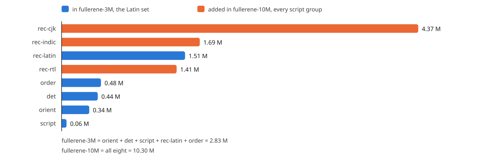
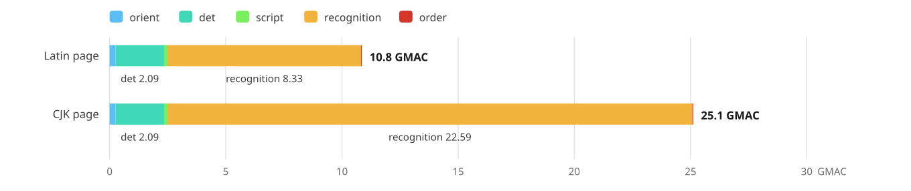
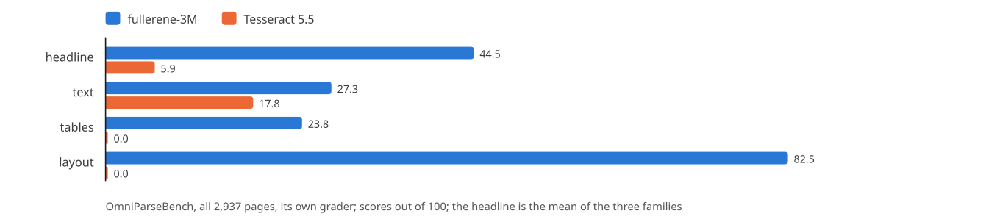
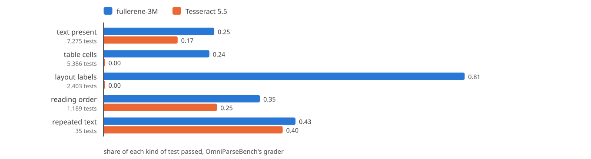
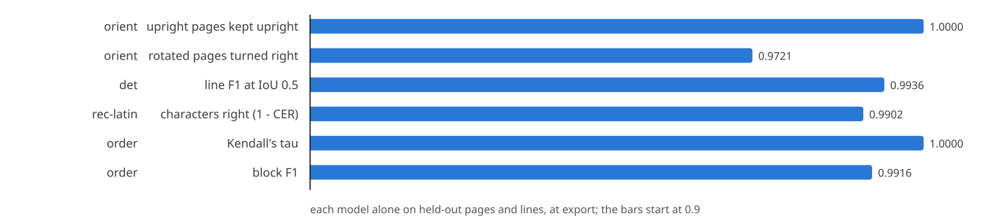
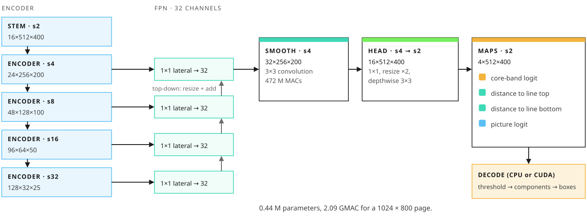
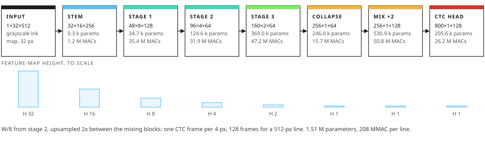

# The Fullerene models

**Fullerene is the family of small networks Carbon-OCR reads with: eight of them, 10.3 M parameters in all.** One finds a page's orientation, one finds its lines, one tells which script each line is in, four read the lines (one per script group), and one puts the lines in reading order and labels the page's blocks. They ship in two sets: `fullerene-3M` for Latin script and `fullerene-10M` for every script.

This document is a reference for running them: each model's job, its input and output tensors, its layers, parameters and compute, the files of a set, the metadata the engine reads from them, and which precision runs on which backend. **The Latin set, `fullerene-3M`, is out on [Hugging Face](https://huggingface.co/CarbonResearchLabs/fullerene-3M)**, under the Carbon-OCR OpenRAIL-AMS license; the other script groups follow. Every parameter and MAC count here is the design's, counted from the layer shapes with each RepVGG block folded, as in the shipped files. How the engine runs the models is in [ENGINE.md](ENGINE.md).

**Contents**

1. The family
2. What every model shares
3. Page orientation: `orient`
4. Line detection: `det`
5. Script routing: `script`
6. Line recognition: the `rec` models
7. Reading order and layout: `order`
8. Language models and formula models
9. The files of a set
10. The metadata and checks the engine reads
11. Precisions and backends
12. Terms

##  The family

| model | job | in | out | parameters | compute per call | set |
|---|---|---|---|---|---|---|
| `orient` | page orientation | a 512 × 512 thumbnail | 12 angle bins and a vertical class | 0.34 M | 255 MMAC a page | both |
| `det` | line detection | the page at 1024 × 800 | four maps at stride 2 | 0.44 M | 2.09 GMAC a page | both |
| `script` | script group of a line | a 32 × 512 crop | one of 6 groups | 0.06 M | 3.7 MMAC a line | both |
| `rec-latin` | read Latin, Cyrillic and Greek lines | a 32 × W crop | 800 class scores per 4 px | 1.51 M | 208 MMAC a 512-px line | both |
| `rec-rtl` | read Arabic-script and Hebrew lines | a 32 × W crop | 400 class scores per 4 px | 1.41 M | 195 MMAC a line | 10M |
| `rec-indic` | read Indic and Southeast Asian lines | a 32 × W crop | 1,500 class scores per 4 px | 1.69 M | 231 MMAC a line | 10M |
| `rec-cjk` | read Chinese, Japanese and Korean lines | a 32 × W crop | 12,000 class scores per 4 px | 4.37 M | 565 MMAC a line | 10M |
| `order` | reading order, block labels, table structure | 16 features per line | an order, 13 block labels, table cells | 0.48 M | 22 MMAC a 40-line page | both |

**Two sets.** A set is shipped and versioned whole, and named by its parameter count rounded to the nearest million, halves up:
- **`fullerene-3M`**, the Latin set, 2.83 M parameters: `orient`, `det`, `script`, `rec-latin` and `order`.
- **`fullerene-10M`**, every script, 10.30 M parameters: the Latin set plus `rec-rtl`, `rec-indic` and `rec-cjk`.

<picture>
  <source media="(prefers-color-scheme: dark)" srcset="assets/fig-params-dark.svg">
  
</picture>

**What a page costs.** A typical page is US Letter at 200 dpi (1700 × 2200 px) with 40 lines, each crop 512 px wide after its padding:

| stage | Latin page | CJK page |
|---|---|---|
| `orient`, once | 0.25 GMAC | 0.25 GMAC |
| `det`, once | 2.09 GMAC | 2.09 GMAC |
| `script`, 40 lines | 0.15 GMAC | 0.15 GMAC |
| the recognizer, 40 lines | 8.33 GMAC (`rec-latin`) | 22.59 GMAC (`rec-cjk`) |
| `order`, once | 0.02 GMAC | 0.02 GMAC |
| **total** | **10.84 GMAC** | **25.10 GMAC** |

Recognition is 77% of a Latin page and 90% of a CJK page, which is why the recognizers get the most design effort and the first GPU kernels (the fused CTC head). Decoding (connected components, CTC's collapse, the order chain), rendering and image decoding are not counted: they are C++ and CUDA, and timed per stage in each page's result.

<picture>
  <source media="(prefers-color-scheme: dark)" srcset="assets/fig-page-compute-dark.svg">
  
</picture>

The engine does not run all of this yet: it reads every line of a page with one recognizer (`rec-latin` by default), so `script` and the routing it drives are still to come ([ENGINE.md](ENGINE.md), section 1).

**Trained, end to end.** The trained `fullerene-3M` ([on Hugging Face](https://huggingface.co/CarbonResearchLabs/fullerene-3M)), read by the engine on all 2,937 pages of OmniParseBench and graded by the benchmark's own grader, against Tesseract 5.5 with its defaults, on the same laptop (3 November 2026): a headline of **43.5** against 5.9 (text 26.2 against 17.8; tables 23.6 and layout 80.6, which Tesseract, writing text alone, scores 0), and **3.79 pages a second on one core** against 0.76 (a median page of 223 ms against 947), 12.3 against 3.0 in six processes. Its FP16 files on the CPU score the same. Each model alone, on held-out pages and lines: `orient` keeps every upright page and turns 97.2% of the rotated ones right at a threshold of 0.65; `det` 0.9936 line F1; `rec-latin` 0.98% CER on held-out print; `order` a Kendall's tau of 1.0 and block F1 0.9916.

<picture>
  <source media="(prefers-color-scheme: dark)" srcset="assets/fig-bench-dark.svg">
  
</picture>

<picture>
  <source media="(prefers-color-scheme: dark)" srcset="assets/fig-bench-types-dark.svg">
  
</picture>

<picture>
  <source media="(prefers-color-scheme: dark)" srcset="assets/fig-bench-models-dark.svg">
  
</picture>

##  What every model shares

- **Ink maps in.** The image models read float32 ink maps, NCHW with one channel: 1 − gray / 255, so ink is 1 and paper 0. The engine makes them from 8-bit gray pages on the CPU, or on the GPU (`cuda::ink_map`) in FP16 for TensorRT's files.
- **Plain operations.** The convolutional networks use ReLU, never HardSwish, and their channel counts are multiples of 16, for tensor cores and SIMD lanes.
- **Folded.** Each convolutional stage is a RepVGG-style block: a 3×3, a 1×1 and an identity branch, each with batch norm, summed. In the shipped files every block is folded into one 3×3 convolution with a bias, so the graph is a chain of plain convolutions, which TensorRT, ONNX Runtime and the engine's native backend all fuse well. The parameter counts here are the folded ones.
- **CPU and GPU pull in different directions.** Depthwise convolutions are cheap on a CPU and memory-bound on a GPU; dense 3×3 convolutions are the reverse. So the networks are dense 3×3 convolutions, with depthwise ones only where they run on one row (the recognizers' mixing blocks) or on 16 channels (the detector's head).
- **ONNX with free dimensions.** Every model is ONNX opset 17, its batch free, and its width (the recognizers), its height and width (`det`) or its line count (`order`) free too.

**Fixed numbers.**

| quantity | value | why |
|---|---|---|
| render resolution | 200 dpi | enough for 6 pt text; a Letter page is 1700 × 2200 px |
| `det` input | long side 1024, padded to a multiple of 32 | a 10 pt line is about 14 px high at this scale |
| `det` output stride | 2 | lines 6 px apart stay separate |
| line crop height | 32 px | one height for every recognizer |
| crop padding | 0.2 of the line's height above and below, 0.3 at each end | ascenders and descenders survive the detector's box errors |
| CTC frame | 4 px of crop width | a Latin letter is about 9 px wide in a 32-px crop, and CTC needs a frame per character plus a blank between repeats |
| width buckets | 32 to 2048 px, each at most 1.3 times the last | padding stays small, and a batch meets few shapes |
| turn threshold | the orientation model's own, else 0.95 | a wrong turn loses the page |

##  Page orientation: orient

**Job.** Before detection, find how the page is turned, so a scan fed sideways or upside down reads at all, and so a page of vertical CJK columns can go to a vertical path.

**In and out.** Input `x`, `[N, 1, 512, 512]`: the thumbnail's ink map, the page at the detector's scale fitted into 512 × 512 at the top left, paper around it. Output `logits`, `[N, 13]`: classes 0 to 11 are bins of 30° (class k: the text turned 30k° clockwise), and class 12 is vertical CJK columns. The engine turns a page only by a quarter turn (classes 3, 6 and 9) and only when that class's softmax probability reaches the model's turn threshold, `carbon.orient.turn_probability` in the file's metadata, else 0.95. What is left, up to 5°, is levelled by deskew, which is not a model. The vertical class is not acted on yet.

| layer | output (C × H × W) | parameters | MACs |
|---|---|---|---|
| 3×3 convolution, stride 2, 16 channels | 16 × 256 × 256 | 160 | 9.4 M |
| 3×3 convolution, stride 2, 32 channels | 32 × 128 × 128 | 4,640 | 75.5 M |
| 3×3 convolution, stride 2, 64 channels | 64 × 64 × 64 | 18,496 | 75.5 M |
| 3×3 convolution, stride 2, 96 channels | 96 × 32 × 32 | 55,392 | 56.6 M |
| 3×3 convolution, stride 2, 128 channels | 128 × 16 × 16 | 110,720 | 28.3 M |
| 3×3 convolution, stride 2, 128 channels | 128 × 8 × 8 | 147,584 | 9.4 M |
| global average pool | 128 | 0 | 0 |
| linear to 13 classes | 13 | 1,677 | 0.0 M |
| **total** | | **0.34 M** | **255 M** |

**Why this shape.** Orientation is a property of the whole page's texture (the direction of its lines, the shape of its ascenders), not of fine detail. Six stride-2 convolutions down to an 8 × 8 grid see enough, at about a tenth of the detector's cost.

##  Line detection: det

<picture>
  <source media="(prefers-color-scheme: dark)" srcset="assets/fig-det-dark.svg">
  
</picture>

**Job.** Find every text line on the page, and its pictures, as boxes.

**In and out.** Input `x`, `[N, 1, H, W]`: the upright page's ink map at a long side of 1024, H and W padded to multiples of 32 (1024 × 800 for a Letter page). Output `maps`, `[N, 4, H/2, W/2]`, at stride 2:

| map | value |
|---|---|
| 0, core | a logit: the line's core band, the middle 40% of its height, shortened at both ends by 0.15 of its height, so the bands of neighboring lines never touch |
| 1, top | at a core pixel, the distance in input pixels from the pixel's center up to the line's top |
| 2, bottom | the same, down to the line's bottom |
| 3, picture | a logit: inside a picture |

Map pixel (r, c) covers input rows 2r to 2r + 1 and columns 2c to 2c + 1, and is in a band when its center is. The engine's line decoder (`carbon/detect.h`, C++, no model) thresholds the core map, takes its connected components and reads each line's box from the distance maps ([ENGINE.md](ENGINE.md), section 4).

| block | output (C × H × W) | parameters | MACs |
|---|---|---|---|
| stem: 3×3, stride 2 | 16 × 512 × 400 | 160 | 29.5 M |
| stride 4: 3×3 stride 2, then 3×3 | 24 × 256 × 200 | 8,688 | 442.3 M |
| stride 8: 3×3 stride 2, then 3×3 | 48 × 128 × 100 | 31,200 | 398.1 M |
| stride 16: 3×3 stride 2, then 3×3 | 96 × 64 × 50 | 124,608 | 398.1 M |
| stride 32: 3×3 stride 2, then 3×3 | 128 × 32 × 25 | 258,304 | 206.5 M |
| FPN: 1×1 laterals to 32 channels at each stride, summed top-down | 32 × 256 × 200 | 9,600 | 72.1 M |
| FPN smoothing: 3×3 at stride 4 | 32 × 256 × 200 | 9,248 | 471.9 M |
| head: 1×1 to 16, resize ×2, depthwise 3×3, 1×1 to 4 maps | 4 × 512 × 400 | 756 | 68.8 M |
| **total** | | **0.44 M** | **2.09 G** |

**Why this shape.** An encoder down to stride 32 gives the context to tell a line from a table rule or a picture's edge. A light 32-channel FPN brings that context back to stride 4, where most of the cost is (the smoothing convolution is a fifth of the model). The head goes on to stride 2, because at stride 4 lines 6 px apart would merge. The detector sees 127 px around each pixel, which is why a page can be detected in strips with 128-row halos and still give the whole page's maps, byte for byte (`carbon/strips.h`).

##  Script routing: script

**Job.** Route each line to the recognizer of its script group, so a page that mixes scripts reads each line with the right model.

**In and out.** Input `[N, 1, 32, W]`: the same crop the recognizers read, which the model's first operation, a 2×2 average pool with no parameters, takes to 16 px high. Output `[N, 6]`: group scores, four for the recognizers' groups (Latin, RTL, Indic and Southeast Asian, CJK) and two reserved. In the design, a line under 0.95 confidence is read by its two most likely recognizers, and the more confident reading wins. The engine does not run `script` yet; in `fullerene-3M` every line goes to `rec-latin` regardless.

| layer | output (C × H × W) | parameters | MACs |
|---|---|---|---|
| average pool 2×2 | 1 × 16 × 256 | 0 | 0 |
| 3×3 convolution, stride 2, 16 channels | 16 × 8 × 128 | 160 | 0.1 M |
| 3×3 convolution, stride 2, 32 channels | 32 × 4 × 64 | 4,640 | 1.2 M |
| 3×3 convolution, stride 2, 64 channels | 64 × 2 × 32 | 18,496 | 1.2 M |
| 3×3 convolution, stride 2 × 1, 64 channels | 64 × 1 × 32 | 36,928 | 1.2 M |
| global average pool | 64 | 0 | 0 |
| linear to 6 groups | 6 | 390 | 0.0 M |
| **total** | | **0.06 M** | **3.7 M** |

**Why this shape.** Script is visible in a few letters, so the model is about a twentieth of a recognizer and adds 2% to a line's cost. It reads the crop at half size, 16 px high, where the groups' letter shapes still differ, and pooling over the whole width makes it indifferent to the line's length.

##  Line recognition: the rec models

<picture>
  <source media="(prefers-color-scheme: dark)" srcset="assets/fig-rec-dark.svg">
  
</picture>

**Job.** Read a line: turn its 32-px crop into a sequence of characters. The four recognizers share one design and differ in their vocabularies and, for CJK, their width.

**In and out.** Input `x`, `[N, 1, 32, W]`: a batch of crops' ink maps, W a multiple of 8 (a width bucket). Output `logits`, `[N, classes, W/4]`: a score for every class every 4 px of width, class 0 the CTC blank. The class strings are in `<rec>.vocab.json`. Greedy CTC decoding takes the best class per frame, drops blanks and collapses repeats; on a GPU it runs fused with the last layer, from the trunk's output `features`, `[N, k, W/4]` in FP16 ([ENGINE.md](ENGINE.md), section 5).

`rec-latin`, layer by layer, for a 32 × 512 crop:

| block | output (C × H × W) | parameters | MACs |
|---|---|---|---|
| stem: 3×3, stride 2 | 32 × 16 × 256 | 320 | 1.2 M |
| stage 1: 3×3 stride 2, then 3×3 | 48 × 8 × 128 | 34,656 | 35.4 M |
| stage 2: 3×3 stride 2, then 3×3 | 96 × 4 × 64 | 124,608 | 31.9 M |
| stage 3: 3×3 stride (2, 1), then 3×3 | 160 × 2 × 64 | 368,960 | 47.2 M |
| collapse the height: 2×3 | 256 × 1 × 64 | 246,016 | 15.7 M |
| mixing block 1: depthwise 1×9, 1×1 to 512, 1×1 back to 256, plus the input | 256 × 1 × 64 | 265,472 | 16.9 M |
| upsample the width 2×, nearest | 256 × 1 × 128 | 0 | 0 |
| mixing block 2: the same | 256 × 1 × 128 | 265,472 | 33.8 M |
| CTC head: 1×1 to 800 classes | 800 × 1 × 128 | 205,600 | 26.2 M |
| **total** | | **1.51 M** | **208 M** |

**Why this shape.**
- **The backbone** is dense 3×3 convolutions, which a GPU runs on its tensor cores at full rate. It halves the height and width together down to W/8 at stage 2; stage 3 halves only the height, since a line is wide and short and its characters are along the width. So stages 2 and 3 both run at W/8's positions, where the same weights cost half the MACs they would at W/4.
- **The collapse** takes the last two rows to one with a 2×3 convolution, so the model reads the full height of every letter once, at W/8.
- **The frames.** The backbone ends at a frame per 8 px, and a Latin letter is about 9 px wide in a 32-px crop: too few frames for CTC, which needs a frame per character and a blank between repeats. The first mixing block runs at W/8; then a nearest 2× upsample, with no parameters, doubles the frames to W/4, and the second block gives each frame of a pair its own context. That costs 30 MMAC a line (14% of the model), against 320 MMAC a line for a backbone kept at W/4 through stages 2 and 3. With both mixing blocks before the upsample, each pair of frames would get the same scores, which is 8-px frames again.
- **The mixing blocks** see ±48 px of the line on top of the backbone's own reach (±32 px for the first, at W/8, and ±16 px for the second, at W/4), enough to reorder Indic vowel signs locally. They are the model's only depthwise layers, used where depthwise is cheap: on one row.
- **The head** is a 1×1 convolution to the classes: 14% of `rec-latin`, and most of `rec-cjk`, which is why that one is factorized.

**The four recognizers.**

| recognizer | classes | channels (stem, stage 1, 2, 3, mixing) | head | parameters | MACs at 512 px |
|---|---|---|---|---|---|
| `rec-latin` | 800 | 32, 48, 96, 160, 256 | 1×1 to 800 | 1.51 M | 208 M |
| `rec-rtl` | 400 | 32, 48, 96, 160, 256 | 1×1 to 400 | 1.41 M | 195 M |
| `rec-indic` | 1,500 | 32, 48, 96, 160, 256 | 1×1 to 1,500 | 1.69 M | 231 M |
| `rec-cjk` | 12,000 | 32, 48, 128, 192, 320 | 1×1 to 192, then to 12,000 | 4.37 M | 565 M |

Compute grows linearly with the width: a 256-px line costs half as much (104 MMAC for `rec-latin`).

**`rec-cjk`.** Han characters are a full em wide and there are thousands of them, so `rec-cjk` is wider in its middle stages (128, 192 and 320 channels), and its head is factorized: a 1×1 down to 192 channels, then a 1×1 to the 12,000 classes. Even so, that last layer is 2.32 M parameters and 295 MMAC a line, over half the model's parameters and 52% of its compute. That makes it the first candidate for INT8, and the model that gains most from the fused CTC head on a GPU: the logits of 256 lines of 512 px would be about 750 MB in FP16, and the fused kernel never writes them.

**Vocabularies.**

| group | classes | contents |
|---|---|---|
| Latin | 800 | Latin with diacritics as precomposed letters, Cyrillic, Greek, digits, punctuation, symbols, Vietnamese and Yoruba tone marks |
| RTL | 400 | Arabic, Persian, Urdu, Pashto and Kurdish letters; Hebrew with niqqud; plus Latin |
| Indic and Southeast Asian | 1,500 | Devanagari, Bengali, Tamil, Telugu, Kannada, Malayalam, Gujarati, Gurmukhi, Odia, Sinhala, Thai, Lao, Khmer, Myanmar, Georgian, Armenian, Ethiopic; plus Latin |
| CJK | 12,000 | Simplified and Traditional Chinese, kana, Hangul, plus Latin |

The classes are Unicode NFC text, with canonical quotes, dashes and spaces. A right-to-left recognizer reads in visual order; putting its text in logical order (the Unicode bidirectional algorithm) is not in the engine yet. The Indic recognizer's classes are in logical order.

##  Reading order and layout: order

**Job.** Put the page's lines in reading order (columns, sidebars, captions, footnotes), group them into labeled blocks, and recover table structure.

**In.** Input `x`, `[1, n, 16]`: 16 features for each of the page's n lines (`carbon::order_features`, `carbon/order.h`), from its box in page pixels and its text:

| feature | value |
|---|---|
| 0 to 3 | the box, over the page's width and height |
| 4, 5 | its center, likewise |
| 6 | its width over the page's |
| 7 | the log of its height over the page's median line height |
| 8 | the log of its aspect, width over height |
| 9 | the page's median line height over the page's height |
| 10 | log(1 + its characters) |
| 11 | the share of its characters that are digits |
| 12 | 1 if it starts with a list marker: a bullet or dash, or 1 to 3 digits, a letter or a roman numeral, then "." or ")" (or in brackets) |
| 13 | 1 if it ends with a hyphen |
| 14 | 1 if it ends a sentence: `.` `!` `?` `:` `;` or an ellipsis (CJK's too), before any closing quotes or brackets |
| 15 | 1 if it starts with a capital: Latin, Greek or Cyrillic |

**Out.** Six outputs, logits, with token 0 the page's start and tokens 1 to n its lines: `successor`, `[1, n+1, n+1]` (row i, the line after line i; column 0, the page's end); `same_block`, `table_row`, `table_col` and `table_cell`, `[1, n, n]` each, symmetric; and `labels`, `[1, n, 13]`, the label of each line's block: Text, Section-Header, Page-Header, Page-Footer, List-Group, Table, Caption, Footnote, Table-Of-Contents, Form, Picture, Formula, Other.

| block | output | parameters | MACs (40 lines) |
|---|---|---|---|
| line features: linear 16 → 128 | 128 per line | 2,176 | 0.1 M |
| transformer layer 1: attention (4 heads), feed-forward 256 | 128 per line | 131,968 | 5.8 M |
| transformer layer 2: the same | 128 per line | 131,968 | 5.8 M |
| transformer layer 3: the same | 128 per line | 131,968 | 5.8 M |
| pairwise heads: successor, same block, table row, table column, table cell | 41 × 41 and 40 × 40 each | 81,920 | 4.4 M |
| block labels: linear to 13 | 13 per line | 1,677 | 0.1 M |
| **total** | | **0.48 M** | **22 M** |

The start token is the embedding of a feature vector of −1s, which no line has. Each layer is a pre-norm attention and a GELU feed-forward, each with its residual, and the layer norms have no weights of their own; a last layer norm follows the third layer. Each pairwise head is a bilinear form, a 128 × 128 matrix with no bias: the successor's over every token, the others over the lines, made symmetric.

**Why this shape.** Reading order is a relation between lines, not a property of pixels, so the model reads the lines' geometry and a few text cues rather than the image: attention over every line of the page, then a bilinear head per relation. It costs less than recognizing one line. The engine decodes its outputs in C++ (`carbon::decode_order`): a greedy chain with repair sweeps, blocks as runs of that order, tables' cells, rows and columns from the pairwise heads, and the XY-cut's order where the chain is unsure ([ENGINE.md](ENGINE.md), section 6).

##  Language models and formula models

**Language models, `lm-<group>`.** The design pairs each script group with a character 7-gram language model, at most 15 MB, in a packed, memory-mapped format (`lm-latin.bin` and so on). It reads again only the lines a recognizer is unsure of, those whose mean CTC peak probability is under 0.9: the recognizer hands over its top classes per frame, and a beam of 8 in C++ rescores them on CPU threads, so a smudged "rn" that could be "m" comes out as the word the language makes likelier. The language models are not counted in the sets' parameters, and the engine does not run them yet.

**Formula models, `mathcls` and `math`.** Planned, opt-in and off by default, in neither set: `mathcls`, a line classifier that flags the lines holding math, so the other lines never pay for it; and `math`, a small encoder-decoder that writes inline LaTeX for the flagged lines, with cached keys and values and an early stop on low confidence.

##  The files of a set

A set is one directory. Its files are named by role and precision:

```
models/fullerene-3M/
  orient.onnx                   page orientation, FP32
  orient.fp16.onnx              FP16, for TensorRT
  orient.int8.onnx              INT8 (Q/DQ), for the native CPU backend
  orient.int8-sym.onnx          symmetric INT8, for TensorRT
  det.onnx  det.fp16.onnx  det.int8.onnx  det.int8-sym.onnx
  script.onnx  script.fp16.onnx  script.int8.onnx
  rec-latin.onnx                the recognizer, FP32
  rec-latin.vocab.json          its classes, class 0 the CTC blank
  rec-latin.fp16.onnx           FP16, for TensorRT
  rec-latin.features.fp16.onnx  its trunk, up to the last layer: TensorRT runs it,
                                then the fused CTC head
  rec-latin.head.bin            the last layer's weights, for that kernel
  rec-latin.int8.onnx           INT8 (Q/DQ), for the native CPU backend
  rec-latin.int8-sym.onnx       symmetric INT8, for TensorRT
  order.onnx                    reading order and layout, FP32
  order.native.bin              its weights, for the native CPU backend
  order.fp16.onnx  order.int8.onnx  order.int8-sym.onnx
  meta.json                     the models' contracts
  lm-latin.bin                  the language model (planned)
```

`fullerene-10M` adds the same files for `rec-rtl`, `rec-indic` and `rec-cjk`.

- **`<rec>.vocab.json`:** `{"model": "rec-latin", "blank": 0, "chars": [...]}`. The engine reads `chars`: class i is `chars[i]`, one string each, and class 0 is the blank.
- **`<rec>.head.bin`:** the recognizer's last 1×1 convolution, little-endian: the magic `CTCHEAD1`, int32 classes, int32 k (the trunk's channels: 256 for `rec-latin`, 192 for `rec-cjk`), the weight `[classes][k]` in float16, the bias `[classes]` in float32.
- **`order.native.bin`:** `order`'s weights for the engine's own kernels, little-endian: the magic `ORDERNT1`; int32 d, layers, heads, feed-forward width, features (16) and labels (13); then float32 weights, `[out][in]`: the embedding's weight and bias, each layer's attention input and output and its two feed-forward layers (weights and biases), the five pairwise forms (weights only), and the labels' weight and bias.
- **`meta.json`:** each model's contract, for tools and people: its input and output names, dtypes and shapes, its parameter count, and for a recognizer its crop rule and frame. The engine does not read it; what the engine needs is in the ONNX files and the vocabulary.

Which files each path opens:

| path | files |
|---|---|
| the CPU engine (`carbon::Engine`, `Pipeline` on the CPU) | `orient`, `det` and the recognizer as `.int8.onnx` where the set has it, else `.onnx`; `det.onnx` too, for detection on several threads; `<rec>.vocab.json`; `order.native.bin`, else `order.onnx` (without either, the XY-cut) |
| the GPU pipeline (`Pipeline` on CUDA) | `orient.fp16.onnx`, `det.fp16.onnx`, `<rec>.features.fp16.onnx` and `<rec>.head.bin` (else `<rec>.onnx`), `<rec>.vocab.json`; the order model as on the CPU |

##  The metadata and checks the engine reads

Two settings travel with the models, in their ONNX files' metadata (`metadata_props`), so a set carries what it was built for:

| key | file | range | without it |
|---|---|---|---|
| `carbon.crop.height` | the recognizer | a whole number, 8 to 512 | 32 |
| `carbon.crop.pad_v` | the recognizer | 0 to 2 | 0.2 |
| `carbon.crop.pad_h` | the recognizer | 0 to 2 | 0.3 |
| `carbon.orient.turn_probability` | `orient` | 0.5 to 1 | 0.95 |

The engine reads the crop rule from the first of `<rec>.onnx`, `<rec>.fp16.onnx`, `<rec>.int8.onnx` and `<rec>.int8-sym.onnx` that exists, and the turn threshold likewise from the `orient` files. A value out of its range, or one that is not a number, stops the engine with `carbon::Error`. `EngineOptions::turn_probability` overrides the set's threshold; `Engine::crop()` and `Engine::turn_probability()` report what is in use.

When it opens a set, the engine also checks that:
- every file it needs is there, and `<rec>.vocab.json` holds a `chars` list;
- the recognizer reads lines as high as its crop rule makes them (where its input height is fixed);
- the recognizer's classes, its output's second dimension (or, on the GPU, the head file's classes), equal its vocabulary's size.

When it orders a page, it checks that the order model gives six outputs.

`carbon-ocr info MODEL` prints a file's inputs and outputs, and `carbon-ocr compare MODEL` runs it on the native backend and on ONNX Runtime and prints how far apart the outputs are.

##  Precisions and backends

Each model ships in several precisions, and each backend runs the one that suits it. TensorRT 11 builds strongly typed networks, so it runs a model in its file's own precision: an FP16 file in FP16, a Q/DQ file in INT8.

| file | precision | format | run by |
|---|---|---|---|
| `<m>.onnx` | FP32 | plain ONNX | ONNX Runtime on the CPU; the native backend where a set has no int8 file; TensorRT for a recognizer without its trunk and head files |
| `<m>.int8.onnx` | INT8 | Q/DQ: int8 weights per output channel, uint8 activations with zero points | the native CPU backend, the engine's default on the CPU for the convolutional networks |
| `<m>.fp16.onnx` | FP16 | float16 inputs, weights and outputs | TensorRT: `orient` and `det` in the GPU pipeline |
| `<rec>.features.fp16.onnx`, `<rec>.head.bin` | FP16 | the trunk in float16; the head's weight in float16, its bias in float32 | TensorRT and the fused CTC head, the GPU pipeline's recognizer |
| `<m>.int8-sym.onnx` | INT8 | Q/DQ: symmetric int8, biases in float | TensorRT, for `carbon-ocr bench --backend trt`; the GPU pipeline does not open it yet |
| `order.native.bin` | FP32 | `ORDERNT1` | the native CPU backend: `order` on the engine's FP32 GEMM |

`order.onnx` runs on ONNX Runtime where a set has no `order.native.bin` (or where every model is asked to run on ONNX Runtime). `order.int8.onnx`, its matrix products in Q/DQ, and `order.fp16.onnx` are for ONNX Runtime and TensorRT; the engine itself runs `order` on the CPU, from `order.native.bin` or `order.onnx`. A recognizer's whole-model `<rec>.fp16.onnx` is there for tools and other runtimes, since the GPU pipeline runs its trunk and the fused head instead.

The INT8 files are the CPU's path: the native backend's int8 kernels run a recognizer 2.5 times as fast as ONNX Runtime runs the FP32 file, while its own FP32 path is slower than ONNX Runtime's. Measured with random weights (speed does not depend on them) on an Intel Core i7-13620H and an RTX 4060 Laptop GPU, October 2026:

| what | measured |
|---|---|
| `rec-latin`, one CPU core | 8 lines of 512 px in 11.4 ms in INT8 on the native backend; 16 lines in 65 ms on ONNX Runtime 1.31 in FP32 |
| `rec-latin`, the GPU | 256 lines of 512 px in 5.1 ms in FP16 (12.8 TMAC/s), 13.6 ms in FP32 and 2.98 ms in INT8 (TensorRT 11.4) |
| `fullerene-3M`, one CPU core | a Latin page in 98 ms, every model included, the set's INT8 files on the native backend |
| `fullerene-10M`, one CPU core | a CJK page in 271 ms |

##  Terms

| term | meaning |
|---|---|
| MAC | a multiply-accumulate: one multiplication and one addition. A layer's MACs are counted from its weights and its output's size |
| GMAC, MMAC | a billion, a million MACs |
| folded | a RepVGG block (3×3, 1×1 and identity branches with batch norm) merged into one 3×3 convolution with a bias, as in the shipped files |
| stride | the step of a convolution; stride 2 halves the height and width |
| depthwise | a convolution that filters each channel on its own: cheap in MACs, memory-bound on a GPU |
| FPN | a feature pyramid network: a top-down path that adds coarse, wide context to finer maps |
| ink map | a model's image input: 1 − gray / 255, ink 1 and paper 0 |
| CTC | connectionist temporal classification: reads a sequence of frames into a shorter sequence of characters, with a blank class between them |
| frame | one step of a recognizer's output, 4 px of crop width |
| logits | a classifier's raw class scores, before the softmax |
| the fused CTC head | the engine's CUDA kernel that runs a recognizer's last 1×1 convolution and greedy CTC decoding together, without writing the logits |
| Q/DQ | quantize and dequantize nodes in an ONNX graph, which carry an INT8 model's scales and zero points |
| a set | the Fullerene models shipped and versioned together, in one directory, named by their total parameter count |
